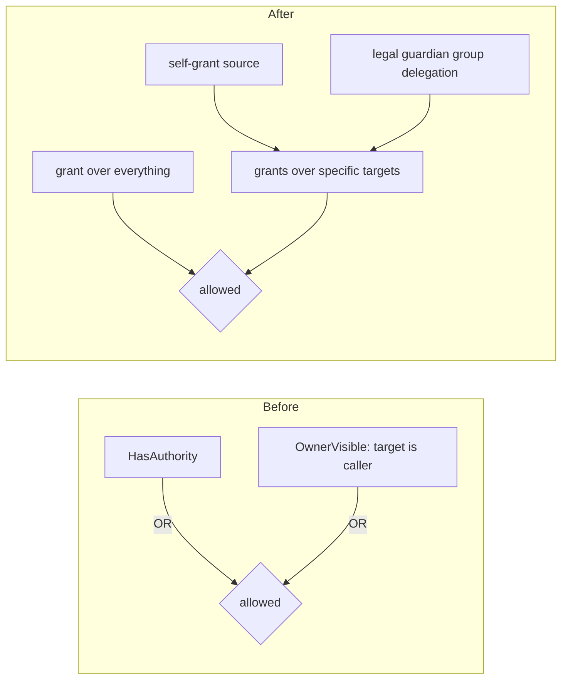

# Proposal

## Why

Authorization has two parallel mechanisms. One is ReBAC grants: an authority held over everything, or over specific targets derived from relationships. The other is the special "owner-visible" rule (`x-klabis-owner-visible` / `@OwnerVisible`), which means "the target is the caller". Because of the owner rule:

- Rights the owner has over their own data cannot be delegated. A legal guardian cannot manage their child's event registrations.
- Minors and adults get the same owner access. A minor can therefore choose their own membership fee type, which the club does not want.
- Some rules cannot be expressed declaratively. Reading a registration means "the member themself, OR a grant over the event", and today `RegistrationReadAccess` checks it by hand.

Issue #451 already replaced the owner rule for financial accounts with a self-grant of `FINANCE:VIEW`. This change finishes that approach for every remaining use and removes the owner rule entirely.

## What Changes

- **Infrastructure**:
  - An operation may identify several targets of different kinds, for example a member and an event. Each authority is checked against the target of its own kind.
  - The owner-visible mechanism is removed from the spec extensions, generated code, the evaluator and the documentation.
- **New permission "Zobrazení údajů člena"** (`MEMBERS:VIEW_PROFILE`, held over individual members): every user holds it over themself, minors included. Callers that need to see a member's sensitive data hold it, `MEMBERS:EDIT_PROFILE` or `MEMBERS:MANAGE`.
- **New permission "Volba členského příspěvku"** (`MEMBERS:SELECT_MEMBERSHIP_FEE_TYPE`, held over individual members): every adult member holds it over themself, and legal guardian groups delegate it over their minors.
  - It guards both choosing a fee type and viewing the fee page. Administrators keep read access through `MEMBERS:MANAGE`.
  - **BREAKING (behavior)**: a minor no longer sees or chooses their own membership fee type; the guardian does it for them. Free group owners no longer see or choose fees of their group members.
- **`EVENTS:REGISTRATIONS` renamed to `EVENTS:REGISTER_MEMBER` and re-targeted** from events to members. It now means "manages the registrations of member X".
  - It can be held over everyone, as today for the registrations manager, or over specific members.
  - Every member holds it over themself, and legal guardian groups delegate it over their minors.
- **`EVENTS:REGISTRATIONS_READ` renamed to `EVENTS:REGISTRATIONS_OVERVIEW`**. It is the event coordinator's full overview of an event's registrations, and its behavior is unchanged.
- **`MEMBERS:EDIT_PROFILE` self-grant extended** to every user except a minor member. Non-member legal guardians are now included, so they edit their own guardian profile through the regular permission.
- **Event registration API**:
  - **BREAKING (API)**: registering moves from `POST /api/events/{eventId}/registrations` to `POST /api/events/{eventId}/registrations/{memberId}`. It names the member being registered instead of always using the caller.
  - The registration-defaults request (`newRegistration=true`) no longer requires the caller to be the member.
  - Together these let a legal guardian, who need not be a member, manage the registrations of their minors through the API. The frontend follows the new path through HAL templates. A UI for choosing which child to register is out of scope.
- **Legal guardian groups** delegate `MEMBERS:EDIT_PROFILE`, `FINANCE:VIEW`, `MEMBERS:SELECT_MEMBERSHIP_FEE_TYPE` and `EVENTS:REGISTER_MEMBER` over their minors.

## Capabilities

### New Capabilities

None.

### Modified Capabilities

- `membership-fees`:
  - Choosing a fee type and viewing the fee page are limited to the adult member themself, the legal guardian of a minor, and (read-only) the membership administrator.
  - Minors no longer see or choose their own fee type.
- `legal-guardians`:
  - Guardians are always delegated the choice of their minor's membership fee and the management of their minor's event registrations, in addition to the existing profile-edit and finance-view delegations.
- `event-registrations`:
  - A legal guardian can view, edit and unregister their minor's registration.
  - Registering a minor on their behalf needs the follow-up UI, so this change does not specify it.

## Impact

- **Backend**:
  - `common.users.Authority`: new authorities, one renamed and re-targeted, one renamed.
  - `common.authorization`: multi-target rules; owner-visible removed.
  - `common.security.fieldsecurity`: `OwnerVisible` removed.
  - Mustache templates (`api`, `pojo`, `pathParams`).
  - The self-profile relationship source in members and the `LegalGuardianGroup` delegation set.
  - `EventCoordinatorRelationshipSource`.
  - `EventRegistrationController`: register path; `RegistrationReadAccess` removed.
  - Membership fee and legal guardian controllers and the `AuthorityToDtoConverter` mapping.
- **API spec**:
  - `common.yaml`: the `Authority` wire enum value `EVENTS:REGISTRATIONS` becomes `EVENTS:REGISTER_MEMBER` (**BREAKING (API)** for the permissions endpoints).
  - `events.yaml`: register path; authorities on registration operations.
  - `members.yaml`: `MemberDetailsResponse`, legal guardian operations.
  - `membershipfees.yaml`: fee choice, summary and history.
  - `common.yaml`: the authority enum.
  - `README.md`: extension table.
- **Frontend**: regenerated API types; the authority label and the permissions dialog use the new value. Registering follows the HAL template target, so no component change is expected.
- **Docs**: developer manual security chapter, `backend/CLAUDE.md`, and the `backend-patterns` and `klabis-api-spec` skills (field security).
- **Data**:
  - No migration. The database is in-memory and has no real migrations yet, so the stored value `EVENTS:REGISTRATIONS` changes to `EVENTS:REGISTER_MEMBER` directly. Example data and seeds are renamed with the code.
  - The new and renamed authorities are specific-only and therefore never stored.
