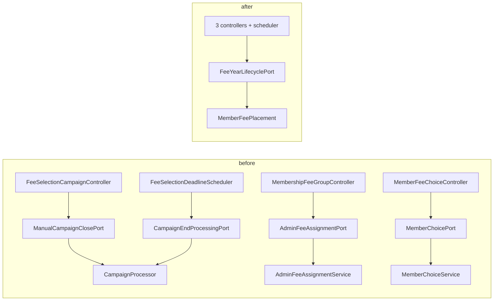

## Why

The lifecycle of a fee year is spread over five collaborators in `membershipfees.application`: `CampaignProcessor` holds the close rules, `ManualCampaignClosePortImpl` and `CampaignEndProcessingPortImpl` both wrap them with the same load → `AllMembersPort.findAll` → process → save sequence, and `AdminFeeAssignmentService` plus `MemberChoiceService` each carry their own copy of the "move a member into a fee group for a year" loop. Understanding one business rule ("close the year", "assign a fee group") means reading four classes, and the three entry-point ports exist only for the module's own REST adapters and scheduler — no other Modulith module consumes them.

The area is hot: the guardian fee-choice feature landed this month and touched both assignment paths, so a duplicated rule is a live cost rather than a theoretical one.

## What Changes

- Add one primary port `FeeYearLifecyclePort` in `membershipfees.application` with five methods: `closeCampaign(FeeSelectionCampaignId)`, `processCampaignEnd(LocalDate)`, `assignLevel(AssignFeeLevel)`, `chooseFeeLevel(ChooseFeeLevel)`, `removeFeeChoice(MemberId, int)`.
- Add `FeeYearLifecycleService` as its single implementation, absorbing `CampaignProcessor`, `AdminFeeAssignmentService`, `ManualCampaignClosePortImpl` and `CampaignEndProcessingPortImpl`.
- Extract the shared "move a member into a fee group for a year" step into a package-private `MemberFeePlacement` collaborator with its own unit test; `chooseFeeLevel`, `removeFeeChoice` and `assignLevel` all go through it.
- Delete `ManualCampaignClosePort`, `CampaignEndProcessingPort`, `AdminFeeAssignmentPort` and `MemberChoicePort`; their write commands live on the new port, while the two queries `getCurrentChoice` and `getRecommendedLevelForYear` move to the existing read port `MemberFeeHistoryPort`.
- Update the four adapters that used the deleted ports: `FeeSelectionCampaignController`, `MembershipFeeGroupController`, `MemberFeeChoiceController`, `FeeSelectionDeadlineScheduler`.
- Delete the two deprecated, uncalled methods `listPublications()` and `listClosedPublications()` from `FeeSelectionCampaignManagementPort`; the rest of that port is unchanged.
- Update the two passages in `openspec/changes/introduce-quartz-scheduler/proposal.md` that name `CampaignEndProcessingPort`.
- Add the term **Fee year (příspěvkový rok)** to `GLOSSARY.md`.
- Consolidate the port-level tests: `ManualCampaignClosePortTest` and `CampaignEndProcessingPortTest` merge into a `FeeYearLifecycleServiceTest` covering close and batch processing; `AdminFeeAssignmentServiceTest` and `MemberChoiceServiceTest` merge into it as well. Aggregate tests (`FeeSelectionCampaignTest`, `MembershipFeeGroupTest`) stay untouched.

## No Behavior Change Justification

**Specs reviewed:**
- `openspec/specs/membership-fees/spec.md` — unaffected: every requirement keeps its scenarios. The close rules (freeze groups, charge each member once, sanction members without a choice, mark the campaign processed), the emergency-assignment override, and the choice/withdrawal window remain exactly where they execute today; only the classes that call them change.
- `openspec/specs/membership-fee-campaign-manual-close/spec.md` — unaffected: the manual close action keeps the same endpoint, the same authority, the same "already processed" rejection and the same effect as the scheduler-triggered close.

**Why no spec update is needed:**
- No endpoint, request/response field, HAL link, HAL-FORMS template, authority or error type changes.
- Guards stay in the aggregates: `MembershipFeeGroup.addMember` still rejects a member choice after the voting deadline or after freezing, and `removeMemberChoice` keeps its guard while the administrator path keeps the unguarded `removeMember`.
- Transaction scope, ordering (freeze → charge → marker → missed-choice events → `markProcessed`), event publication points and the batch failure semantics of `processCampaignEnd` are preserved as they are.
- The asymmetry that `MemberFeeSelectionResolvedEvent` is published only by an emergency assignment is intentional per **Lifting the Sanction by Emergency Assignment**, not a defect to fix here.
- Aggregates keep their own behaviour; no new domain rules are introduced.

## Impact

- `backend/src/main/java/com/klabis/membershipfees/application/` — new `FeeYearLifecyclePort`, `FeeYearLifecycleService`, `MemberFeePlacement`; `CampaignProcessor` folded in; four port types removed.
- `backend/src/main/java/com/klabis/membershipfees/infrastructure/restapi/` — `FeeSelectionCampaignController`, `MembershipFeeGroupController`, `MemberFeeChoiceController` now inject the new port.
- `backend/src/main/java/com/klabis/membershipfees/infrastructure/scheduler/FeeSelectionDeadlineScheduler.java` — injects the new port; the `processCampaignEnd(LocalDate)` signature is unchanged so the Quartz proposal stays accurate apart from the type name.
- `backend/src/test/java/com/klabis/membershipfees/` — `MembershipFeesWebMvcMockitoBeans`, `FeeSelectionCampaignControllerTest`, `MembershipFeeGroupControllerTest`, `MembershipFeesErrorTypesTest`, and the four port-level test classes.
- `openspec/changes/introduce-quartz-scheduler/proposal.md` — two references updated.
- `GLOSSARY.md` — new domain term.
- No build, dependency, or developer-workflow changes.
