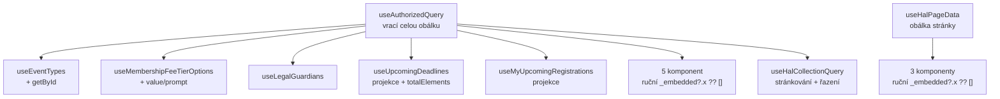

## Context

A HAL collection response carries its rows under `_embedded`, keyed by a name derived from the item type (`eventTypeDtoList`, `membershipFeeTierSummaryResponseList`, `transactions`, …). The generated types confirm **22 embedded blocks, every one with exactly one key**. An **empty** collection omits `_embedded` entirely — Spring HATEOAS does not serialise an empty embedded block (`CalendarControllerTest.java:272` asserts `$._embedded` does not exist).

Today the frontend repeats the unwrap at every consumer:



`useHalCollectionQuery` already does the unwrap correctly, but only two consumers use it; everyone else re-declares the envelope type and the collection name.

## Goals / Non-Goals

**Goals:**
- One interface that answers "rows of this HAL collection", whether the caller fetches it or already holds the envelope.
- Call sites stop naming embedded keys.
- Unwrap, inference and guards tested once.

**Non-Goals:**
- Changing `useHalPageData` or `HalRouteContext` themselves — their consumers only switch how they read `_embedded`.
- Envelopes that legitimately carry several embedded collections (`GenericHalPage`).
- Changing query-key strategy or cache invalidation.
- Changing pagination or sorting behaviour.
- Removing the existing `collectionName` props from table call sites.
- Touching backend responses or specs.

## Decisions

**D1 — Scope: lists, projections, page-data readers and the table hook.** All four groups use the same concept. The table hook composes the core instead of duplicating it; otherwise two modules would answer the same question.

**D2 — Pure core plus a fetching hook, in one module.** Three call sites (`RulesTable`, `CalendarPage`, `MembershipFeeGroupDetailPage`) already hold the envelope from `useHalPageData`; making them fetch it again would add a request. So the unwrap lives in a pure function, and the hook is a thin fetch around it (via `useAuthorizedQuery`'s `select`). Both stay in `useHalCollection.ts` for locality.

```ts
embeddedItems<Row>(
  envelope: HalResponse | undefined,
  collection?: string,            // override; normally inferred
): Row[]

useHalCollection<Row, T = Row>(
  href: string | undefined,
  options?: {
    collection?: string;
    select?: (rows: Row[]) => T[];
    staleTime?: number;
    enabled?: boolean;
  },
): {
  items: T[];
  pageMetadata: PageMetadata | undefined;   // size, totalElements, totalPages, number
  isLoading: boolean;
  error: Error | null;
  refetch: () => void;
}
```

`Row` is the generated item type the caller names once; `select` receives typed rows, so adapters do not cast. `select` maps the whole array because projections filter as well as map.

**D3 — Collection name inferred from the single `_embedded` key.** 22/22 generated envelopes have exactly one key, so requiring the name from callers is knowledge they cannot express any better than the module can. Rules, in order:

| Envelope | Result |
|---|---|
| `undefined` (not loaded yet) | `[]` |
| no `_embedded` | `[]` — empty collection |
| `collection` given | `_embedded[collection]`; key absent → guard error |
| exactly one key | its value |
| two or more keys, no override | guard error |
| value is not an array | guard error |

The override serves detail resources whose `_embedded` is not the resource's own collection (`MembershipFeeGroupDetailPage` passes `'members'`) and the table's existing `collectionName` props.

**D4 — Loud guards, surfaced as an error state.** A guard throws `HalCollectionError` (extends `Error`) whose message names the envelope's self href and the keys found. Silence (`?? []`) is rejected for contract violations: it turns a wrong link or a changed contract into an empty table.
- In `useHalCollection` the guard runs inside `select`; TanStack Query catches it and returns it as `error`, so the component renders its error state instead of crashing. `error` is typed `Error | null` because it carries both `ApiError` and `HalCollectionError`.
- Callers of `embeddedItems` during render (page-data readers) let it propagate to the app's `ErrorBoundary` (`App.tsx` / `ErrorFallback`).

**D5 — Input is `href: string | undefined`.** Undefined already means "nothing to fetch" at three call sites and composes with `toHref`/`parseHalHref`; accepting link objects too would add a second shape to normalise.

**D6 — Return `{items, pageMetadata, isLoading, error, refetch}`.** The raw envelope stays behind the seam, so a caller cannot re-implement the unwrap. `pageMetadata` is the response's `page` block (undefined when absent) — `useUpcomingDeadlines` needs its `totalElements` and the table needs all of it. `refetch` is used by `UpcomingDeadlinesWidget` and `HomePage`. `undefined` href yields `items: []` and `isLoading: false` — the rule currently hand-written in `useLegalGuardians`.

**D7 — The table adapter returns `items` and `pageMetadata`, not `rows`/`pageData`/`page`.** Rows are `items`; `pageMetadata` is passed through from the core; the adapter adds `currentPage`, `setPage`, `rowsPerPage`, `setRowsPerPage`. The old `page` (current page number) is renamed `currentPage` so that no name changes meaning during migration. Query options stay as today (`staleTime: 30000`); the hook's explicit `retry: 1` and `gcTime: 5 min` are dropped because they equal the global default (`main.tsx:24`) and TanStack's default — no behaviour change.

**D8 — Rename `useHalCollectionQuery` → `useHalTableQuery`.** Once it composes `useHalCollection`, the old name no longer differentiates the two.

**D9 — Delete the `content` / `data` fallback.** Both table consumers receive HAL envelopes; the fallback has no caller. A response without `_embedded` now renders as an empty table (D3), the same as an empty HAL collection.

**D10 — Projections stay in the adapters.** `useUpcomingDeadlines` and `useMyUpcomingRegistrations` keep their mapping functions and pass them through `select`; the module does not learn view models. Their return shape flattens: `useUpcomingDeadlines` → `{items, totalElements, refetch}` (`totalElements` from `pageMetadata`, default `0`), `useMyUpcomingRegistrations` → `{items, refetch}`. Their two consumers drop the `data?.` access.

**D11 — Tests concentrate, they are not duplicated.** `embeddedItems` tests cover inference and every row of the D3 table, without a QueryClient. The hook test covers fetch, `select`, `pageMetadata`, the undefined-href rule and that a guard failure arrives as `error`. Adapter tests keep only what the adapter adds: `getById`, value/prompt mapping, projection of a captured row. Component tests that today assert unwrap behaviour rely on the module instead.

**D12 — `collectionName` on table components becomes an optional override.** `KlabisTableWithQuery.collectionName` (already optional) and `HalEmbeddedTable.collectionName` (today required) are passed as `collection`. The 13 existing call sites stay unchanged; `HalEmbeddedTable` fetches the page's self link, so on detail resources (e.g. `EventDetailPage` → `registrationDtoList`) the override is still meaningful. Removing redundant props is a follow-up.

## Risks / Trade-offs

- **Inference hinges on an invariant.** A future envelope with two embedded collections, or one whose single value is a resource rather than an array, now fails with an error state instead of rendering empty. The guard message names the href and keys so the failure is diagnosable; the override is the escape hatch.
- **Render-time throw for page-data readers.** A contract violation on a page resource replaces the page with the error fallback rather than an empty section. Accepted: it is the same contract violation, and correct responses (including empty ones) never trigger it.
- **Bundle-wide rename churn.** `useHalTableQuery` touches two consumers and one test file; kept in the same change so no intermediate state has two names.
- **Slightly wider interface.** Two exports, four options and five results; each was added because a real call site needs it. Anything not needed (retry, gcTime, headers) stays out — callers that need them keep using `useAuthorizedQuery`.

## Glossary

| Term | Meaning |
|---|---|
| HAL collection | A HAL response whose rows sit in `_embedded` under a single key, with optional `page` metadata. Empty when `_embedded` is absent. |
| Collection name | The single key inside `_embedded`. Inferred by the module, override available. |
| Page metadata | The response's `page` block: `size`, `totalElements`, `totalPages`, `number`. |
| Page-data reader | A component reading `_embedded` from the envelope it already holds via `useHalPageData`. |
| Table adapter | `useHalTableQuery`: adds paging and sort state on top of `useHalCollection`. |
| Projection | An adapter's own mapping of rows into a view item, passed as `select`. |

## Domain and API impact

None. No domain concept changes and no REST API changes: the frontend consumes the same responses. The rules about a domain class diagram and an API chapter therefore do not apply.
