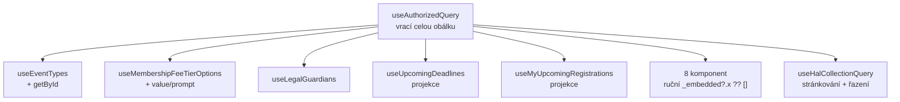

## Context

A HAL collection response carries its rows under `_embedded`, keyed by a name derived from the item type (`eventTypeDtoList`, `membershipFeeTierSummaryResponseList`, `transactions`, …). The generated types confirm **22 embedded blocks, every one with exactly one key**.

Today the frontend repeats the unwrap at every consumer:



`useHalCollectionQuery` already does the unwrap correctly, but only two consumers use it; everyone else re-declares the envelope type and the collection name.

## Goals / Non-Goals

**Goals:**
- One interface that answers "rows of this HAL collection".
- Call sites stop naming embedded keys.
- Unwrap, inference and guards tested once.

**Non-Goals:**
- Changing response handling of single resources (`useHalPageData`, `HalRouteContext`).
- Changing query-key strategy or cache invalidation.
- Changing pagination or sorting behaviour.
- Touching backend responses or specs.

## Decisions

**D1 — Scope: lists, projections and the table hook.** All three groups use the same concept. The table hook composes the core instead of duplicating it; otherwise two modules would answer the same question.

**D2 — One hook, no extracted pure helper.** `useAuthorizedQuery`'s `select` is already the pure seam; a separate `embeddedList(response)` function would exist only to be tested on its own — the "extract pure functions for testability, lose locality" trap.

```ts
useHalCollection<T>(
  href: string | undefined,
  options?: {
    collection?: string;          // override; normally inferred
    select?: (rows: unknown[]) => T[];
    staleTime?: number;
    enabled?: boolean;
  },
): { items: T[]; isLoading: boolean; error: ApiError | null }
```

**D3 — Collection name inferred from the single `_embedded` key.** 22/22 generated envelopes have exactly one key, so requiring the name from callers is knowledge they cannot express any better than the module can. Override stays available for a future multi-key envelope.

**D4 — Loud guards.** Zero embedded keys, more than one, or a value that is not an array raises an error carrying the href and the keys found. Silence (`?? []`) is rejected: it turns a wrong link or a changed contract into an empty table, which is what the current call sites do.

**D5 — Input is `href: string | undefined`.** Undefined already means "nothing to fetch" at three call sites and composes with `toHref`/`parseHalHref`; accepting link objects too would add a second shape to normalise.

**D6 — Return `{items, isLoading, error}`.** The raw envelope stays behind the seam, so a caller cannot re-implement the unwrap. `undefined` href yields `items: []` and `isLoading: false` — the rule currently hand-written in `useLegalGuardians`.

**D7 — The table adapter returns `items`, not a second rows field.** Rows are `items`; the adapter adds `currentPage`, `setPage`, `rowsPerPage`, `setRowsPerPage` and the `page` **metadata** (`size`, `totalElements`, `totalPages`, `number`). No duplicated rows attribute; the metadata keeps its own name because it is not the rows.

**D8 — Rename `useHalCollectionQuery` → `useHalTableQuery`.** Once it composes `useHalCollection`, the old name no longer differentiates the two.

**D9 — Delete the `content` / `data` fallback.** Both table consumers receive HAL envelopes; the fallback has no caller. It returns if a non-HAL page ever needs it.

**D10 — Projections stay in the adapters.** `useUpcomingDeadlines` and `useMyUpcomingRegistrations` keep their mapping functions and pass them through `select`; the module does not learn view models.

**D11 — Tests concentrate, they are not duplicated.** The module's test covers fetch, inference, guards and the undefined-href rule. Adapter tests keep only what the adapter adds: `getById`, value/prompt mapping, projection of a captured row. Component tests that today assert unwrap behaviour rely on the module instead.

## Risks / Trade-offs

- **Inference hinges on an invariant.** A future envelope with two embedded collections, or one whose single value is a resource rather than an array, now fails at runtime instead of rendering empty. The guard message names the href and keys so the failure is diagnosable; the override is the escape hatch.
- **Bundle-wide rename churn.** `useHalTableQuery` touches two consumers and one test file; kept in the same change so no intermediate state has two names.
- **Slightly wider interface.** The module has four options and three results; each was added because a real call site needs it. Anything not needed (retry, gcTime, headers) stays out — callers that need them keep using `useAuthorizedQuery`.

## Glossary

| Term | Meaning |
|---|---|
| HAL collection | A HAL response whose rows sit in `_embedded` under a single key, with optional `page` metadata. |
| Collection name | The single key inside `_embedded`. Inferred by the module, override available. |
| Table adapter | `useHalTableQuery`: adds paging and sort state on top of `useHalCollection`. |
| Projection | An adapter's own mapping of rows into a view item, passed as `select`. |

## Domain and API impact

None. No domain concept changes and no REST API changes: the frontend consumes the same responses. The rules about a domain class diagram and an API chapter therefore do not apply.
