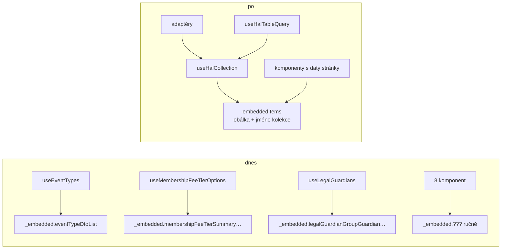

## Why

Every place that reads a HAL collection re-learns the same three things: fetch the href, reach into `_embedded`, and name the collection key. The knowledge is spread over five near-duplicate hooks and eight component call sites, so a response that renames one embedded list breaks call sites that never mention the resource it belongs to.

## What Changes

- **One module, `useHalCollection.ts`**, with two exports:
  - `embeddedItems(envelope, collection?)` — pure; owns the unwrap, the collection-name inference from the single `_embedded` key, and the guards. A missing `_embedded` is an empty collection (Spring HATEOAS omits it for empty lists); several embedded keys, a missing override key, or a non-array value fail loudly.
  - `useHalCollection(href, options)` — fetches and returns `{items, pageMetadata, isLoading, error, refetch}` built on `embeddedItems`.
- **Five hooks become adapters over it**: `useEventTypes`, `useMembershipFeeTierOptions`, `useLegalGuardians`, `useUpcomingDeadlines`, `useMyUpcomingRegistrations`. Their own mapping (`getById`, value/prompt, projections) stays in the adapter. The two projection hooks change their return shape from `{data: {items, …}}` to `{items, …}`.
- **Eight component call sites stop unwrapping by hand**:
  - fetching a collection → `useHalCollection`: `CategoryPresetPickerButton`, `PastCampaignsSection`, `CampaignDetail`, `GroupsPage`, `AccommodationListPage`;
  - already holding the page's envelope from `useHalPageData` → `embeddedItems`: `RulesTable`, `CalendarPage`, `MembershipFeeGroupDetailPage`.
- **The table hook composes it**: `useHalCollectionQuery` is renamed `useHalTableQuery`, adds paging and sort state, and returns `items` for the rows (no duplicated rows attribute) plus `pageMetadata`. Its unused `content`/`data` fallback is deleted. `collectionName` on `KlabisTableWithQuery` and `HalEmbeddedTable` becomes an optional override.
- **Query policy stays per call site**: `staleTime` and `select` are passed through, not decided by the module.
- **Tests stop being repeated**: unwrap, inference and the guards are tested once on `embeddedItems`; adapters keep only their own mapping tests.

## No Behavior Change Justification

**Specs reviewed:**
- `openspec/specs/non-functional-requirements/spec.md` — unaffected: it constrains the **server's** response format (`_embedded`, `page` metadata, pagination links). No response changes.
- `openspec/specs/member-accounts/spec.md` (`History Pagination, Sorting, and Filtering`) — unaffected: the table still paginates and sorts through the same query parameters; only which hook builds them changes.
- `openspec/specs/members/spec.md` — unaffected: the member list keeps its pagination controls; the page still renders the same rows.

**Why no spec update is needed:** the change moves fetch-and-unwrap logic behind one module. Requests, responses, rendered rows (including empty lists), pagination behaviour, links and permissions stay identical; no spec names a hook or a query key. The only new observable outcome is a diagnosable error instead of a silently empty list when a response violates the collection contract — no correct response triggers it.

## Impact

**Affected code (frontend):**
- New `src/hooks/useHalCollection.ts` (`embeddedItems` + `useHalCollection`).
- `src/hooks/{useEventTypes, useMembershipFeeTierOptions, useLegalGuardians, useUpcomingDeadlines, useMyUpcomingRegistrations}.ts` become adapters; consumers of the projection hooks `components/dashboard/UpcomingDeadlinesWidget` and `pages/HomePage` follow the new return shape.
- `src/hooks/useHalCollectionQuery.ts` → `useHalTableQuery.ts`; consumers `KlabisTableWithQuery`, `FinancesPage`; `HalEmbeddedTable` makes `collectionName` optional. Its 13 existing `collectionName` call sites stay unchanged.
- `src/components/{events/CategoryPresetPickerButton, membership-fees/PastCampaignsSection, membership-fees/CampaignDetail, membership-fees/RulesTable}` and `src/pages/{groups/GroupsPage, events/AccommodationListPage, calendar/CalendarPage, membership-fees/MembershipFeeGroupDetailPage}`.
- `src/api/types.ts`: `hasCalendarItems` is deleted once `CalendarPage` no longer needs it.
- Tests: five hook tests shrink to mapping-only; new module test covers `embeddedItems` inference and guards, and the hook's fetch behaviour.

**Excluded:** `GenericHalPage` intentionally flattens every embedded key of an arbitrary resource and stays as it is.

**APIs:** none. **Backend:** none. **Build/dev workflow:** unchanged.
