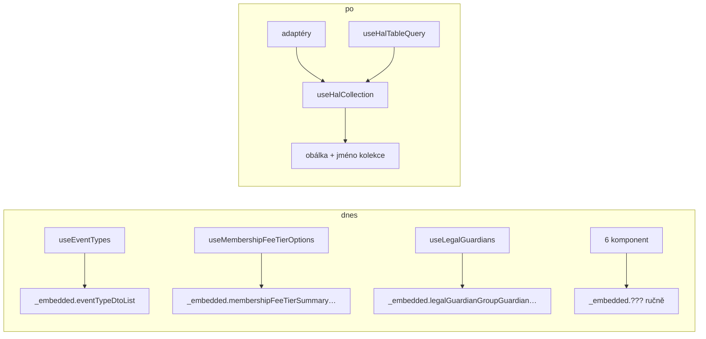

## Why

Every place that reads a HAL collection re-learns the same three things: fetch the href, reach into `_embedded`, and name the collection key. The knowledge is spread over five near-duplicate hooks and eight component call sites, so a response that renames one embedded list breaks call sites that never mention the resource it belongs to.

## What Changes

- **One module, `useHalCollection(href, options)`**, that fetches a HAL collection and returns `{items, isLoading, error}`. The collection name is **inferred from the single `_embedded` key**, with an explicit override; a response with zero or several embedded keys, or with a non-array value, fails loudly.
- **Five hooks become adapters over it**: `useEventTypes`, `useMembershipFeeTierOptions`, `useLegalGuardians`, `useUpcomingDeadlines`, `useMyUpcomingRegistrations`. Their own mapping (`getById`, value/prompt, projections) stays in the adapter.
- **Eight component call sites stop unwrapping by hand**: `CategoryPresetPickerButton`, `PastCampaignsSection`, `CampaignDetail`, `RulesTable`, `GroupsPage`, `AccommodationListPage`, `MembershipFeeGroupDetailPage`.
- **The table hook composes it**: `useHalCollectionQuery` is renamed `useHalTableQuery`, adds paging and sort state, and returns `items` for the rows (no duplicated rows attribute) plus pagination metadata. Its unused `content`/`data` fallback is deleted.
- **Query policy stays per call site**: `staleTime` and `select` are passed through, not decided by the module.
- **Tests stop being repeated**: unwrap, inference and the guards are tested once in the module; adapters keep only their own mapping tests.

## No Behavior Change Justification

**Specs reviewed:**
- `openspec/specs/non-functional-requirements/spec.md` — unaffected: it constrains the **server's** response format (`_embedded`, `page` metadata, pagination links). No response changes.
- `openspec/specs/member-accounts/spec.md` (`History Pagination, Sorting, and Filtering`) — unaffected: the table still paginates and sorts through the same query parameters; only which hook builds them changes.
- `openspec/specs/members/spec.md` — unaffected: the member list keeps its pagination controls; the page still renders the same rows.

**Why no spec update is needed:** the change moves fetch-and-unwrap logic behind one module. Requests, responses, rendered rows, pagination behaviour, links and permissions stay identical; no spec names a hook or a query key.

## Impact

**Affected code (frontend):**
- New `src/hooks/useHalCollection.ts`.
- `src/hooks/{useEventTypes, useMembershipFeeTierOptions, useLegalGuardians, useUpcomingDeadlines, useMyUpcomingRegistrations}.ts` become adapters.
- `src/hooks/useHalCollectionQuery.ts` → `useHalTableQuery.ts`; consumers `KlabisTableWithQuery`, `FinancesPage`.
- `src/components/{events/CategoryPresetPickerButton, membership-fees/PastCampaignsSection, membership-fees/CampaignDetail, membership-fees/RulesTable}` and `src/pages/{groups/GroupsPage, events/AccommodationListPage, membership-fees/MembershipFeeGroupDetailPage}`.
- Tests: five hook tests shrink to mapping-only; new module test covers fetch, inference and guards.

**APIs:** none. **Backend:** none. **Build/dev workflow:** unchanged.
