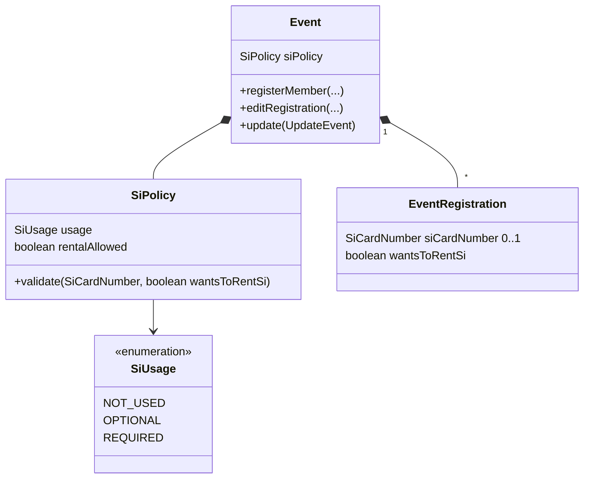

# Design

## Context

`EventRegistration.create` rejects a missing `SiCardNumber`, `events.event_registrations.si_card_number` is `NOT NULL`, and `RegisterEventRequest` / `EditRegistrationRequest` declare `siCardNumber` as required. The event has per-event offers already modelled the same way this change needs (`sharedTransportEnabled` / `sharedAccommodationEnabled` on `Event`, the request schemas and `EventDto`), and the registration form is built from the HAL-FORMS template of the registration representation, which already includes or omits properties per event (the shared-service tick boxes).

## Goals / Non-Goals

**Goals:**
- Per-event SI policy, enforced by the `Event` aggregate on register and edit.
- Registration form shaped by the policy through HAL-FORMS metadata only.

**Non-Goals:**
- Mapping ORIS SI / RentSI — done in `oris-event-registration-sync`.
- Rental fees, rental stock, or showing rental requests in the registrations list.
- Reading an SI policy from ORIS event details on import (imported events get "required, rental allowed").
- Synchronising the SI policy with ORIS — it is a Klabis-owned field, absent from the event's sync projection.

## Decisions

### D1 — `SiPolicy` value object on `Event`

`SiPolicy(SiUsage usage, boolean rentalAllowed)` with `SiUsage ∈ {NOT_USED, OPTIONAL, REQUIRED}`. `rentalAllowed` is forced to `false` when `usage = NOT_USED` (normalised in the factory, so the UI hiding the tick box and the domain agree). There is no general default: a manager creating an event in Klabis must choose the usage (`CreateEvent` requires it). `SiPolicy.forOrisImport()` = `REQUIRED` with rental allowed is applied by `Event.createFromOris`; ORIS races normally offer rental and the registrations synchronised from ORIS may carry rental requests. The DB column defaults (`REQUIRED`, no rental) only serve existing rows.

*Alternative:* default `REQUIRED` without rental for new Klabis events — rejected by the user: the manager decides per event.

*Alternative:* three booleans (`siUsed`, `siRequired`, `rentalAllowed`) — rejected: allows the meaningless "required but not used" combination.

### D2 — The aggregate validates the registration against the policy

`Event.registerMember` / `editRegistration` call `siPolicy.validate(siCardNumber, wantsToRentSi)`:

| usage | SI number | rent | result |
|---|---|---|---|
| NOT_USED | any | – | accepted; a number sent anyway is dropped, rent forced false |
| OPTIONAL | empty or valid | allowed only if `rentalAllowed` | accepted |
| REQUIRED | valid | – | accepted |
| REQUIRED | empty | true and `rentalAllowed` | accepted |
| REQUIRED | empty | otherwise | rejected "SI card number is required" |

Rent requested on an event without rental → rejected. `EventRegistration` itself only guarantees the format (`SiCardNumber`) and no longer requires presence.

Changing the policy (D1) never touches existing registrations: recorded numbers and rental requests are kept and simply not shown / not required while the policy says so (same approach as the shared-service offers).

### D3 — HAL-FORMS template shapes the form

The registration templates (`registerForEvent`, `editRegistration`) include `siCardNumber` only when usage ≠ NOT_USED and mark it `required` only when usage = REQUIRED and rental is not allowed (with rental allowed, "required unless renting" is a cross-field rule enforced by the domain — the form shows the server error). `wantsToRentSi` is included only when `rentalAllowed`. This reuses the mechanism the shared-service properties already use, so the frontend needs only labels.

## Domain Model

| Element | Change |
|---|---|
| `SiPolicy`, `SiUsage` | **Added** |
| `Event.siPolicy`; `CreateEvent`, `UpdateEvent`, `CreateEventFromOris` | **Changed** — carry the policy; `CreateEvent` requires it, `createFromOris` uses `forOrisImport()` |
| `EventRegistration.siCardNumber` | **Changed** — optional |
| `EventRegistration.wantsToRentSi`; `CreateEventRegistration`, `EditRegistrationCommand` | **Added** |
| `events.events` | + `si_usage VARCHAR(20) NOT NULL DEFAULT 'REQUIRED'`, + `si_rental_allowed BOOLEAN NOT NULL DEFAULT FALSE` |
| `events.event_registrations` | `si_card_number` → `NULL`; + `wants_to_rent_si BOOLEAN NOT NULL DEFAULT FALSE` |

## API

No new endpoints, link names or template names.

| Schema | Change |
|---|---|
| `CreateEventRequest`, `UpdateEventRequest` | + `siUsage` (enum `NOT_USED`/`OPTIONAL`/`REQUIRED`, mapped to domain `SiUsage`, `x-hal-input-type: SiUsage`; required in `CreateEventRequest`, no default), + `siRentalAllowed` (boolean, default false) |
| `EventDto` | + `siUsage`, + `siRentalAllowed` |
| `RegisterEventRequest`, `EditRegistrationRequest` | `siCardNumber` no longer in `required`; + `wantsToRentSi` (boolean, default false) |
| `RegistrationDto` | `siCardNumber` may be absent; + `wantsToRentSi` |
| Templates `registerForEvent`, `editRegistration` | property set per D3 |

## Glossary

| Term | Meaning |
|---|---|
| SI policy | Per-event setting saying whether an SI card is not used, optional or required, and whether rental is allowed. |
| SI card rental (půjčení čipu) | The participant asks the organiser to lend them an SI card for the event instead of using their own. |

## Risks / Trade-offs

- [Making `si_card_number` nullable touches every reader of the SI number (registration detail, ORIS later, any export)] → grep all `siCardNumber()` usages during task 1 and handle absence explicitly; covered by tests on the detail response.
- [Cross-field "required unless renting" cannot be expressed as a static HAL-FORMS `required` flag] → domain error surfaces in the form, covered by a scenario test.
