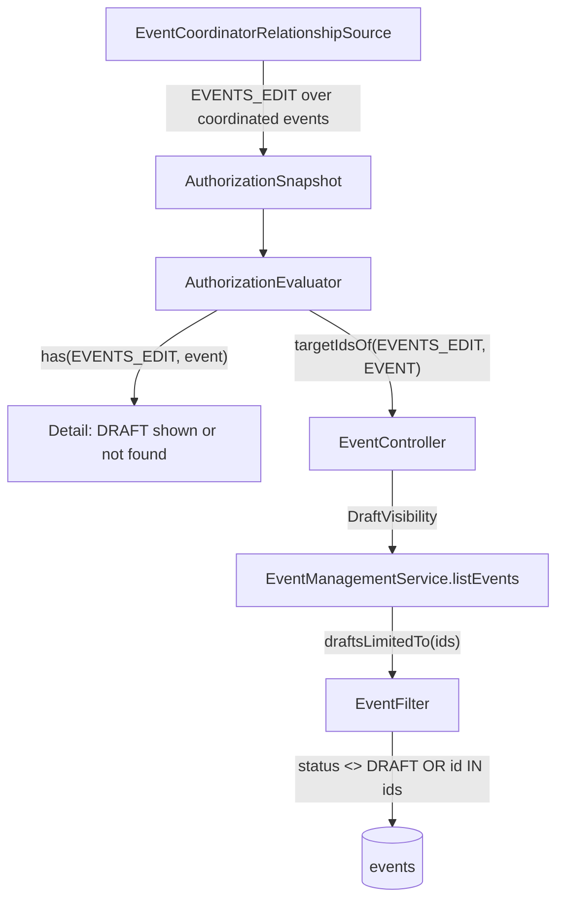
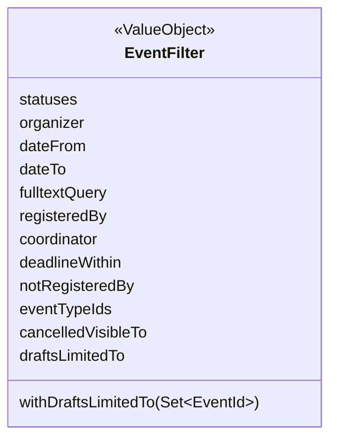

# Design

## Context

See proposal.md › Why. Relevant current state:

- Coordinator authority is delivered by `EventCoordinatorRelationshipSource`, which grants `EVENTS_EDIT` and `EVENTS_REGISTRATIONS_READ` over every event the user coordinates (grant form SPECIFIC, target EVENT). `AuthorizationEvaluator` honours SPECIFIC grants only for operations that carry a target (`x-klabis-target-id`); a targetless operation needs the authority held over everything (ADR-010).
- `updateEvent` already accepts `[EVENTS_MANAGE, EVENTS_EDIT]` over the event. `publishEvent` and `cancelEvent` accept only `EVENTS_MANAGE`, although their path parameter `EventIdParam` already declares `x-klabis-target-id: EVENT`.
- Management affordances on event detail and list rows (`EventAffordanceSupport.addManagementAffordances`) go through `klabisAfford`, which evaluates the operation's authorization per target. Changing the operation's authorities is therefore enough for the affordances to follow.
- DRAFT visibility is decided by a single boolean `canManageEvents` (`has(EVENTS_MANAGE)`) passed to `EventManagementService.getEvent` / `listEvents`. Cancelled-event visibility uses a per-viewer rule in `EventFilter` (`cancelledVisibleTo`) that the JDBC adapter turns into `status <> CANCELLED OR id IN (events the member is registered for)`. That rule predates ADR-010 but is not access control: the cancelled event detail is open to every authenticated user, the list only hides irrelevant cancelled events.
- `AuthorizationSnapshot.targetsOf(authority)` already exists; `AuthorizationEvaluator` does not expose it to callers.
- `CategoryPresetPickerButton` fetches the hard-coded `/api/category-presets`; `listPresets` requires `EVENTS_MANAGE` (targetless). The root link `category-presets` drives the admin menu item.
- `GET /api/events?coordinator=<uuid>` already filters by coordinator; the frontend filter bar does not expose it. `listMemberOptions` (`MEMBERS_READ`, held by every member by default) returns value/prompt pairs for member pickers.

## Goals / Non-Goals

**Goals:**
- Reuse the existing coordinator grant (`EVENTS_EDIT` over the event) for publish, cancel and DRAFT visibility — no new authority, no change to the authorization model.
- Every DRAFT visibility decision (detail and list) comes from the authorization snapshot; no module code re-derives the coordinator relationship for access control.
- Keep every frontend capability decision HAL-driven (no hard-coded API URLs in the touched components).

**Non-Goals:**
- A "coordinated by me" shortcut filter (`coordinator=me`) — rejected during exploration; a member picker covers it.
- Coordinator access to ORIS import, bulk sync, per-event synchronisation, changing coordinators, or the presets administration page.
- Limiting the coordinator filter options to members who actually coordinate something — all members are offered (KISS, ~300 members).
- Reworking `cancelledVisibleTo` — it is a list-relevance rule, not authorization; renaming or remodelling it is a separate cleanup.

## Decisions

### D1: Publish and cancel accept `EVENTS_EDIT` over the event

`publishEvent` and `cancelEvent` change to `x-klabis-authority: [EVENTS_MANAGE, EVENTS_EDIT]`, mirroring `updateEvent`. Their target id already exists, so the regenerated `@HasAuthority` + `@TargetId` lets the coordinator grant through, and `klabisAfford` starts offering the actions on the coordinator's detail page and list rows without any postprocessor change.

*Alternative:* a new SPECIFIC authority (e.g. `EVENTS_LIFECYCLE`) granted to coordinators. Rejected — coordinators should run the whole lifecycle of their event, so a separate authority would only split one relationship into two grants with no case that holds one without the other.

### D2: DRAFT visibility is decided by the authorization snapshot

DRAFT visibility is access control (a hidden DRAFT detail answers "not found"), so both the detail and the list take it from the snapshot — the same grant that lets the coordinator edit the event.

- **Evaluator:** new `AuthorizationEvaluator.targetIdsOf(Authority, TargetType)` returning the ids of targets of that type over which the user holds the authority through a SPECIFIC grant (delegates to `AuthorizationSnapshot.targetsOf`). It answers "over which targets", complementing `has(authority, target)`; it is the only new public API in `common.authorization`.
- **Detail:** the controller passes `isAllowed([EVENTS_MANAGE, EVENTS_EDIT], event(id))` instead of `has(EVENTS_MANAGE)` to `getEvent`. The service parameter is renamed to express "may see this draft" rather than "can manage".
- **List:** the controller resolves the viewer's draft visibility — unrestricted with `has(EVENTS_MANAGE)`, otherwise the set from `targetIdsOf(EVENTS_EDIT, EVENT)` — and passes it to `listEvents`, replacing the `canManageEvents` boolean. The service sets `EventFilter.draftsLimitedTo(Set<EventId>)` for non-managers instead of excluding DRAFT. The JDBC adapter builds `status <> DRAFT OR id IN (:ids)` (just `status <> DRAFT` for an empty set). The adapter no longer needs to know anything about members or coordinators for this rule.
- A viewer without a member profile holds no coordinator grant, so the set is empty and DRAFT stays hidden — no special case.

*Alternatives:*
- `draftVisibleTo(MemberId)` resolved in the adapter via `findIdsCoordinatedBy` (first draft of this design). Rejected — re-derives the coordinator relationship outside the authorization engine, the pre-ADR-010 pattern; detail and list would read the relationship from two places.
- Evaluate visibility per event via `AuthorizationEvaluator` after loading a page. Rejected — breaks pagination and totals.

### D5: ADR-010 is amended

ADR-010 states that `publishEvent` / `cancelEvent` are `EVENTS_MANAGE` only because "coordinators must not perform" them. D1 reverses that, so the ADR-010 paragraph on event coordinators is updated in place (coordinators may publish and cancel their events; changing coordinators, ORIS import and synchronisation stay `EVENTS_MANAGE`), and the evaluator section lists `targetIdsOf` beside `has` / `isSelf` with its purpose: restricting list queries to the targets a user holds an authority over.

### D3: Category presets readable by every member; links instead of hard-coded URLs

- `listPresets` changes to `x-klabis-authority: EVENTS_READ`, the same as `listEventTypes`. `getPreset`, create, update and delete stay `EVENTS_MANAGE` — the picker needs only the list.
- The events list response and the event detail response gain a `categoryPresets` link (subject only to `listPresets` authorization, i.e. present for every member). The picker reads it from the HAL resource of the page the form is opened from (`useHalRoute().resourceData`) and renders nothing without it. No extra condition is needed: the picker exists only inside create/edit forms, which are offered only to users allowed to create/edit.
- The root `category-presets` link (admin menu item → presets administration page) is added only when the caller `has(EVENTS_MANAGE)`, checked explicitly in `EventsRootPostprocessor`, because `klabisLinkTo` alone would now expose it to everyone.

*Alternatives:* (a) keep presets managers-only and only hide the button — rejected by the user, coordinators should be able to use presets; (b) "authority over at least one target" in the evaluator — changes ADR-010 for one button; (c) event-scoped `GET /events/{id}/category-presets` — the create form has no event yet, so two endpoints would serve the same data.

### D4: Coordinator filter options via a `coordinatorOptions` link

`EventListPostprocessor` adds a `coordinatorOptions` link to `listMemberOptions` (present when the caller holds `MEMBERS_READ`). `EventsFilterBar` renders a "Vedoucí" select only when the link is present, loads options from it, and `useEventsFilterState` maps the selection to the existing `coordinator` URL/query parameter (`useUrlFilters` `string` entry), so the filter survives reload and sharing like the other filters. `HalFormsMemberId` is Formik-bound and therefore not reused; the filter bar gets a plain select consistent with the existing year select.

*Alternative:* a HAL-FORMS "filter" template describing all filter properties — a new pattern in the project, disproportionate for one select.

### Domain changes

The `Event` aggregate does not change. Only the `EventFilter` value object gains one criterion.

| Element | Change | Meaning |
|---|---|---|
| `EventFilter.draftsLimitedTo` | added | Event ids that may appear in DRAFT status; null = DRAFT unrestricted (managers), empty = no DRAFT event. Pure query criterion — carries no viewer identity |
| `EventFilter.withDraftsLimitedTo` | added | Copy of the filter with the criterion set |
| `EventFilter.cancelledVisibleTo` | unchanged | List-relevance rule, out of scope |

### REST API changes

| Operation | Change |
|---|---|
| `POST /api/events/{id}/publish` (`publishEvent`) | `x-klabis-authority: [EVENTS_MANAGE, EVENTS_EDIT]` (target = event id) |
| `POST /api/events/{id}/cancel` (`cancelEvent`) | `x-klabis-authority: [EVENTS_MANAGE, EVENTS_EDIT]` (target = event id) |
| `GET /api/events` (`listEvents`) | DRAFT events of which the caller is a coordinator are included (also for `status=DRAFT`). New link `coordinatorOptions` → `listMemberOptions` (present with `MEMBERS:READ`). New link `categoryPresets` → `listPresets`. |
| `GET /api/events/{id}` (`getEvent`) | DRAFT event returned to its coordinators (otherwise 404 as today). New link `categoryPresets` → `listPresets`. Templates `publishEvent`/`cancelEvent`/`updateEvent` offered to coordinators per status. |
| `GET /api/category-presets` (`listPresets`) | `x-klabis-authority: EVENTS_READ` |
| Root resource | `category-presets` link only for `EVENTS:MANAGE` (unchanged visibility, now explicit) |

Request/response bodies are unchanged. The `x-hal-links` / `x-hal-templates` descriptions in `events.yaml` are updated accordingly (e.g. `createEvent` description stays "EVENTS:MANAGE only"; list-row and detail template descriptions mention coordinators).

## Risks / Trade-offs

- [Coordinator publishes an unfinished event] → Accepted product decision; the coordinator is responsible for their event and a manager can still cancel it.
- [Presets readable via API by every member] → Presets hold only category names (no personal data); same exposure as event types.
- [Root link and `listPresets` authorization diverge (explicit check vs. annotation)] → Covered by a postprocessor test asserting the root link is absent for a member with only `EVENTS_READ`.
- [Frontend picker reads the link from the page resource; a form opened elsewhere would lose the picker] → Today the event forms are opened only from the events list and the event detail, both of which carry the link.

## Migration Plan

No data migration. Deploy backend and frontend together (frontend relies on the new links; without them the picker and the filter simply do not render). Rollback = redeploy the previous version.

## Glossary

- **Coordinator grant** — the event-scoped authority (`EVENTS_EDIT`, `EVENTS_REGISTRATIONS_READ`) a member holds over each event they coordinate; derived from the event's coordinators collection, never assigned manually.
- **Draft visibility rule** — DRAFT events are visible to managers and to the coordinators of that particular event; decided from the authorization snapshot.
- **Drafts-limited-to criterion** — the set of event ids an events-list query may return in DRAFT status, computed from the viewer's grants before the query runs.
