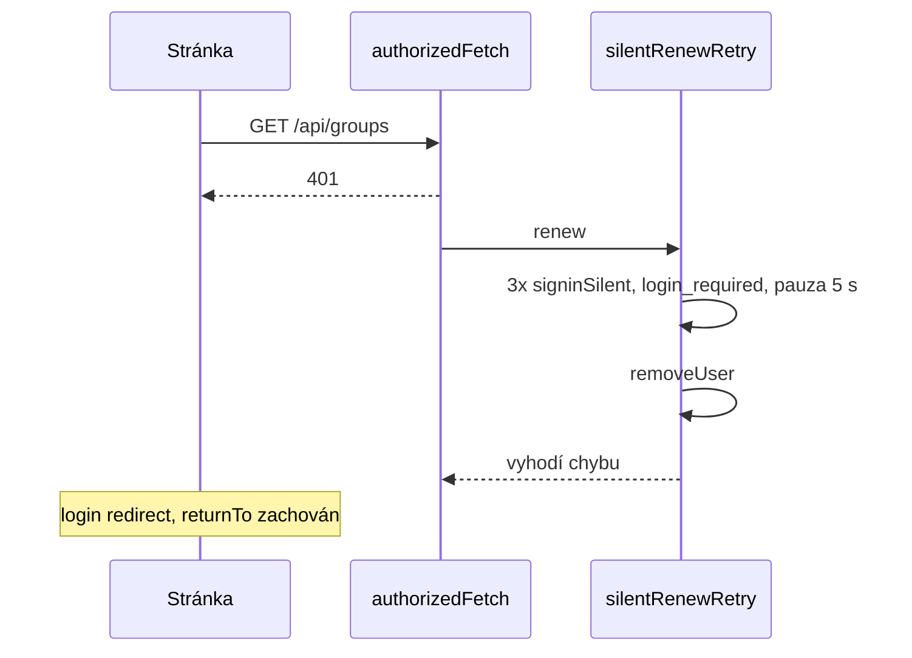

## Context

Obnova tokenu je dnes na třech místech: `authorizedFetch` (401, pak `silentRenewRetry`, jedno opakování), middleware v `api/setup.ts` (totéž pro `openapi-fetch`) a události oidc-client-ts v `klabisUserManager.ts` (`accessTokenExpired`, `silentRenewError`). Vedle toho běží `automaticSilentRenew` knihovny, které `silentRenewRetry` nehlídá.

Chování zjištěné lokálně na `:3000` (neplatný `access_token`, bez refresh tokenu, nenavštívená stránka):

Lokálně iframe renew vždy selže (SPA na `:3000`, AS na `:8443`, cookie se do iframe neposílá) a skončí re-loginem, který URL zachová. Na PROD (same-origin) iframe renew funguje; první požadavek ze stale tabu tam ale selhává z dosud neznámého důvodu a chyba zůstane viset, protože `HalRouteProvider` má `retry: 0` a nic nerefetchne po obnově.

## Goals / Non-Goals

**Goals:**
- Stale tab po otevření bez viditelné chyby: buď se token obnoví a stránka se načte, nebo následuje login s návratem na původní URL.
- Jedno místo, které rozhoduje o obnově tokenu a opakování požadavku.
- Rychlé selhání pro definitivní odpovědi AS.

**Non-Goals:**
- Změna TTL tokenů, session AS nebo refresh tokenů pro veřejného klienta (viz paměť k silent renew, `fix-api-session-id-rotation`).
- Nové uživatelské scénáře ve specifikacích.

## Decisions

1. **Nejdřív diagnostika.** První úkol přidá logování (stav uživatele při požadavku, výsledek každého pokusu o renew, status odpovědi). Pozorování z PROD určí, zda je příčinou souběh renew, syrová chyba z iframe, nebo jiný status než 401. Zbylé body se implementují nezávisle na výsledku.
2. **Jeden modul `authSession`** v `api/`: `ensureFreshToken()` (pokud je uživatel expirovaný, počká na renew) a `fetchWithAuth(request)` (injektuje token, po 401 jednou obnoví a zopakuje). `authorizedFetch` a `setup.ts` ho jen volají. Alternativa „ponechat dvě kopie a opravit obě" odmítnuta: právě duplicita způsobuje rozjíždění.
3. **Klasifikace chyb renew:** `ErrorResponse` s `login_required`, `interaction_required` nebo `consent_required` je definitivní (bez dalších pokusů, rovnou `removeUser`). Timeout a síťové chyby se opakují jako dnes. Z `silentRenewRetry` vyletí typovaná `SessionExpiredError`, kterou `ErrorPage` nezobrazí, protože login redirect proběhne dřív (`removeUser` spustí `ProtectedRoute` → `login()` s `returnTo`).
4. **Souběh:** `automaticSilentRenew` se vypne (`automaticSilentRenew: false`); jedinou cestu renew řídí `silentRenewRetry` na `accessTokenExpiring` a `accessTokenExpired`. Odstraní se tím větev `addSilentRenewError` s ručním `stopSilentRenew`/`startSilentRenew`. Alternativa „nechat automatiku a jen hlídat guard" odmítnuta: knihovna `signinSilent` volá přímo.
5. **Samoléčení chyb:** po `userLoaded` se zavolá `queryClient.refetchQueries` pro authorized dotazy ve stavu `error`. `ErrorPage` pro chyby načtení nabídne „Zkusit znovu" přes `refetch` z `useHalPageData`. Alternativa `retry: 1` v `HalRouteProvider` odmítnuta: maskuje problém a neřeší chybu po dlouhém renew.

## Risks / Trade-offs

- [Vypnutí `automaticSilentRenew` změní načasování renew] → obnova se spouští na `accessTokenExpiring`, který knihovna dál emituje; ověřit v testu a ručně na `:3000`.
- [Proaktivní renew zvýší latenci prvního požadavku po expiraci] → dnes stejně čeká na 401 a renew, ušetří se jedno kolo.
- [Příčina na PROD nemusí odpovídat žádné z hypotéz] → diagnostika v první skupině úkolů; zbylé úpravy jsou užitečné i tak.
- [Lokálně nelze věrně simulovat same-origin iframe renew] → pokrýt jednotkovými testy modulu a E2E na CI prostředí, kde je AS i SPA na jednom originu.
