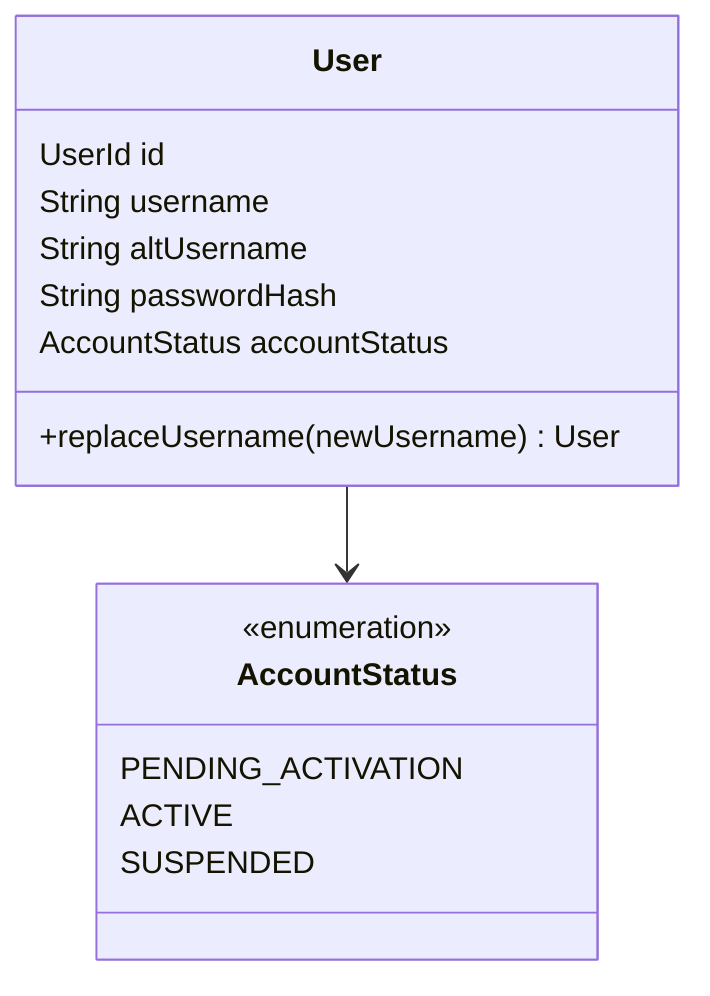
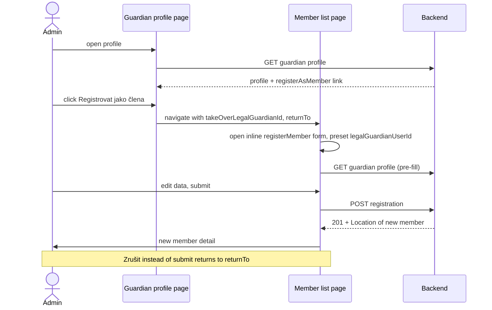

# Design

## Context

See `proposal.md` — Why / What Changes. Current state relevant to the approach:

- **Registration form** is the inline `registerMember` HAL-FORMS template of the member list (`MembersPage`, `HalFormButton modal={false}`), with a custom layout. Guardian logic lives in `RegistrationGuardianSections`: it shows the takeover section only when the date of birth is adult, clears the chosen guardian when the date of birth turns minor, and, once a guardian is chosen, loads the guardian's profile and pre-fills first name, last name, e-mail and telephone.
- **Takeover rule on the backend**: `RegistrationService.registerMember` already rejects a takeover combined with a minor's date of birth (`GuardiansNotAllowedException.takeOverByMinor`, error type `minor-cannot-take-over-guardian`, field `legalGuardianUserId`), before anything is created. The frontend already has a Czech label for this error.
- **Post-submit navigation**: `HalFormDisplay` navigates to the `Location` of a successful POST. Registration returns the new member's location, so the admin already lands on the new member's detail after submit — the "land on the detail" decision needs no new code.
- **Logins**: a `User` has a single `username` (`common.users.user_name`, `VARCHAR(7) UNIQUE`). Every lookup by a login — the authorization server's `KlabisUserDetailsService`, the activation-link request (`PasswordSetupServiceImpl.requestNewToken`), the per-request `AccountStatusValidationFilter` — goes through `findByUsername`. Token claims `sub` / `user_name` / `preferred_username` come from `UserDetails.getUsername()`. The takeover (`RegistrationService.takeOverLegalGuardian`) already generates a registration number for the member, but keeps the guardian's user with `username` = EXTnnnn, so today the member's registration number and login differ.
- **Guardian profile** (`GET /api/legal-guardians/{userId}`) is visible to MEMBERS:MANAGE holders and to the guardian themself; its response carries only `self` + `updateLegalGuardian`. Registration (`registerMember`) is guarded by MEMBERS:MANAGE.

## Goals / Non-Goals

**Goals:**
- Takeover section independent of the date of birth; the minor/takeover conflict is reported by the existing backend rule.
- A permission-gated hypermedia entry point from the guardian profile to the registration form, with the guardian pre-selected.
- Cancel from such a form returns to the guardian profile.
- A taken-over guardian logs in with the new registration number or the former EXT login number and is presented by the registration number.

**Non-Goals:**
- No change to the registration request or the rest of the takeover (guardian groups, permissions).
- No UI for showing or editing an altUsername; no altUsername for anyone but taken-over guardians.
- No generic "open a template with initial values from the URL" mechanism in the HAL-FORMS framework.
- Survival of the pre-selection across a page reload (reload just shows the member list).

## Decisions

### D1 — Domain changes limited to the User aggregate

The takeover (guardian user becomes the member's user, keeps guardian groups) and the minor-takeover rejection already exist. Members and legal guardian aggregates do not change. The only domain change is the optional altUsername on `User` (D6–D8, see *Domain changes*).

### D2 — Entry point is a HAL link on the guardian profile, gated by the registration permission

The guardian profile response gets a link `registerAsMember` built with `klabisLinkTo(methodOn(RegistrationApi.class).registerMember(null, null))`. `klabisLinkTo` returns the link only when the current user may invoke `registerMember` (MEMBERS:MANAGE), so the guardian viewing their own profile never gets it. The href is the member collection (`/api/members`), which is also the page that hosts the registration template.

Alternatives considered:
- *Put the `registerMember` affordance directly on the guardian profile* — the registration form has a custom two-column layout bound to the member list page, and a template targeting another resource would make the form load data from that target. Rejected: duplicates the layout or fights the framework.
- *Frontend shows the button based on its own permission check* — violates the HATEOAS rule (UI availability is driven by links/templates from the API). Rejected.

### D3 — Pre-selection travels as router state, not as a URL parameter

Clicking "Registrovat jako člena" navigates to the route of the `registerAsMember` href with router state `{takeOverLegalGuardianId, returnTo}` (`returnTo` = the guardian profile route). `MembersPage`, when it finds that state and the list resource exposes the `registerMember` template, opens the inline registration form once (as if the admin clicked "Registrovat člena") and passes the guardian id to `RegistrationGuardianSections`, which sets `legalGuardianUserId` on mount. The existing pre-fill effect then fills first name, last name, e-mail and telephone; the fields stay editable (the request values are what the member is registered with).

Alternative: a query parameter (`/members?takeOverLegalGuardian=<id>`) — survives reload and is shareable, but introduces a URL contract the frontend has to parse and keep stable, for a one-shot admin action. Rejected as more than needed (KISS).

### D4 — Cancel callback on the inline form request

`HalFormRequest` (halFormContext) gets an optional `onCancel` callback; `HalFormsPageLayout` calls it after `closeForm` when the admin clicks "Zrušit". `MembersPage` passes `() => navigate(returnTo)` only when the form was opened from a guardian profile; the regular "Registrovat člena" flow is unchanged. Success keeps the existing POST+Location navigation (new member's detail).

Alternative: `navigate(-1)` on cancel — depends on browser history and breaks when the page was opened in a new tab. Rejected.

### D5 — Takeover section always rendered, conflict left to the backend

`RegistrationGuardianSections` renders the takeover section whenever the template has `legalGuardianUserId`, regardless of the date of birth, and no longer clears the chosen guardian when the date of birth turns minor. The profile pre-fill query is enabled whenever a guardian is chosen. The "Zákonní zástupci" section for minors and the clearing of `legalGuardians` for adults are unchanged. On submit with a minor's date of birth and a chosen guardian, the backend's existing field error on `legalGuardianUserId` is shown next to the takeover picker.

Alternative: client-side validation of the conflict — duplicates a rule the backend already owns and reports per field. Rejected.

### D6 — altUsername is an optional value on the User aggregate

`User` gets an optional `altUsername` beside its `username`. It is set only by `User.replaceUsername(newUsername)`: the current username moves to the altUsername and `newUsername` becomes the username. The operation is refused when the user already has an altUsername (a user is taken over at most once). Persistence: nullable `alt_user_name VARCHAR(7) UNIQUE` in `common.users` (edit V001, no new migration).

A login has to be unique across both columns. The DB enforces each column on its own; a cross-column collision cannot occur in practice because altUsernames are always from the EXT series and usernames of members are registration numbers with the club prefix. No extra check is added (KISS).

Alternatives considered:
- *A separate `user_logins` table (any number of aliases)* — general, but nothing needs more than one alias. Rejected (KISS).
- *Keep EXT as username and store the registration number as altUsername* — contradicts "always presented by the registration number" and keeps token `sub` = EXT. Rejected.

### D7 — Every lookup by a login matches the username or the altUsername; tokens carry the username

`UserRepository.findByUsername` is replaced by `findByAnyUsername(username)` (match on `user_name` or `alt_user_name`), and `UserService.findUserByUsername` by `findUserByAnyUsername`. All current callers (login, activation-link request, `AccountStatusValidationFilter`, bootstrap check) use it. `KlabisUserDetails.getUsername()` returns the `username`, so whatever login the user typed, the authenticated principal — and therefore `sub`, `user_name`, `preferred_username` and the audit trail — is the registration number.

Alternative: try the username lookup and fall back to the altUsername only in `KlabisUserDetailsService` — leaves the activation form and the token filter blind to the altUsername. Rejected.

### D8 — Takeover replaces the username with the generated registration number

`RegistrationService.takeOverLegalGuardian` receives the registration number generated for the member and, besides releasing the guardian profile and updating permissions, calls `UserService.replaceUsername(guardianId, registrationNumber)`. All of it runs in the registration transaction, so a failed registration leaves the guardian's EXT login untouched. The EXT series is not affected: the number stays assigned to the user (as altUsername) and is never reused.

## Domain changes



| Element | Change | Description |
|---|---|---|
| `User.username` | unchanged | The login the user is presented by (registration number for members, EXTnnnn for non-member guardians). |
| `User.altUsername` | added | Optional second login accepted at login and activation. Set only by `replaceUsername`. |
| `User.replaceUsername(newUsername)` | added | Moves the current username to the altUsername and sets the new username. Refused if an altUsername already exists. |
| `UserRepository.findByUsername` | replaced by `findByAnyUsername` | Matches the username or the altUsername. |

## REST API

Additive change to `GET /api/legal-guardians/{userId}` (`getLegalGuardian`) response:

| Element | Name | Target | Present when |
|---|---|---|---|
| HAL link | `self` | `getLegalGuardian` | unchanged |
| HAL+FORMS template | `updateLegalGuardian` | `updateLegalGuardian` | unchanged |
| HAL link (new) | `registerAsMember` | `registerMember` (href `/api/members`) | the viewer may register members (MEMBERS:MANAGE) |

Spec change in `docs/openapi/spec/members.yaml`, `getLegalGuardian` → `200` → `x-hal-links`:

```yaml
registerAsMember:
  operation: registerMember
  description: Member registration with this guardian taken over (only for users who may register members)
```

No request/response body changes; `registerMember` is unchanged.

## Flow



## Glossary

| Term | Meaning |
|---|---|
| Guardian takeover | Registering an existing non-member legal guardian as a club member: the guardian's user account becomes the member's account (keeps the guardian groups), gets the member's registration number as username and keeps the EXT login number as altUsername; the guardian profile is replaced by the member profile. |
| username | The login a user is presented by everywhere (application, tokens, audit trail): the registration number of a member, the EXT login number of a non-member guardian. |
| altUsername | An additional login accepted on the login page and in the activation form; today only the former EXT login number of a taken-over guardian. |

## Risks / Trade-offs

- [A session opened before the takeover still carries EXTnnnn as principal name, so audit records made in it name EXTnnnn] → the guardian was not a member during that session; the token filter still finds the user via the altUsername; the next login yields the registration number. Accepted.
- [The activation-link rate limit is keyed by the entered login, so alternating the two logins doubles the allowed requests for one account] → at most 2× of a small limit for the few taken-over accounts. Accepted (KISS).

- [Takeover section visible for minors adds noise to a minor's registration] → hint text under the section already explains when to use it; the conflict is reported clearly on submit.
- [Router state is lost on reload of the member list page] → acceptable; the admin sees the plain member list and can start again from the profile.
- [Pre-fill effect overwrites values the admin typed before the guardian profile loaded] → the form opens pre-selected, so the profile loads before the admin can type; the edited-after-load case is unaffected (the effect runs once per loaded profile).
