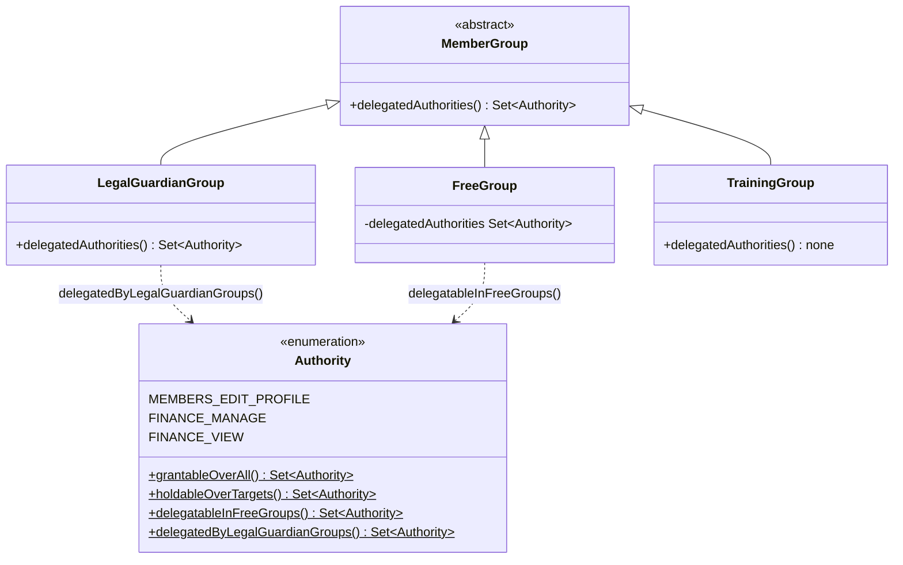

# Design

## Context

See `proposal.md` (Why) and the delta specs for the required behaviour.

Relevant current state:

- **Delegated permissions.** A group's owners hold `delegatedAuthorities()` over the group's members. `DelegatedGrants` turns this into grants and every group type has a `RelationshipSource` that feeds them into the per-request authorization snapshot. `LegalGuardianGroup.delegatedAuthorities()` returns its own constant `{MEMBERS_EDIT_PROFILE}`, so nothing is stored per group.
- **Free groups.** `FreeGroup` derives its delegatable authorities from `Authority`: every authority held over specific targets with target type `MEMBER`. Any new member-targeted authority would therefore become delegatable for free groups automatically.
- **Account access.** The three account reads (`getAccount`, `listTransactions`, `getTransaction`) are guarded in `finance.yaml` by `x-klabis-authority: FINANCE_MANAGE` and `x-klabis-owner-visible: true` (OR semantics). The owner sees their own account only through the owner-visible rule. Writes are FINANCE_MANAGE only.
- **Links.** `AccountMemberDetailLinkProcessor` adds the `account` link to a member detail for FINANCE_MANAGE only. `AccountRootLinkProcessor` adds the root `account` link (the "Finance" menu entry) only for users with a member profile.
- **Frontend.** The "Finance" page is `MemberAccountManagePage` at `/members/:memberId/account`. It already hides manager controls when the HAL templates are missing, and shows the owner from the `accountOwner` link. The `HalResourceLinks` type already accepts `Link | Link[]`.

## Goals / Non-Goals

**Goals:**
- One authorization rule for reading an account: FINANCE_MANAGE, or `FINANCE:VIEW` over the account owner. The owner and the guardians both get `FINANCE:VIEW` from relationships (ReBAC). Guardianship is not checked anywhere in the finance module.
- Keep the account page a single page. The switcher only navigates between account URLs.

**Non-Goals:**
- No new endpoint and no new persistence.
- No change to the permissions dialog. The new authority is never assigned by hand.

## Glossary

| Term | Meaning |
|---|---|
| **Zobrazení financí člena** (`FINANCE:VIEW`) | Authority to view one specific member's financial account (balance and history). It is held only over specific members, never over everybody, and only through relationships: the account owner over themselves, and legal guardians over their minors. |
| **Viewable account** | An account of a member over whom the current user holds `FINANCE:VIEW`: their own account (if they are a member) and the accounts of their minor children. |
| **Account switcher** | A control on the "Finance" page that lists the viewable accounts and navigates between them. |

## Decisions

### D1: New authority `FINANCE:VIEW`, member-targeted, held only over specific members

A new `Authority` constant `FINANCE_VIEW("FINANCE:VIEW", TargetType.MEMBER, GrantForm.SPECIFIC)`. Because it is `SPECIFIC`-only, it is never offered in the permissions dialog (`grantableOverAll()` excludes it), the same as `MEMBERS:EDIT_PROFILE`.

*Alternative:* let the finance module ask the members module "is the user the guardian of M?". Rejected: it duplicates the delegation mechanism and couples finance to legal guardian groups.

### D2: Account owner holds `FINANCE:VIEW` over themselves (replaces owner-visible)

A new `RelationshipSource` in the finance module grants the current user `FINANCE:VIEW` over their own member id when the user is a member. Non-member users (EXT guardians, the bootstrap `admin`) have no account and get no self-grant. Membership is checked through the `Members` port, which finance already depends on.

`x-klabis-owner-visible` is removed from the three account reads (D4). A member then sees their own account for the same reason a guardian sees their child's.

*Alternative:* keep `x-klabis-owner-visible` and add `FINANCE_VIEW` next to it. Rejected: it would keep two parallel rules for the same question. With the self-grant, "viewable accounts" (D6) is simply the set of `FINANCE:VIEW` targets, including the user's own account.

### D3: Domain changes — delegation sets live in `Authority`

`Authority` gets two functions next to `grantableOverAll()` / `holdableOverTargets()`. They are the single place that defines which authorities each kind of group delegates:

- `Authority.delegatableInFreeGroups()` → `{MEMBERS_EDIT_PROFILE}`. These are the authorities a free group founder may choose from.
- `Authority.delegatedByLegalGuardianGroups()` → `{MEMBERS_EDIT_PROFILE, FINANCE_VIEW}`. A legal guardian group always delegates exactly these.



| Element | Change | Description |
|---|---|---|
| `Authority.FINANCE_VIEW` | **added** | View one member's financial account. Target type `MEMBER`, held over specific members only. |
| `Authority.delegatableInFreeGroups()` | **added** | Authorities a free group founder may delegate: `{MEMBERS_EDIT_PROFILE}`. |
| `Authority.delegatedByLegalGuardianGroups()` | **added** | Authorities every legal guardian group delegates: `{MEMBERS_EDIT_PROFILE, FINANCE_VIEW}`. |
| `LegalGuardianGroup.delegatedAuthorities()` | **changed** | Returns `Authority.delegatedByLegalGuardianGroups()` instead of its own constant. Still computed, so no data migration. |
| `FreeGroup` delegatable set | **changed** | Uses `Authority.delegatableInFreeGroups()` instead of deriving it from all member-targeted authorities. The aggregate guard (`InvalidDelegatedAuthorityException`) therefore rejects `FINANCE_VIEW`, and the create form's options leave it out. `FreeGroup.delegatableAuthorities()` is removed and its callers use the `Authority` function. |
| `TrainingGroup` | unchanged | Delegates nothing. |

The two sets are listed explicitly rather than derived from per-constant attributes. A new authority therefore never becomes delegatable by accident.

Loss of access at 18 or on removal needs no code: `LegalGuardianGroupRelationshipSource` grants only over the current minors of groups the user guards. The daily run already removes adults from the group.

### D4: Account reads require FINANCE_MANAGE or `FINANCE_VIEW` over the owner

In `finance.yaml`, `getAccount`, `listTransactions` and `getTransaction` change to `x-klabis-authority: [FINANCE_MANAGE, FINANCE_VIEW]`, and `x-klabis-owner-visible` is removed. `AccountMemberIdParam` already carries `x-klabis-target-id: MEMBER`, which `validate.mjs` requires for a `SPECIFIC` authority. Deposit, charge and reverse stay FINANCE_MANAGE only. Their templates and the reverse affordance are already filtered by authorization, so owners and guardians get a read-only page without frontend branching.

### D5: Member detail `account` link for `FINANCE:VIEW` holders

`AccountMemberDetailLinkProcessor` adds the link when the user holds FINANCE_MANAGE, or holds `FINANCE:VIEW` over the displayed member and it is not the user's own profile. Because of D2 the self-exclusion must now be explicit. The own account stays reachable from "Finance", as today. `AccountMemberSummaryLinkProcessor` (member list rows) stays FINANCE_MANAGE only.

### D6: Account switcher as repeated `viewableAccount` links

The account resource carries one `viewableAccount` link per viewable account. HAL serializes several links with the same rel as an array under one key, and Spring HATEOAS does this automatically. Each link has `href` (the account URL) and `title` (the owner's first and last name). The links are ordered with the user's own account first and then the children by last name and first name.

The viewable set is `targetIdsOf(FINANCE_VIEW, MEMBER)` from the authorization snapshot. Names come from `Members.findByIds`. The links are added only when:

- the displayed account is itself one of the viewer's viewable accounts (so a finance manager browsing a stranger's account does not see their family switcher), and
- there are at least two viewable accounts.

*Alternative:* a new collection endpoint for "my viewable accounts". Rejected: it would add an endpoint and a second fetch for a list of 1–4 entries.

### D7: Root `account` link for every user with a viewable account

`AccountRootLinkProcessor` links to the first viewable account (same ordering as D6): the user's own account for a member, the first child's account for a non-member guardian. With no viewable account it adds no link, so the "Finance" entry is hidden. This replaces the current "has member profile" check.

### D8: Frontend

- `MemberAccountManagePage` renders an account switcher (a select) when the resource has `viewableAccount` links. The current account is selected. Changing the selection navigates to the chosen account's URL.
- `MemberDetailPage` already renders the action when the `account` link is present, so it needs no change.
- Localization: add the `FINANCE:VIEW` label "Zobrazení financí člena" to the authority labels, plus a label for the switcher.

### D9: Spec alignment — no switcher for a single account

D6 shows the switcher only with two or more accounts, so a non-member guardian of one child sees that child's account without a switcher. The member-accounts delta states "a user who can view only one account sees no switcher" to match.

## API changes

All changes live in `docs/openapi/spec/finance.yaml`. Regenerate the bundle and the frontend types afterwards. The response shapes are unchanged; only the authorization rule changes and a link is added.

| Operation | Change |
|---|---|
| `GET /api/members/{memberId}/account` (`getAccount`) | `x-klabis-authority: [FINANCE_MANAGE, FINANCE_VIEW]`, `x-klabis-owner-visible` removed. New rel `viewableAccount` in `x-hal-links` (operation `getAccount`, repeated, each with `title`; present only per D6). |
| `GET /api/members/{memberId}/account/transactions` (`listTransactions`) | `x-klabis-authority: [FINANCE_MANAGE, FINANCE_VIEW]`, `x-klabis-owner-visible` removed. |
| `GET /api/members/{memberId}/account/transactions/{txId}` (`getTransaction`) | `x-klabis-authority: [FINANCE_MANAGE, FINANCE_VIEW]`, `x-klabis-owner-visible` removed. |
| `POST` deposit / charge / reverse | unchanged (FINANCE_MANAGE). |
| Member detail (`getMember`) | `account` link is also present for `FINANCE:VIEW` holders over that member, except on the user's own profile. |
| Root (`/api`) | `account` link points to the user's first viewable account, so non-member guardians get it too. |

Example on a member guardian's own account:

```json
"_links": {
  "self": {"href": "/api/members/1111…/account"},
  "viewableAccount": [
    {"href": "/api/members/1111…/account", "title": "Petr Novák"},
    {"href": "/api/members/2222…/account", "title": "Anna Nováková"},
    {"href": "/api/members/3333…/account", "title": "Jan Novák"}
  ]
}
```

## Risks / Trade-offs

- [Removing owner-visible could lock members out of their own account if the self-grant is missing] → Integration tests: a member without FINANCE_MANAGE reads their own account, transactions and a single transaction. An unrelated member is denied.
- [`x-hal-links` may not express a repeated rel] → Check how `haltypes.mjs` and `validate.mjs` treat the rel. The runtime type `HalResourceLinks` already accepts `Link | Link[]`. If the generator needs it, extend it in the same change.
- [The free-group create form and `InvalidDelegatedAuthorityException` currently rely on the derived set] → Test that creating a free group with `FINANCE:VIEW` is rejected and that the form options list only "Úprava údajů člena".
- [A non-member guardian's token might lack what the account endpoints need (e.g. the `MEMBERS` scope)] → Cover with an integration test as an EXT guardian. Non-member guardians already open their child's member detail under the same scope, so no change is expected.
- [The self-grant source and the root link processor add a `Members` lookup when the snapshot is built and on the root fetch] → Acceptable at the expected load.
- [The recorder link on a transaction leads to a member detail the guardian may not be allowed to open] → This already applies to account owners today and is out of scope.

## Migration Plan

No data migration. Both the delegation and the self-grant are computed, so they take effect as soon as the change is deployed. Rollback is a plain redeploy of the previous version.
