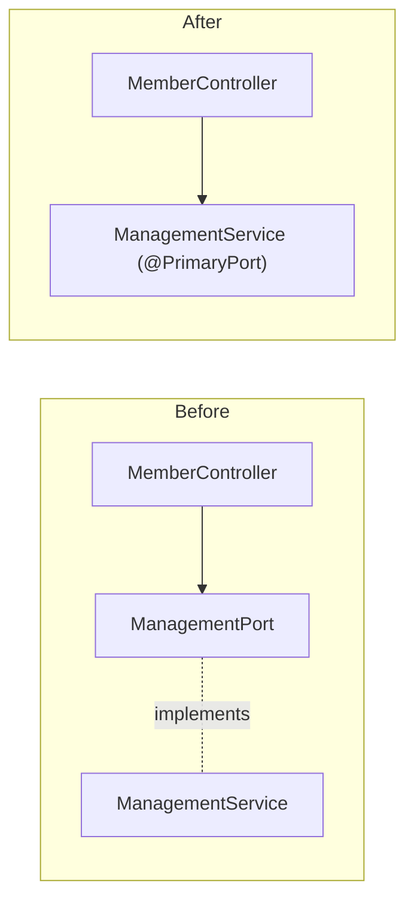

## Why

In `members` and `events`, almost every application service is a `XxxPort` interface plus a single `XxxService` implementation, although the interface is only consumed inside its own module (controllers, jobs, tests). Every new use case therefore touches two files, javadoc is split between them, and two thin service groups (guardian contacts/completeness, ORIS event import) are spread over more classes than their logic needs.

## What Changes

- Delete intra-module `@PrimaryPort` interfaces that have exactly one implementation; the service class itself carries `@PrimaryPort` and becomes `public` where consumed from another package.
  - **members:** `ManagementPort`, `RegistrationPort`, `MemberAgeOutPort`, `MemberAccountActivationPort`, `LegalGuardianPort`, `LegalGuardianGroupPort`, `GuardianCandidatesPort`, `GuardianContactResolver`
  - **events:** `EventManagementPort`, `EventRegistrationPort`, `AccommodationListPort`, `CategoryPresetManagementPort`, `DisciplineManagementPort`
- Nested command records and annotations declared on the interfaces (`RegistrationPort.RegisterNewMember`, `@Transactional`, `@NonNull`) move to the service class.
- Merge `MemberContactService` and `MemberCompletenessService` (same dependencies, both resolve guardian contacts) into one `MemberContactService`; delete `MemberContactPort` and `MemberCompletenessPort`.
- Merge `OrisEventImportService`, `OrisEventBulkImportService` and `OrisBulkSyncService` into one `OrisEventImportService`; delete `OrisEventImportPort`, `OrisEventBulkImportPort`, `OrisBulkSyncPort`.
- `MemberDiscoveryPort` and `OrisEventRegistrationDiscoveryPort` (implemented by `@Application` jobs) are removed only if `JMoleculesArchitectureTest` accepts a primary adapter depending on the job class; otherwise they stay (see design.md).
- Kept unchanged: cross-module ports (`Members`, `LegalGuardians`, `AllMembersPort`, `ActiveMembersByAgeProvider`, `EventTypeManagementPort`, `MemberRegistrationSanctionPort`, `EventScheduleQuery`, `EventDataProvider`, `EventTypeOptionsProvider`), SPIs implemented elsewhere (`MemberFinancialStatePort`, `MemberOwnedGroupsPort`, `ImportedOrisEventsPort`), secondary ports (`LoginNumberSequence`, repositories).
- New ADR-011 in `docs/design-decisions.md`; `backend-patterns` skill updated (service = concrete class, interface only for cross-module port or SPI).

## No Behavior Change Justification

**Specs reviewed:**
- `openspec/specs/members/spec.md`, `legal-guardians/spec.md`, `member-synchronization/spec.md` — unaffected; they describe user-facing behaviour, not service structure.
- `openspec/specs/events/spec.md`, `event-registrations/spec.md`, `event-types/spec.md`, `disciplines/spec.md`, `category-presets/spec.md`, `data-synchronization/spec.md` — unaffected for the same reason.
- `openspec/specs/non-functional-requirements/spec.md` — contains no rule about ports or hexagonal layering.

**Why no spec update is needed:** the change only removes Java interfaces and moves methods between classes of the same module. Method bodies, transactions, REST contract, authorization and events published stay identical; existing tests (with mocks retargeted from interfaces to classes) verify that.

## Impact

- `backend/src/main/java/com/klabis/members/**`, `backend/src/main/java/com/klabis/events/**` (application services, controllers, jobs, sync adapters using them).
- Tests: `@MockitoBean`/`mock(...)` targets change from `*Port` to concrete services (`EventsWebMvcMockitoBeans`, members equivalents, service unit tests); merged services' tests merge too.
- Docs: `docs/design-decisions.md` (ADR-011), `.claude/skills/backend-patterns` (`SKILL.md`, `references/domain-layer.md`, `references/aggregate-checklist.md`).
