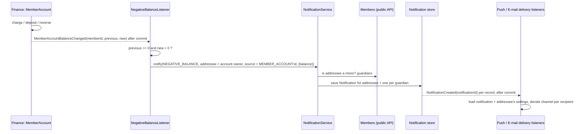
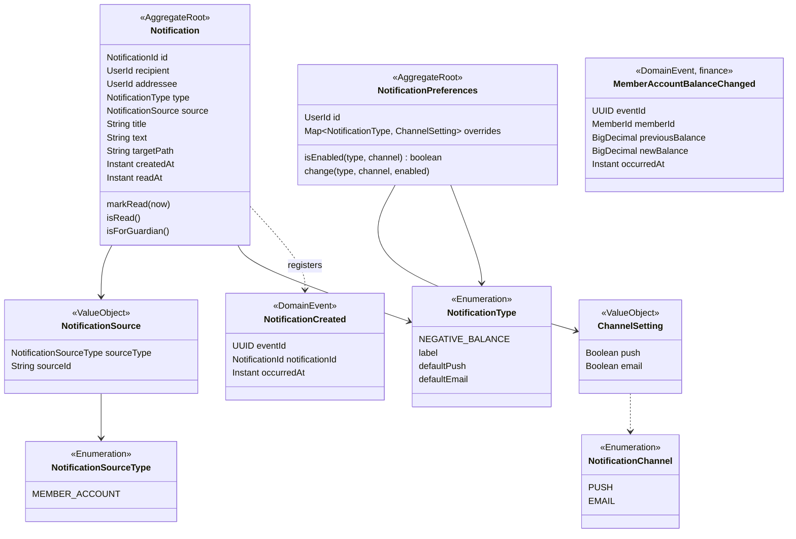

# Design

## Context

See proposal.md for motivation and specs/ for the required behaviour.

Current state:

- The `notifications` module (`com.klabis.notifications`) owns push devices (`NotificationDevice`), web push delivery and the public API `PushNotifications.send(UserId, PushMessage)`, which nothing calls yet. Its REST API is spec-first in `docs/openapi/spec/notifications.yaml`; `GET /api/notifications` returns the VAPID key and the user's devices. The root link `notifications` (section `main`) is added only when VAPID is configured and drives the home-page "Notifikace" panel.
- E-mail is shared infrastructure: `common.email.EmailService` with Thymeleaf templates in `resources/templates/email/` (welcome, password setup). Failures are logged, never thrown.
- `finance.domain.MemberAccount` (identity `MemberId`) changes its balance in `deposit`, `charge`, `chargeForRegistration` and `reverse`. It publishes no domain events today, but its memento already forwards aggregate events via `@DomainEvents`.
- `members` exposes `Members` and `LegalGuardians` as public ports. The guardians of a minor are known only inside the module (`LegalGuardianGroupPort.guardiansOf(MemberId)`, `GuardianContact`). `MemberId` and `UserId` share the same UUID.
- Authorization is relationship-based (ADR-010, ADR-011): `RelationshipSource` beans grant `SPECIFIC` authorities over targets per request; operations declare `x-klabis-authority`, `x-klabis-owner-visible` and `x-klabis-target-id` in the spec. `LegalGuardianGroupRelationshipSource` already grants each guardian the group's delegated authorities over its minors and `GROUPS_OWNER` over the group.
- The `sync` engine identifies entities of any module by `SyncTarget(SyncEntityType, String entityId)`, so it depends on no module's identifier type.
- Modules talk through Spring Modulith; listeners use `@ApplicationModuleListener` (asynchronous, after commit, own transaction, publication registry). Events carry ids plus what listeners need, no PII. Retention jobs use `@Scheduled` (for example `SyncHistoryRetentionJob`). Domain DDL goes into `V001__initial_schema.sql`; no new migration scripts.

## Goals / Non-Goals

**Goals:**

- A notification module that later steps extend by adding a notification type, a listener for their domain event and a text template, without touching delivery, feed or settings.
- Finance stays unaware of notifications; the dependency points from `notifications` to the producing modules.

**Non-Goals:**

- Daily e-mail digest (likely later; the stored notifications make it possible).
- Notification types other than `NEGATIVE_BALANCE`.
- Guardians viewing a minor's financial account ([#451](https://github.com/zabiny/klabis/issues/451); until then the guardian's notification links to the minor's detail page).
- Merging the `push-notifications` spec into `notifications`. The project rule asks for one spec per module; merging the device requirements is a documentation follow-up after this change is archived.
- Real-time feed updates (websocket/SSE). The unread count refreshes on navigation and window focus.

## Decisions

### D1: Integration through domain events, the notification module depends on producers

The producing module publishes a plain domain event about its own domain (here: "balance changed", with previous and new balance). A listener in `notifications` interprets it: decides whether a notification is due, its type, the user it is for (the addressee) and the aggregate that caused it (the source), then hands a notification request to the notification service. The service stores the feed records and publishes `NotificationCreated` for each; delivery listeners send push and e-mail (D7).



- **Why:** David's decision (step 2 discussion, point 8). The module has to know each type anyway (texts, links, defaults); the producer should not shape notifications.
- **Alternative rejected:** a public `Notifications.send(...)` API called by producers. It makes every producer depend on notifications and spreads routing knowledge.

### D2: Event carries previous and new balance; the crossing is detected by the listener

`MemberAccount` registers `MemberAccountBalanceChanged(eventId, memberId, previousBalance, newBalance, occurredAt)` on every balance change. The listener notifies only when `previousBalance >= 0` and `newBalance < 0`. No "already notified" flag is stored: the crossing itself is the dedup rule, and optimistic locking on the aggregate serialises concurrent changes, so each crossing is seen once.

- **Alternative rejected:** a dedicated "balance turned negative" event decided in finance. It would move a notification concern into the finance domain.

### D3: One stored notification per recipient (fan-out on write)

The service resolves recipients when the event happens and stores a `Notification` per recipient. Read state lives on the record.

- **Why:** push and e-mail need recipients at that moment anyway; read state is per user; users whose role changes later (a new trainer or finance manager) do not see older notifications; with 200 to 300 users the volume is negligible. A digest can later be built from the same records.
- **Alternative rejected:** a global event log filtered at read time. Needs separate per-user read state and leaks old notifications to users who gain a role later.

### D4: Routing rules in code, minors redirected by the service

Each type's listener names the addressee (for `NEGATIVE_BALANCE` the account owner). When the addressee is a minor, the service adds a record for each legal guardian. All channel decisions use the **addressee's** settings:

| Recipient | Feed | Push | E-mail |
|-----------|------|------|--------|
| Adult addressee | always | per own settings | own e-mail, per own settings |
| Minor addressee | always | **never** | own e-mail if set, per minor's settings |
| Each legal guardian of a minor addressee | always | per **minor's** settings | guardian's e-mail, per **minor's** settings |

Future management types (event managers, trainers of a group) will name their addressees directly in their listener; the guardian redirection applies whenever an addressee is a minor.

### D5: Settings stored as overrides on top of per-type defaults

`NotificationPreferences` (one per user) stores only the channel values the user (or a guardian) changed. Unset values fall back to the type's default, evaluated at delivery time. Defaults are one set per type, the same for adults and minors (David, 2026-11-20); a separate minor default can be added to a type when one needs it. Consequence: when a minor turns 18, the values stay as they were, and push starts reaching the member's own devices instead of the guardians' (D4). No reaction to `MinorAgedOutEvent` is needed.

### D6: Guardianship as the ReBAC relationship authority `LEGAL_GUARDIAN_OF`

A new authority `Authority.LEGAL_GUARDIAN_OF` (`MEMBERS:LEGAL_GUARDIAN_OF`, target type `MEMBER`, `GrantForm.SPECIFIC` only, never assignable, never delegatable) expresses "the user is a legal guardian of this member". `LegalGuardianGroupRelationshipSource` grants it over every minor of every group the user guards, next to the delegated authorities and `GROUPS_OWNER` it grants today (age is not checked; the minor leaves the group in the daily run after turning 18, so the grant ends with it).

The settings update operation declares the member as its target (`x-klabis-target-id: MEMBER` on `memberId`), `x-klabis-owner-visible: true` and `x-klabis-authority: [LEGAL_GUARDIAN_OF]`: the member themself **or** their legal guardian. `MEMBERS_MANAGE` is deliberately not listed, so the operation needs a test asserting that an administrator who is neither is refused.

The spec makes a minor's own settings read-only. Endpoint authorization lets the minor through as owner, so the application service rejects a change by a minor to their own settings, and the settings postprocessor omits the update template for them.

- **Why:** the relation states the actual fact (guardianship) and is reusable for any record owned by a member (settings now, the minor's account in [#451](https://github.com/zabiny/klabis/issues/451), and so on).
- **Alternatives rejected:** an imperative guardian check in the service (bypasses the declarative authorization used everywhere else); reusing `MEMBERS_EDIT_PROFILE` (held also by every adult over themself and configurable per group, so it does not mean "guardian").

### D7: Delivery in event listeners

`Notification` registers `NotificationCreated(eventId, notificationId, occurredAt)` when created. Two listeners in the notifications module (`PushDeliveryListener`, `EmailDeliveryListener`, both `@ApplicationModuleListener`) load the notification, the addressee's settings and the recipient's contact, apply D4 and send. `PushNotifications` and `EmailService` already log and swallow delivery failures, so the publication completes and is never retried into duplicate deliveries. The event carries only the id, so no notification text or e-mail lands in the Modulith outbox.

- **Why:** storing the feed record and delivering are separate concerns; a slow or failing SMTP server never holds the transaction that writes the feed; new channels are new listeners.
- **Alternative rejected:** inline delivery in the service after saving.

### D8: Notification source as a typed reference

`Notification.source` is a `NotificationSource(NotificationSourceType sourceType, String sourceId)`, after `SyncTarget` in the sync engine: the module can point back to the aggregate that triggered the notification (for `NEGATIVE_BALANCE` the member account, `MEMBER_ACCOUNT` + account id) without depending on that module's identifier type. `NotificationSourceType` starts with `MEMBER_ACCOUNT`; later steps add their values.

### D9: Retention by a daily `@Scheduled` job

`NotificationRetentionJob` deletes notifications older than 90 days every night (pattern of `SyncHistoryRetentionJob`). It moves to Quartz together with the other jobs once `introduce-quartz-scheduler` is implemented; this change does not wait for it.

### D10: Members public API additions

- `LegalGuardians.guardiansOf(MemberId minor): List<LegalGuardianContactDto>` with user id, name and e-mail of every guardian (members and non-members); empty for adults.
- `Members.isMinor(MemberId): boolean`.
- `Authority.LEGAL_GUARDIAN_OF` and its grant in `LegalGuardianGroupRelationshipSource` (D6).

The ports delegate to existing internals (`LegalGuardianGroupPort.guardiansOf`, `GuardianContactResolver`, member birth date).

## Domain Model



| Element | Module | Status | Description |
|---------|--------|--------|-------------|
| `Notification` | notifications | added | One notification for one recipient: addressee, type, source, rendered title, text, target page and read state. A guardian's copy has `recipient` ≠ `addressee`. |
| `NotificationId` | notifications | added | Identity of a notification. |
| `NotificationSource`, `NotificationSourceType` | notifications | added | Typed reference to the aggregate that triggered the notification (D8). |
| `NotificationCreated` | notifications (domain) | added | Registered on creation; consumed by the delivery listeners inside the module. |
| `NotificationPreferences` | notifications | added | A user's changed channel settings; identity is the user's `UserId`. |
| `ChannelSetting` | notifications | added | Push and e-mail values set for one type; an unset value means "use the default". |
| `NotificationType` | notifications | added | Known types with Czech label and default per channel. First value `NEGATIVE_BALANCE` (label "Záporný zůstatek"; push on, e-mail on). |
| `NotificationChannel` | notifications | added | `PUSH`, `EMAIL`. The feed is not a channel; it always receives everything. |
| `MemberAccountBalanceChanged` | finance (public) | added | Published by `MemberAccount` on every balance change. |
| `MemberAccount` | finance | changed | Registers `MemberAccountBalanceChanged` in deposit, charge, registration charge and reversal. |
| `Authority.LEGAL_GUARDIAN_OF` | common.users | added | Relationship authority "guardian of this member" (D6). |
| `LegalGuardianContactDto` | members (public) | added | Guardian contact for other modules. |
| `NotificationDevice`, `PushNotifications`, `PushMessage` | notifications | unchanged | Push delivery reused by the push listener. |

## REST API

Existing device endpoints are unchanged. All endpoints resolve the feed through the acting user; the settings update authorises by target (D6).

| Method & path | operationId | Authorization | Purpose |
|---------------|-------------|---------------|---------|
| `GET /api/notifications` | `getNotificationSettings` (changed) | authenticated | Settings tab: VAPID key, devices, own preferences, children's preferences |
| `PUT /api/notifications/preferences/{memberId}` | `updateNotificationPreferences` (new) | `x-klabis-owner-visible: true`, `x-klabis-authority: [LEGAL_GUARDIAN_OF]`, `memberId` is `x-klabis-target-id: MEMBER` | Change the preferences of the given member (own, or a child's). `memberId` is the user's id, so it also works for a non-member guardian's own settings. A minor changing their own settings gets 400 with a `/errors/…` type (ADR-012). |
| `GET /api/notifications/feed?page&size` | `getNotificationFeed` (new) | authenticated | Paged feed, newest first, default size 20 |
| `GET /api/notifications/feed/unread-count` | `getUnreadNotificationCount` (new) | authenticated | Number for the bell |
| `POST /api/notifications/feed/{notificationId}/read` | `markNotificationRead` (new) | authenticated, own notification | Mark one read; idempotent; 404 for another user's notification |
| `POST /api/notifications/feed/read-all` | `markAllNotificationsRead` (new) | authenticated | Mark all of the user's notifications read |

**`NotificationSettings`** (changed):

```json
{
  "vapidPublicKey": "BP...",            // null when push is not configured
  "pushAvailable": true,
  "managedByGuardians": false,          // true for a minor: preferences are read-only
  "preferences": [
    { "type": "NEGATIVE_BALANCE", "label": "Záporný zůstatek", "push": true, "email": true }
  ],
  "_embedded": {
    "devices": [ { "id": "…", "description": "Chrome, Android", "enabledAt": "…", "endpoint": "…" } ],
    "minors": [
      { "memberId": "…", "firstName": "Jan", "lastName": "Novák",
        "preferences": [ { "type": "NEGATIVE_BALANCE", "label": "Záporný zůstatek", "push": false, "email": true } ],
        "_templates": { "updateNotificationPreferences": "PUT …/preferences/{child id}" } }
    ]
  },
  "_links": { "self": "…", "notificationFeed": "…" },
  "_templates": {
    "updateNotificationPreferences": "PUT …/preferences/{own id} (absent for a minor)",
    "registerNotificationDevice": "… (absent when push is not configured)",
    "sendTestNotification": "… (only with at least one device)"
  }
}
```

**Preferences request body:** `{ "preferences": [ { "type": "NEGATIVE_BALANCE", "push": false, "email": true } ] }`. Unknown types are rejected with 400.

**`NotificationFeed`** (paged collection): `_embedded.notifications[]` of `{ id, type, title, text, createdAt, read, targetPath }`; each item has template `markNotificationRead` while unread. Collection links `self`, paging links, `notificationSettings`; template `markAllNotificationsRead` while any notification is unread.

**`UnreadNotificationCount`**: `{ "unreadCount": 3 }` with `self`.

**Root links:** `notificationFeed` (no menu section, used by the bell) for every authenticated user; `settings` (section `main`, label "Nastavení") pointing at `getNotificationSettings`, now always present. The current `notifications` root link (and the home-page panel it drives) is removed.

## Frontend

- `Layout`: bell button in the header with the unread count (TanStack Query, refetch on window focus and route change, "99+" above 99). Shown when the root carries `notificationFeed`.
- `/notifications`: new feed page (replaces `NotificationSettingsPage` on that route). Click → `markNotificationRead` then navigate to `targetPath`; "Označit vše jako přečtené" from the template; link to settings.
- `/settings/notifications`: "Nastavení" page with tabs (same tab pattern as the synchronisation overview); "Nastavení notifikací" tab hosts the moved device UI (hidden without `pushAvailable`), the own preferences table (read-only with a note when `managedByGuardians`) and a section per minor.
- Menu: "Nastavení" in the desktop main section; excluded from the mobile bottom navigation.
- `HomePage`: the "Notifikace" panel is removed.
- Test notification `targetPath` changes to `/settings/notifications`.

## Texts

One template per type, the same for the addressee and for guardians; it always names the addressee.

| | `NEGATIVE_BALANCE` |
|---|---|
| Title | Záporný zůstatek: {first} {last} |
| Feed / e-mail text | Zůstatek na účtu {first} {last} je {balance} Kč. |
| Push text | Zůstatek na účtu {first} {last} je záporný. |
| Target | addressee: own financial account (`/finance`); guardian: the minor's detail page until [#451](https://github.com/zabiny/klabis/issues/451) |

E-mail uses one generic notification template pair (`notification.html` / `notification.txt`) with title, text and an absolute link built from the configured base URL.

## Glossary

| Term | Meaning |
|------|---------|
| Notification | One message for one recipient, shown in their feed and possibly sent by push or e-mail. |
| Feed ("Notifikace") | The list of a user's notifications in the app, opened from the bell. |
| Recipient | The user whose feed holds the notification. |
| Addressee | The user the notification is for and whose settings decide the channels. Equals the recipient, except for a guardian's copy of a minor's notification. |
| Notification source | The aggregate that triggered the notification, as type + id. |
| Notification type | A kind of notification with its own text template, addressee rule and default channels (first: `NEGATIVE_BALANCE`). |
| Channel | A delivery path outside the app: push or e-mail. |
| Notification preferences | A user's per-type channel choices; unset choices use the type's defaults. |
| `legalGuardianOf` | Relationship authority `LEGAL_GUARDIAN_OF` a guardian holds over each of their minor children. |

## Risks / Trade-offs

- [Yearly fee run creates many notifications and e-mails at once] → Expected and approved (step 2 discussion, point 5). Delivery runs in asynchronous listeners; at 300 members the SMTP load is small.
- [Push or e-mail fails and is never retried] → Accepted; the feed always has the notification. Revisit with the digest.
- [Unread count is stale until navigation or focus] → Acceptable for the club's usage; push covers urgency.
- [Guardian cannot open the minor's account from the notification] → Link goes to the minor's detail page until #451.
- [Owner-visible lets a minor through the settings endpoint] → The service rejects it and the template is not offered; a test covers it.
- [Two specs for one module (`push-notifications`, `notifications`)] → Merge as a docs follow-up after archive.

## Migration Plan

- DDL for `notifications` and `notification_preferences` tables goes into `V001__initial_schema.sql` (project rule, no production data to migrate).
- Deploy as one release; no feature flag. Rollback = previous image (tables are additive).
