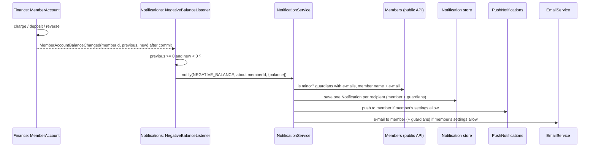
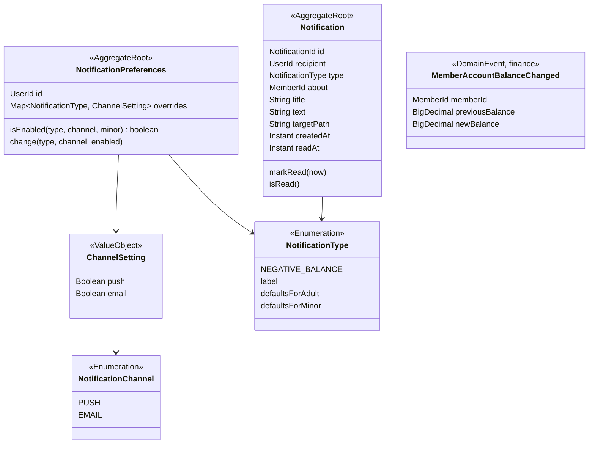

# Design

## Context

See proposal.md for motivation and specs/ for the required behaviour.

Current state:

- The `notifications` module (`com.klabis.notifications`) owns push devices (`NotificationDevice`), web push delivery and the public API `PushNotifications.send(UserId, PushMessage)`, which nothing calls yet. Its REST API is spec-first in `docs/openapi/spec/notifications.yaml`; `GET /api/notifications` returns the VAPID key and the user's devices. The root link `notifications` (section `main`) is added only when VAPID is configured and drives the home-page "Notifikace" panel.
- E-mail is shared infrastructure: `common.email.EmailService` with Thymeleaf templates in `resources/templates/email/` (welcome, password setup). Failures are logged, never thrown.
- `finance.domain.MemberAccount` (identity `MemberId`) changes its balance in `deposit`, `charge`, `chargeForRegistration` and `reverse`. It publishes no domain events today, but its memento already forwards aggregate events via `@DomainEvents`.
- `members` exposes `Members` and `LegalGuardians` as public ports. The guardians of a minor are known only inside the module (`LegalGuardianGroupPort.guardiansOf(MemberId)`, `GuardianContact`). `MemberId` and `UserId` share the same UUID.
- Modules talk through Spring Modulith; listeners use `@ApplicationModuleListener` (asynchronous, after commit, own transaction, publication registry). Retention jobs use `@Scheduled` (for example `SyncHistoryRetentionJob`). Domain DDL goes into `V001__initial_schema.sql`; no new migration scripts.

## Goals / Non-Goals

**Goals:**

- A notification module that later steps extend by adding a notification type, a listener for their domain event and a text template, without touching delivery, feed or settings.
- Finance stays unaware of notifications; the dependency points from `notifications` to the producing modules.

**Non-Goals:**

- Daily e-mail digest (likely later; the stored notifications make it possible).
- Notification types other than `NEGATIVE_BALANCE`.
- Guardians viewing a minor's financial account (the guardian's notification links to the minor's detail page instead).
- Merging the `push-notifications` spec into `notifications`. The project rule asks for one spec per module; merging the device requirements is a documentation follow-up after this change is archived.
- Real-time feed updates (websocket/SSE). The unread count refreshes on navigation and window focus.

## Decisions

### D1: Integration through domain events, the notification module depends on producers

The producing module publishes a plain domain event about its own domain (here: "balance changed", with previous and new balance). A listener in `notifications` interprets it: decides whether a notification is due, which type it is and whom it concerns, then hands a notification request to the notification service.



- **Why:** this is David's decision (step 2 discussion, point 8). The module has to know each type anyway (texts, links, defaults); the producer should not shape notifications.
- **Alternative rejected:** a public `Notifications.send(...)` API called by producers. It makes every producer depend on notifications and spreads routing knowledge.

### D2: Event carries previous and new balance; the crossing is detected by the listener

`MemberAccount` registers `MemberAccountBalanceChanged(memberId, previousBalance, newBalance)` on every balance change. The listener notifies only when `previousBalance >= 0` and `newBalance < 0`. No "already notified" flag is stored: the crossing itself is the dedup rule, and optimistic locking on the aggregate serialises concurrent changes, so each crossing is seen once.

- **Alternative rejected:** a dedicated "balance turned negative" event decided in finance. It would move a notification concern into the finance domain.

### D3: One stored notification per recipient (fan-out on write)

The service resolves recipients when the event happens and stores a `Notification` per recipient, with the text already rendered for that recipient ("your account" vs "account of Jan Novák"). Read state lives on the record.

- **Why:** push and e-mail need recipients at that moment anyway; read state is per user; recipients whose role changes later (a new trainer or finance manager) do not see older notifications; with 200 to 300 users the volume is negligible. A digest can later be built from the same records.
- **Alternative rejected:** a global event log filtered at read time. Needs separate per-user read state and leaks old notifications to users who gain a role later.

### D4: Routing rules in code, minors redirected by the service

Each type's listener names the member the notification is about (for `NEGATIVE_BALANCE` the account owner). The service applies the minor rule for every type:

| Recipient | Feed | Push | E-mail |
|-----------|------|------|--------|
| Adult member | always | per own settings | own e-mail, per own settings |
| Minor | always | per minor's settings (default off) | own e-mail if set, per minor's settings |
| Each legal guardian of a minor | always | never | guardian's e-mail, per **minor's** settings |

Future management types (event managers, trainers of a group) will name their recipients directly in their listener; the minor redirection applies only to notifications about a member.

### D5: Settings stored as overrides on top of per-type defaults

`NotificationPreferences` (one per user) stores only the channel values the user (or a guardian) changed. Unset values fall back to the type's default for adults or minors, evaluated at delivery time. Consequence: when a minor turns 18, values the guardians set explicitly stay; untouched values follow adult defaults (push on). This matches the spec scenario and needs no reaction to `MinorAgedOutEvent`.

### D6: Guardian authorisation for a minor's settings is checked in the service

Changing a minor's settings is allowed to the minor's current legal guardians (via the new `LegalGuardians.guardiansOf`), and to nobody else, the minor included. The check lives in the application service, since it is not a permission held through `@HasAuthority`.

- **Alternative considered:** reuse the "Úprava údajů člena" delegation that legal guardian groups grant. It is held by the same people, but binding notification settings to a members-module delegation couples the modules further for no gain.

### D7: Delivery inline after storing, failures swallowed

The service stores the notifications in the listener's transaction and then calls push and e-mail inline. Both already log and swallow failures, so a delivery failure never causes the publication registry to retry the event and create duplicate notifications.

### D8: Retention by a daily `@Scheduled` job

`NotificationRetentionJob` deletes notifications older than 90 days every night (pattern of `SyncHistoryRetentionJob`). It moves to Quartz together with the other jobs once `introduce-quartz-scheduler` is implemented; this change does not wait for it.

### D9: Members public API additions

- `LegalGuardians.guardiansOf(MemberId minor): List<LegalGuardianContactDto>` with user id, name and e-mail of every guardian (members and non-members); empty for adults.
- `Members.isMinor(MemberId): boolean`.

Both delegate to existing internals (`LegalGuardianGroupPort.guardiansOf`, `GuardianContactResolver`, member birth date).

## Domain Model



| Element | Module | Status | Description |
|---------|--------|--------|-------------|
| `Notification` | notifications | added | One notification for one recipient, with rendered title, text, target page and read state. |
| `NotificationId` | notifications | added | Identity of a notification. |
| `NotificationPreferences` | notifications | added | A user's changed channel settings; identity is the user's `UserId`. |
| `ChannelSetting` | notifications | added | Push and e-mail values set for one type; an unset value means "use the default". |
| `NotificationType` | notifications | added | Known notification types with Czech label and defaults for adults and minors. First value `NEGATIVE_BALANCE` (label "Záporný zůstatek"; adult: push on, e-mail on; minor: push off, e-mail on). |
| `NotificationChannel` | notifications | added | `PUSH`, `EMAIL`. The feed is not a channel; it always receives everything. |
| `MemberAccountBalanceChanged` | finance (public) | added | Published by `MemberAccount` on every balance change. |
| `MemberAccount` | finance | changed | Registers `MemberAccountBalanceChanged` in deposit, charge, registration charge and reversal. |
| `NotificationDevice`, `PushNotifications`, `PushMessage` | notifications | unchanged | Push delivery reused by the service. |
| `LegalGuardianContactDto` | members (public) | added | Guardian contact for other modules. |

## REST API

All endpoints are for any authenticated user and always resolve data through the acting user; none carry `x-klabis-authority`. Existing device endpoints are unchanged.

| Method & path | operationId | Purpose |
|---------------|-------------|---------|
| `GET /api/notifications` | `getNotificationSettings` (changed) | Settings tab: VAPID key, devices, own preferences, children's preferences |
| `PUT /api/notifications/preferences` | `updateNotificationPreferences` (new) | Change own preferences |
| `PUT /api/notifications/minors/{memberId}/preferences` | `updateMinorNotificationPreferences` (new) | Guardian changes a child's preferences; 403 for non-guardians, 404 for unknown member |
| `GET /api/notifications/feed?page&size` | `getNotificationFeed` (new) | Paged feed, newest first, default size 20 |
| `GET /api/notifications/feed/unread-count` | `getUnreadNotificationCount` (new) | Number for the bell |
| `POST /api/notifications/feed/{notificationId}/read` | `markNotificationRead` (new) | Mark one read; idempotent; 404 for another user's notification |
| `POST /api/notifications/feed/read-all` | `markAllNotificationsRead` (new) | Mark all of the user's notifications read |

**`NotificationSettings`** (changed):

```json
{
  "vapidPublicKey": "BP...",            // null when push is not configured
  "pushAvailable": true,
  "managedByGuardians": false,          // true for a minor: preferences are read-only
  "preferences": [
    { "type": "NEGATIVE_BALANCE", "label": "Záporný zůstatek", "push": true, "email": true }
  ],
  "_embedded": {
    "devices": [ { "id": "…", "description": "Chrome, Android", "enabledAt": "…", "endpoint": "…" } ],
    "minors": [
      { "memberId": "…", "firstName": "Jan", "lastName": "Novák",
        "preferences": [ { "type": "NEGATIVE_BALANCE", "label": "Záporný zůstatek", "push": false, "email": true } ],
        "_templates": { "default": "updateMinorNotificationPreferences" } }
    ]
  },
  "_links": { "self": "…", "notificationFeed": "…" },
  "_templates": {
    "updateNotificationPreferences": "… (absent for a minor)",
    "registerNotificationDevice": "… (absent when push is not configured)",
    "sendTestNotification": "… (only with at least one device)"
  }
}
```

**Preferences request body** (both PUT operations): `{ "preferences": [ { "type": "NEGATIVE_BALANCE", "push": false, "email": true } ] }`. Unknown types are rejected with 400.

**`NotificationFeed`** (paged collection): `_embedded.notifications[]` of `{ id, type, title, text, createdAt, read, targetPath }`; each item has template `markNotificationRead` while unread. Collection links `self`, paging links, `notificationSettings`; template `markAllNotificationsRead` while any notification is unread.

**`UnreadNotificationCount`**: `{ "unreadCount": 3 }` with `self`.

**Root links:** `notificationFeed` (no menu section, used by the bell) for every authenticated user; `settings` (section `main`, label "Nastavení") pointing at `getNotificationSettings`, now always present. The current `notifications` root link (and the home-page panel it drives) is removed.

## Frontend

- `Layout`: bell button in the header with the unread count (TanStack Query, refetch on window focus and route change, "99+" above 99). Shown when the root carries `notificationFeed`.
- `/notifications`: new feed page (replaces `NotificationSettingsPage` on that route). Click → `markNotificationRead` then navigate to `targetPath`; "Označit vše jako přečtené" from the template; link to settings.
- `/settings/notifications`: "Nastavení" page with tabs (same tab pattern as the synchronisation overview); "Nastavení notifikací" tab hosts the moved device UI (hidden without `pushAvailable`), the own preferences table (read-only with a note when `managedByGuardians`) and a section per minor.
- Menu: "Nastavení" in the desktop main section; excluded from the mobile bottom navigation.
- `HomePage`: the "Notifikace" panel is removed.
- Test notification `targetPath` changes to `/settings/notifications`.

## Texts

| Recipient | Title | Feed / e-mail text | Push text | Target |
|-----------|-------|--------------------|-----------|--------|
| Member (adult or minor) | Záporný zůstatek | Zůstatek na vašem účtu je {balance} Kč. | Zůstatek na vašem účtu je záporný. | `/finance` (own account) |
| Legal guardian | Záporný zůstatek: {first} {last} | Zůstatek na účtu {first} {last} je {balance} Kč. | (no push) | minor's detail page |

E-mail uses one generic notification template pair (`notification.html` / `notification.txt`) with title, text and an absolute link built from the configured base URL.

## Glossary

| Term | Meaning |
|------|---------|
| Notification | One message for one recipient, shown in their feed and possibly sent by push or e-mail. |
| Feed ("Notifikace") | The list of a user's notifications in the app, opened from the bell. |
| Notification type | A kind of notification with its own texts, recipients rule and default channels (first: `NEGATIVE_BALANCE`). |
| Channel | A delivery path outside the app: push or e-mail. |
| Notification preferences | A user's per-type channel choices; unset choices use the type's defaults. |
| About (member) | The member a notification concerns; used to route notifications about minors to their guardians. |

## Risks / Trade-offs

- [Yearly fee run creates many notifications and e-mails at once] → Expected and approved (step 2 discussion, point 5). E-mail sending is already asynchronous per listener; at 300 members the SMTP load is small.
- [Push or e-mail fails and is never retried] → Accepted; the feed always has the notification. Revisit with the digest.
- [Unread count is stale until navigation or focus] → Acceptable for the club's usage; push covers urgency.
- [Guardian cannot open the minor's account from the notification] → Link goes to the minor's detail page; guardian access to a minor's account is a separate ticket.
- [Two specs for one module (`push-notifications`, `notifications`)] → Merge as a docs follow-up after archive.

## Migration Plan

- DDL for `notifications` and `notification_preferences` tables goes into `V001__initial_schema.sql` (project rule, no production data to migrate).
- Deploy as one release; no feature flag. Rollback = previous image (tables are additive).
