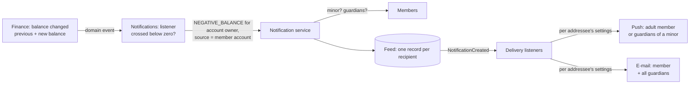

# Proposal

## Why

Klabis can deliver web push and e-mail, but nothing tells members about things that concern them: `PushNotifications.send` has no callers and e-mail only covers the welcome and password-setup messages. Members want one place in the app where they see what happened and a say in which notifications also reach them by push or e-mail ([#28](https://github.com/zabiny/klabis/issues/28)). Notifications about a minor must reach all of the minor's legal guardians ([#354](https://github.com/zabiny/klabis/issues/354)), and the first concrete notification members asked for is a negative balance on their financial account ([#27](https://github.com/zabiny/klabis/issues/27)). This is step 2 of the core/MVP plan; later steps (training groups [#271](https://github.com/zabiny/klabis/issues/271), [#120](https://github.com/zabiny/klabis/issues/120), [#90](https://github.com/zabiny/klabis/issues/90), [#330](https://github.com/zabiny/klabis/issues/330)) add their own notification types on top of this module.

## What Changes

- **Notification feed.** Every notification is stored for each of its recipients. A bell in the top bar shows the number of unread notifications and opens the "Notifikace" page with the user's notifications, newest first. Opening a notification marks it read and navigates to the page it refers to. "Označit vše jako přečtené" marks all read. Notifications cannot be deleted one by one; they disappear 90 days after they were created.
- **Who receives what.** Each notification type decides its recipients in code (for this change: the member the notification is about). A user only ever sees notifications addressed to them, so management notifications (for example to event managers or to trainers of a group) will reach only those people when such types are added.
- **Notification settings.** A new main-menu entry "Nastavení" (desktop sidebar; on mobile the settings are reached from the feed page, the bottom navigation stays unchanged) opens a settings page with the tab "Nastavení notifikací". The tab holds the existing push device management and a new matrix notification type × channel (push, e-mail) with per-type defaults. The feed always receives every notification; the matrix governs only push and e-mail. The tab is always available; the device part is hidden when the server has no push configuration. The feed page links to it.
- **Minors.** A minor's settings are managed by their legal guardians, each guardian sees a section per child in their own notification settings. For a notification about a minor: the minor and every legal guardian get it in their feed; e-mail (per the minor's settings) goes to every legal guardian and to the minor's own e-mail if set; push (per the minor's settings, off by default) goes to every legal guardian and never to the minor. When the member turns 18, they take their settings over. Guardianship becomes a ReBAC relation `legalGuardianOf`, which authorises a guardian to change the child's settings.
- **Negative balance notification ([#27](https://github.com/zabiny/klabis/issues/27)).** When a member's balance drops from zero or above to below zero, for whatever reason (registration payment, finance-manager charge, yearly membership fee, reversal), the member is notified once. Push text names no amount; feed and e-mail show the new balance. Defaults: e-mail on, push on (push off for minors). Finance managers are not notified.
- **E-mail** is sent immediately after the triggering change commits; no digest yet. Welcome and password-setup e-mails are not notifications and stay unchanged.
- The home-page "Notifikace" panel that led to the device settings is removed; the bell and the "Nastavení" menu entry replace it.

## Capabilities

### New Capabilities

- `notifications`: the in-app notification feed (bell, unread count, read state, retention), the notification settings matrix and its defaults, delivery over push and e-mail according to the settings, and how notifications about a minor are routed to the minor and their legal guardians.

### Modified Capabilities

- `push-notifications`: the device settings move from the home-page "Notifikace" entry to the "Nastavení notifikací" tab under "Nastavení"; the page is shown even without server push configuration (device part hidden); the test notification opens the new settings tab.
- `legal-guardians`: "Notifications About A Minor Reach Their Guardians" is extended from e-mail only to feed, e-mail and push, following the rules above.
- `member-accounts`: new requirement that the member is notified when their balance drops below zero.
- `application-navigation`: new "Nastavení" main-menu entry and the notification bell in the top bar.

## Impact

- **Backend, `notifications` module:** new aggregates for the notification and for per-user notification settings, a notification service with recipient routing that publishes `NotificationCreated`, delivery listeners for push and e-mail, listener for the finance event, e-mail templates, daily retention job (`@Scheduled`, moves to Quartz once `introduce-quartz-scheduler` lands; this change does not wait for it). Flyway migration for the new tables.
- **Backend, `finance` module:** `MemberAccount` publishes a balance-changed domain event carrying the previous and new balance. Finance gains no dependency on notifications.
- **Backend, `members` module:** public API gains the lookup of a member's legal guardians (with e-mails) and whether a member is a minor. `LegalGuardianGroupRelationshipSource` also grants the new relationship authority `LEGAL_GUARDIAN_OF` over each minor of the guardian's groups (`common.users.Authority`, target `MEMBER`, specific only).
- **API:** `docs/openapi/spec/notifications.yaml` gains the feed, unread count, mark-read and one settings-update operation for a given member, allowed to the member themself or to their legal guardian.
- **Frontend:** bell with unread count in `Layout`, new feed page on `/notifications`, settings page with the "Nastavení notifikací" tab (moves the current `NotificationSettingsPage`), removal of the home-page panel.
- **Known gap:** legal guardians cannot open a minor's financial account today ([#451](https://github.com/zabiny/klabis/issues/451)), so the guardian's feed item about a minor's negative balance links to the minor's detail page instead.
