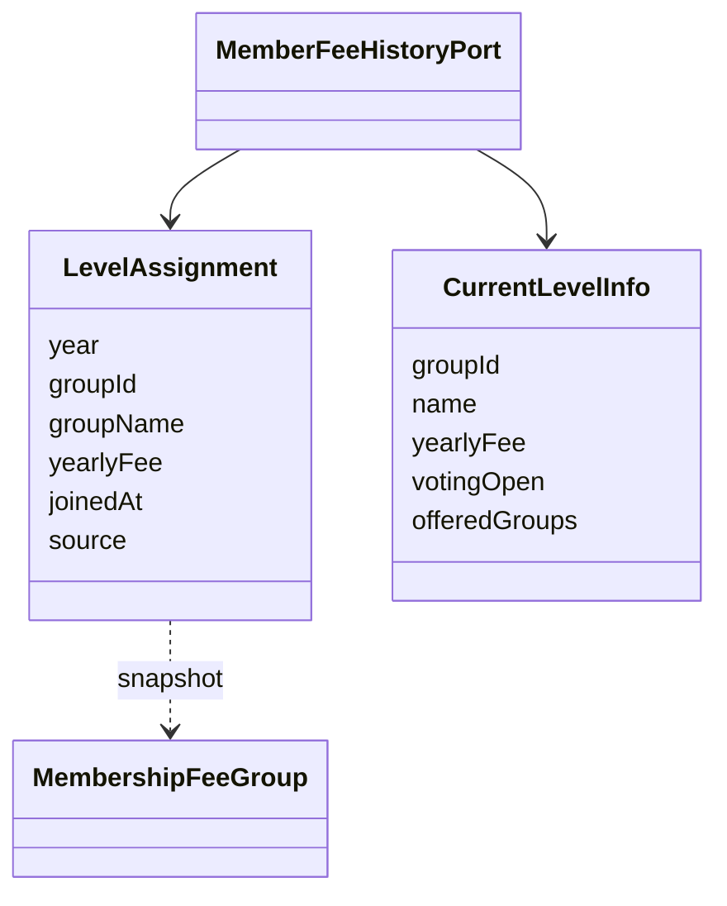

# Design

## Context

See proposal.md for motivation. Implemented **after** `rename-fee-tier-to-fee-type`, so all names below are the post-rename ones (`MembershipFeeType`, `chooseFeeType`, `/api/membership-fee-types`). `MembershipFeeGroup` (published type of one year) keeps its name.

Current state:
- The member's page (`/members/:memberId/fee-history`) renders `MemberFeeSection` (status + link) and the history table. The link leads to `MemberFeeChoicePage` (`/members/:memberId/fee-choice/:year`), which builds the `fee-summary` URL by hand and renders radio cards without prices.
- `feeSummary` link on `fee-history` is added for everyone who may read the history, with the year from `relevantFeeYear` (active campaign year, else latest not-past campaign year, else current year). `chooseFeeType` / `removeChoice` templates exist only while voting is open and the caller has `MEMBERS_EDIT_PROFILE` (owner or guardian); an administrator with only `MEMBERS_MANAGE` receives the summary without templates.
- History entries (`FeeAssignmentResponse`) carry year, group id/name, joined date and source — no price. The published group already stores `yearlyFeeSnapshot`.

## Goals / Non-Goals

**Goals:**
- One place on the member's page to see and decide the membership fee type, with prices.
- The section exists only when the member may act on it and a campaign is active; this is decided by the backend, not by frontend guesswork.
- History shows the price paid per year.

**Non-Goals:**
- Detailed display of the current type outside the history table (deferred, per issue).
- Changing sanctions, deadlines, emergency assignment or administrator pages.
- The unused `GET /api/members/{id}/fee-choice/{year}` resource stays as it is (not part of this change).

## Decisions

### D1: HAL link controls the section; frontend does not decide visibility

The `feeSummary` link on `fee-history` is added only when **all** hold: a campaign is active (`findActiveCampaign` present) and the caller may choose for the member (member themself or guardian with the choice right — the same check that gates the `chooseFeeType` affordance). The link's year is the active campaign's year. `MemberFeeSection` renders only when the link is present and follows it; it no longer builds URLs.

Alternatives: (a) keep the link for everybody and hide in the frontend by template presence — rejected, the issue asks that the backend not offer the section, and administrators would still receive data they cannot act on; (b) deny `fee-summary` to administrators altogether — rejected, would be a breaking authorization change for an endpoint that stays accessible to `MEMBERS_MANAGE` for reading.

Active campaign includes the period after the deadline until the campaign is closed, so the locked/closed-voting states in the spec are rendered by the same section. `relevantFeeYear` is still used elsewhere; the history postprocessor stops using it.

### D2: Offered types with prices travel in the summary payload

`MemberFeeSummaryResponse` gains `offeredGroups` (id, name, yearlyFee), filled only while voting is open. The `chooseFeeType` template keeps its inline options (id → name) as the form contract; the frontend takes the price from `offeredGroups` by id.

Alternative: put the price into the option prompt text — rejected, the backend would format Czech currency strings and the UI could not style or reformat them. Alternative: add a second HAL link to a groups collection — rejected as an extra request for 3–5 items.

### D3: Choice UI is merged into the section; separate page is removed

The radio-card selection, pre-selected recommended type, withdraw action and locked card move from `MemberFeeChoicePage` into `MemberFeeSection`. The page, its route and `/fee-choice/:year` SPA path are deleted. After a successful choose/withdraw the page data is refetched (existing mutation invalidation) so the section and history update in place.

### D4: History price is the published snapshot

`FeeAssignmentResponse` gets `yearlyFee`, read from the published group's `yearlyFeeSnapshot` via the history service (`LevelAssignment` read model gets the fee). Shown as a new "Cena" column (`labels.memberFee`), formatted as in other money columns. No data migration: the snapshot already exists.

### D5: Terminology sweep in UI texts

`labels.ts` (catalog, actions, section titles, error type labels, field labels such as "Tier poplatku", "Tiery") and Czech messages in backend error mapping switch to "typ členského příspěvku" in the right grammatical form. Identifier names are handled by the rename change, so this change touches texts only.

### Domain model

No aggregate changes. Read models only:

| Element | Change |
|---|---|
| `LevelAssignment` | added `yearlyFee` |
| `CurrentLevelInfo` | added offered groups (id, name, yearlyFee) while voting is open |
| `MembershipFeeGroup` | unchanged |

### API (format after change)

| Endpoint | Change |
|---|---|
| `GET /api/members/{memberId}/fee-history` | `assignments[].yearlyFee` (number, CZK) added. HAL links: `self`, `member`, `feeSummary` — `feeSummary` present only with an active campaign and when the caller may choose; its year is the active campaign's year |
| `GET /api/members/{memberId}/fee-summary/{year}` | `offeredGroups[]` (`id`, `name`, `yearlyFee`) added, present only while voting is open. Links `self`, `group` unchanged. Templates `chooseFeeType` (inline options of the published groups) and `removeChoice` unchanged |
| `GET/POST/DELETE /api/members/{memberId}/fee-choice/{year}` | unchanged (UI no longer uses a dedicated page) |

Both response schemas change in `docs/openapi/spec/membershipfees.yaml`; bundle and frontend types are regenerated.

### Glossary

- **Typ členského příspěvku (membership fee type):** catalog item with a name, yearly fee and payment rules; formerly "tier"/"level".
- **Published type (`MembershipFeeGroup`):** snapshot of a type for one campaign year.
- **Sekce „Členský příspěvek":** part of the member's "Členské příspěvky" page where the type is chosen.

## Risks / Trade-offs

- [Old bookmarks to `/members/:id/fee-choice/...` break] → accepted; nothing else links to it, the member page is the entry point.
- [A guardian/owner check duplicated between the link condition and the affordance] → reuse the one existing authorization evaluation instead of a second implementation; cover both with a `@WebMvcTest` (member, guardian, administrator, other member).
- [`offeredGroups` and template options can drift] → both are built from the same `listGroupsForYear(year)` call in one postprocessor.
- [Terminology sweep misses a text] → check `labels.ts`, backend messages and E2E feature files with a final grep for `tier`/`úroveň` (excluding `MembershipFeeGroup` comments).
