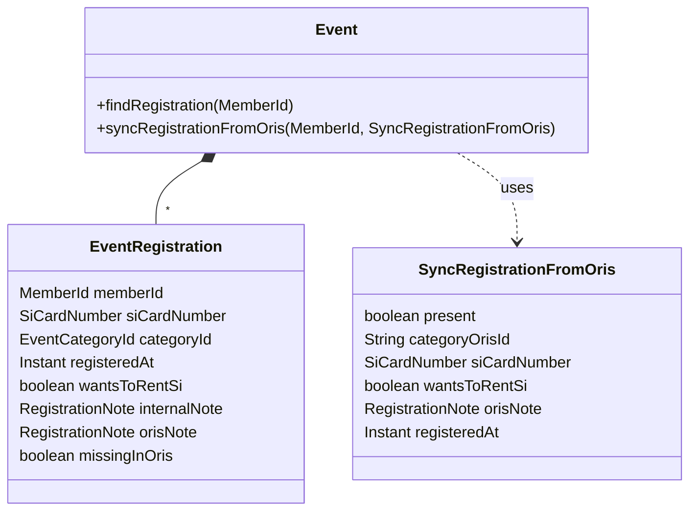

# Design

## Context

The `sync` engine pairs one Klabis entity with one external record through a `SynchronizationAdapter` (read local / read external / apply / create), decides direction from hashes against a baseline, raises conflicts for local changes a pull-only adapter cannot push, and keeps history and retries (ADR-005, `data-synchronization` spec). Existing ORIS adapters: `OrisEventSyncAdapter` (events, pull-only + creates local), `DisciplineSyncAdapter`, `MemberSyncAdapter`, with discovery jobs (`MemberDiscoveryJob`, `DisciplineDiscoveryJob`) that subtract already-paired external ids and call `pullAndEnroll` per new id.

A registration is a value object inside the `Event` aggregate; one registration per (event, member) is enforced by `uk_event_registrations_event_member`. `oris-client` already exposes `getEventEntries(eventId, clubId)` returning `EventEntry` (`ClubUserID`, `ClassID`, `SI`, `RentSI`, `Note`, `CreatedDateTime`, …). In ORIS a person has at most one entry per event. A member's MEMBER/ORIS sync record uses the ORIS club-membership id (`ClubMember.id` = `EventEntry.ClubUserID`) as its external id.

Constraints from the engine that shape this design:
- `uq_sync_record_target (entity_type, entity_id, external_system)` and `uq_sync_record_external (external_system, external_id, entity_type)` hold for RETIRED records too — a pairing is for life.
- `findByExternalReferences` returns RETIRED pairings as well.
- An adapter exception that is neither I/O nor `RetryableSyncFailureException` fails the record terminally on the spot.

## Goals / Non-Goals

**Goals:**
- ORIS → Klabis synchronisation of club members' entries on ACTIVE ORIS events, with no change to the engine's algorithm.
- Registrations stay accessible only through the `Event` aggregate.

**Non-Goals:**
- Klabis → ORIS (`createEntry` / `updateEntry` / `deleteEntry`) — issue #370.
- Entries of people not paired as MEMBER/ORIS (guests, unknown people).
- A dedicated UI listing all registration conflicts; the existing per-record sync screens are used.

## Decisions

### D1 — One sync record per participation, symmetric identity

| | value | why |
|---|---|---|
| entity type | `EVENT_REGISTRATION`, path segment `event-registrations` | generic `/api/{entityType}/{id}/sync` works unchanged |
| `entityId` | `"<eventId>:<memberId>"` | stable for the participation, matches `/api/events/{eventId}/registrations/{memberId}`; reachable only through `Event.findRegistration(MemberId)` |
| `externalId` | `"<orisEventId>:<clubUserId>"` | stable across delete / re-create in ORIS (one entry per person per event) |

*Alternatives:* `eventId:registrationId` — rejected: unregister + re-register creates a new identity that can never be paired again, because the old pairing (RETIRED or not) still holds the external id. ORIS entry id as external id — rejected: a re-created entry gets a new id, and the registration's pairing is for life.

The colon needs no encoding in the path segment (`pchar` allows `:`); a `@WebMvcTest` on `/api/event-registrations/{uuid}:{uuid}/sync` guards it.

### D2 — Presence is part of the projection (tombstones on both sides)

```
OrisEventRegistrationProjection {
  present: boolean
  categoryOrisId: String     (null when absent)
  siCardNumber: String
  wantsToRentSi: boolean
  orisNote: String
  @JsonIgnore registeredAt, eventId, memberId   -- carried for createLocal, never hashed
}
```

| side | absent when |
|---|---|
| local | the member has no registration for the event, **or** the registration is marked "missing in ORIS" |
| external | ORIS lists no entry for the person on the event |

An absent side is `{present=false}` with every other field null, so two absent sides are equal. Consequences, all from the unchanged engine rules:

| change | engine sees | result |
|---|---|---|
| entry deleted in ORIS | external changed | pull → `applyToLocal(absent)` marks the registration "missing in ORIS" (never deletes) |
| entry re-created in ORIS | external changed | pull → clears the mark and applies values, or creates the registration if none exists |
| member unregisters in Klabis, entry still in ORIS | local changed, pull-only | CONFLICT |
| …registrar then deletes the entry in ORIS | both absent → equal | conflict resolves itself |
| category / SI / rent / ORIS note edited in Klabis | local changed | CONFLICT |
| internal note / shared-service choices edited | not in projection | nothing |

The local mark maps to `present=false` so that a kept-but-missing registration and an absent ORIS entry compare equal; otherwise the pair could never be in step again.

*Alternatives:* throw "not found" (engine fails the record terminally, an admin must reset it for every ORIS unregistration); retire on deletion (pairing is for life, so re-entry could never be paired again); a new "deleted on the other side" conflict kind (engine change, only useful once #370 can delete outward).

### D3 — Adapter operations go through the aggregate

`OrisEventRegistrationSyncAdapter` (`events.infrastructure.orissync`, `@Application`, capabilities `pullOnlyCreating`):

- `readLocal(entityId)` → `eventRepository.findById(eventId)` → `event.findRegistration(memberId)` → projection (absent if none or marked).
- `readExternal(externalId)` → `OrisEventEntries.entriesOf(orisEventId)` (filter `ClubUserID`) → projection; resolves Klabis `eventId` (EVENT pairing of `orisEventId`) and `memberId` (MEMBER pairing of `clubUserId`) onto the ignored fields.
- `applyToLocal(entityId, p)` → `event.syncRegistrationFromOris(memberId, SyncRegistrationFromOris)`: present → create-or-update the registration from ORIS values (clearing the mark); absent → mark the existing registration missing (no-op if none).
- `createLocal(p)` → same `syncRegistrationFromOris` call, returns `"eventId:memberId"`. Covers both a brand-new registration and **adoption** of an existing Klabis registration (D5).
- `applyToExternal` → unsupported.

`Event.syncRegistrationFromOris` skips `assertRegistrationsOpen()` and the SI policy check (ORIS is fact, validation belongs to Klabis input), resolves the category by ORIS class id, and publishes the registration domain events with origin `SYNCHRONISATION`.

### D4 — Category not yet known is retryable

If `categoryOrisId` matches no category of the event, `syncRegistrationFromOris` throws `OrisCategoryNotYetSynchronisedException extends RetryableSyncFailureException`; the event's own synchronisation will normally add the category, and the engine's backoff retries the registration.

### D5 — Adoption takes ORIS values

When discovery finds an unpaired entry for a member who already has a registration, `pullAndEnroll` → `createLocal` updates that registration from ORIS (category, SI, rent, ORIS note) and keeps the Klabis registration time, internal note and shared-service choices. This is the spec's "first synchronisation after linking takes the external system's values".

### D6 — Discovery

`OrisEventRegistrationDiscoveryJob` (own cron `klabis.events.oris-entries-discovery-cron`, plus `@Scheduled(initialDelay)` like `MemberDiscoveryJob`):

1. Active EVENT/ORIS pairings → load events, keep `ACTIVE` ones.
2. Per event: `getEventEntries(orisEventId, klabis.oris.clubid)`.
3. Keep entries whose `ClubUserID` has a MEMBER/ORIS pairing (`findByExternalReferences(MEMBER, …)`).
4. Subtract `findByExternalReferences(EVENT_REGISTRATION, …)` (any status, incl. RETIRED).
5. `pullAndEnroll` each remaining id; per-entry and per-event try/catch so one failure cannot stop the run.

The on-demand action runs steps 2–5 for one event (`discoverForEvent(eventId)`), exposed as an affordance on `getEvent` for SYNC:MANAGE when the event is ACTIVE and has an active EVENT/ORIS pairing.

Already-paired registrations are kept in step by the engine's own scans (`scan-cron`, `due-scan-interval`), not by discovery.

### D7 — ORIS read cost

`getEventEntries` is not cached by `oris-client`. `OrisEventEntries` (adapter-side facade) caches per `(orisEventId, clubId)` for a short TTL (configurable, default 5 min) so a scan over N registrations of one event costs one ORIS call. A missing `klabis.oris.clubid` makes the facade throw at startup when the `oris` profile is active (fail fast, unlike the club key which is runtime data).

### D8 — Lifecycle listeners

`EventRegistrationsSyncListener` (`@PrimaryAdapter`, same pattern as `EventsSyncListener`):

| domain event | action |
|---|---|
| `MemberRegisteredForEventEvent`, `RegistrationEditedEvent`, `MemberUnregisteredFromEventEvent` with origin `MANUAL` | `markDirty(EVENT_REGISTRATION, eventId:memberId)` (no-op if not enrolled) |
| same, origin `SYNCHRONISATION` | ignored (engine's own write) |
| `EventFinishedEvent`, `EventCancelledEvent` | retire every EVENT_REGISTRATION record of the event (`findActiveByTargets` over its registrations' ids) |

The three registration events gain an `origin` (`UpdateOrigin`), as `EventUpdatedEvent` has.

## Domain Model



| Element | Change |
|---|---|
| `Event.syncRegistrationFromOris`, `SyncRegistrationFromOris` | **Added** — create / update / mark-missing from ORIS, no window or SI-policy check |
| `EventRegistration.missingInOris` | **Added** — `events.event_registrations.missing_in_oris BOOLEAN NOT NULL DEFAULT FALSE` (V001) |
| `MemberRegisteredForEventEvent`, `RegistrationEditedEvent`, `MemberUnregisteredFromEventEvent` | **Changed** — carry `UpdateOrigin` |
| `SyncEntityType.EVENT_REGISTRATION` | **Added** (`sync` module) |

## API

| Item | Change |
|---|---|
| `sync.yaml` `SyncEntityTypeParam` | + `event-registrations`; all five sync operations work for `/api/event-registrations/{eventId}:{memberId}/sync…` |
| `RegistrationDto` | + `missingInOris` (boolean, read-only) |
| `RegistrationSummaryDto` | + `missingInOris` — field security `EVENTS_REGISTRATIONS` + owner-visible + coordinator target id (same as `registrationTime`) |
| `getRegistration` response links | + `syncState` → `getSyncState` for SYNC:MANAGE when the registration is enrolled |
| `getEvent` templates | + `discoverOrisRegistrations` → new `POST /api/events/{eventId}/oris-registrations/discovery` (SYNC:MANAGE, 204), offered per D6 |

## Configuration

| property | default | meaning |
|---|---|---|
| `klabis.oris.clubid` | none (required with `oris` profile) | ORIS numeric club id for `getEventEntries` |
| `klabis.events.oris-entries-discovery-cron` | `0 30 * * * *` | discovery schedule |
| `klabis.events.oris-entries-cache-ttl` | `5m` | D7 cache |

## Glossary

| Term | Meaning |
|---|---|
| ORIS entry | A participant's registration for an event in ORIS. |
| Participation | One member on one event — the unit paired between Klabis and ORIS, whether or not either side currently holds a registration. |
| Tombstone | A projection saying "no registration on this side" (`present=false`). |
| Missing in ORIS (V ORISu nenalezena) | Mark on a Klabis registration whose ORIS entry has disappeared. |
| Adoption | Pairing an existing Klabis registration with a newly found ORIS entry; ORIS values win. |

## Risks / Trade-offs

- [Every Klabis edit of a synchronised field becomes a conflict until #370] → accepted by the user; conflicts resolve themselves when the registrar mirrors the change in ORIS.
- [A conflict resolved with "take ORIS values" discards a member's ORIS note] → noted in #370, which turns this into an outward push.
- [Discovery calls ORIS once per ACTIVE ORIS event per run] → hourly default, D7 cache; acceptable for a club-sized number of events.
- [A member whose MEMBER pairing is missing never gets their ORIS entries] → by design ("only users existing in Klabis"); once paired, the next discovery picks them up.
- [Entries brought in can violate the event's SI policy] → deliberate; validation applies to Klabis input only.

## Migration Plan

No data migration. Enabling the `oris` profile with `klabis.oris.clubid` set starts discovery; existing registrations on ORIS events are adopted on the first run (ORIS values win, D5).
