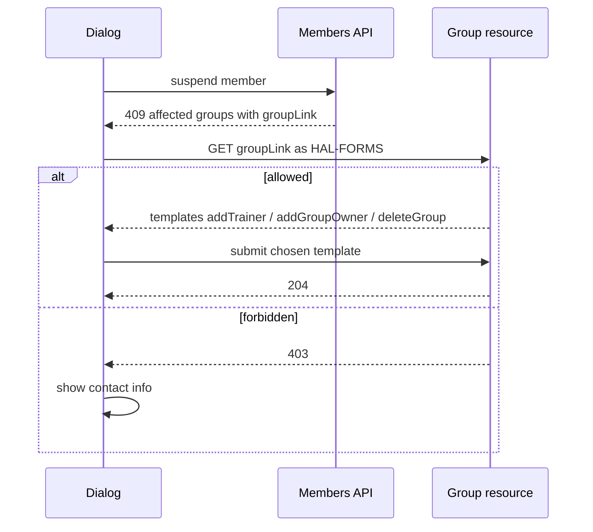
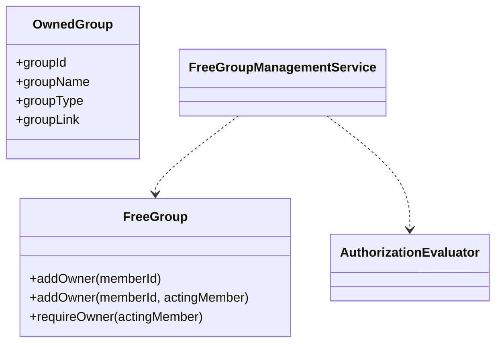

# Design

## Context

See proposal.md, section Why, for the motivation. Current state (verified in code):

- `ManagementService.suspendMember` asks every `MemberOwnedGroupsPort` (one adapter per group module: training, free, legal guardian) for groups where the member is the last owner/trainer/guardian, checks the finance snapshot, and throws `SuspensionBlockedException`. `MembersExceptionHandler` turns it into a plain-JSON 409 (`SuspensionBlockedWarning` with `debt` and `groups.affectedGroups[{groupId, groupName, groupType}]`) - not HAL, no links.
- `suspendMember` requires `MEMBERS_MANAGE` (`x-klabis-authority`). `MEMBERS:UPDATE`, used by the members spec, is not in the `Authority` enum - `MEMBERS:MANAGE` is the only matching authority. The user-stated "MEMBERS:MANAGE" is therefore right and the spec text was stale.
- Training groups: `addTrainer`, `deleteTrainingGroup` carry `x-klabis-authority: GROUPS_TRAINING`; `getTrainingGroup` is allowed for GROUPS:TRAINING holders and group members (imperative), and its self link already offers `addTrainer` (remote member options) and `deleteTrainingGroup`. A trainer need not be a trainee.
- Free groups: `FreeGroupController` operations have no `x-klabis-authority`; ownership is enforced inside `FreeGroup` (`requireOwner`) from `@ActingMember`. `getGroup` is allowed for owners and members only. The self link offers `addGroupOwner`/`deleteGroup` only to owners. Owner promotion requires the promoted person to be a current member (`CannotPromoteNonMemberToOwnerException`). The existing group detail page already renders the `addGroupOwner` template (member picker).
- Legal guardian groups ("family groups" in older specs/the old spec text; ADR-008): cannot be created or deleted by hand (legal-guardians spec). Guardians are replaced as a whole through `setLegalGuardianGroupGuardians` (`MEMBERS_MANAGE`), UI on the "Zákonní zástupci" page. The current dialog and its unit test offer "Rozpustit skupinu" for them - contradicts the specs.
- Dependency direction is groups -> members (ports in members, adapters in groups); the members module must not reference group APIs.
- Dialog consumers: `MemberDetailPage` and `MembersPage` via `useSuspendMemberAction`; the 409 is delivered through `HalFormDisplay.onSubmitError`.

## Goals / Non-Goals

**Goals:**
- Make "Určit nástupce" and "Rozpustit skupinu" work from the dialog, offered only where the caller is allowed to act.
- Keep the members module free of knowledge about group-module APIs.
- Reuse existing group templates, forms and pickers.

**Non-Goals:**
- Dissolving training groups or legal guardian groups.
- Changing the other free-group operations (rename, invite, remove owner/member) - they stay owner-only.
- Notifying members of a dissolved group (existing deletion behavior is unchanged).
- Per-group audit of who dissolved what (no such audit exists for owner deletions either).

## Decisions

### D1: How MEMBERS:MANAGE coexists with "owner only" on free groups

The owner check is not expressible declaratively: `x-klabis-authority` is evaluated by the method interceptor *before* the aggregate and combines with it as AND, so `x-klabis-authority: MEMBERS_MANAGE` on `addGroupOwner`/`deleteGroup` would lock out ordinary owners (the very reason groups.yaml leaves these 13 operations without it), and `x-klabis-owner-visible` compares a path *member* id with the caller, not a group-owner set.

Options:

| Option | Description | Verdict |
|---|---|---|
| A | Separate admin-only operations (new endpoints with `x-klabis-authority: MEMBERS_MANAGE`) | Clean declarative authorization, but two endpoints and two templates for one action; frontend must choose between them. Rejected. |
| B | Keep the two operations; the application service allows `owner OR MEMBERS_MANAGE` via `AuthorizationEvaluator.has(MEMBERS_MANAGE)`; the postprocessor offers the affordances under the same rule. No `x-klabis-authority`. | **Chosen** - smallest change, one endpoint/template, consistent with ADR-010 rule "application code asks the evaluator". |
| C | Model group ownership as a relationship grant (new target type GROUP, a SPECIFIC authority from `FreeGroupRelationshipSource`) and declare `x-klabis-authority: [MEMBERS_MANAGE, <owner authority>]` + `x-klabis-target-id: GROUP` | The ADR-010-pure answer, makes affordances declarative, but needs a new target type, authority, source and migrating the aggregate's owner checks. Out of proportion for two operations; noted as the follow-up if more admin overrides appear. |

Consequences of B:
- Affordances are not filtered by `klabisAfford` (no guard on the operation), so the postprocessor must gate them itself with `owner OR has(MEMBERS_MANAGE)` - same helper as the service (one private predicate each side, covered by a test that both agree).
- The acting caller may have no member profile (e.g. the bootstrapped `admin` account). `@ActingMember` fails without a profile, so the three operations switch to `@ActingUser CurrentUserData` (`memberId` nullable). Owner semantics: owner iff `memberId != null && group.isOwner(memberId)`.
- Domain: `FreeGroup` gets actor-free variants used after the service decided (`addOwner(memberId)` keeps the "must be a current member" rule; deletion needs no actor). The owner-check overloads stay for the owner path. Alternative of passing a `isManager` flag into the aggregate was rejected - the aggregate knows nothing about authorities.
- `getGroup` also admits `MEMBERS_MANAGE` holders (read of name, owners, members; no pending invitations, no invitation management) - needed so the dialog can discover templates and the member picker. MEMBERS:MANAGE already reads every member's data, so no new data class is exposed. A manager gets exactly the `addGroupOwner` and `deleteGroup` templates on the self link (not rename/invite).
- Side effect, accepted by the user decision: a MEMBERS:MANAGE holder may add an owner to / dissolve any free group at any time, not only inside a suspension flow. It is the same trust level as managing all members.

### D2: What happens on dissolution

- Free group: existing deletion semantics (group, memberships removed; pending invitations cancelled). Confirmation dialog in the UI before the call.
- Legal guardian group: never dissolved (minors would be left without a guardian group). Two resolutions: set another guardian ("Určit nástupce" navigates to the group's page in "Zákonní zástupci", existing guardian form, no second form embedded) or suspend the whole group (D6).
- Training group: never dissolved from here (spec: successor required).

### D3: Who can be the successor, how it is picked

| Group type | Successor | Picker |
|---|---|---|
| Training | any active member (trainers need not be trainees); a trainee promoted to trainer leaves the trainee list (existing rule) | `addTrainer` template, existing remote member options |
| Free | a current member of that group (existing rule) | `addGroupOwner` template, same picker as the existing group detail page |
| Legal guardian | another guardian (member or new non-member), or no successor at all when the whole group is suspended (D6) | existing guardian form on the group page |

"Group without other members" (free): `addGroupOwner` can never succeed, so the dialog hides "Určit nástupce" and offers only dissolve. The dialog learns it from the group resource (`members` empty), not from a separate flag. Picking the member being suspended again is harmless: the group stays blocked and the final resubmission reports it.

### D4: Dialog behavior after resolution

- Each row has local state `unresolved | resolved`; an action's success marks the row resolved (checkmark, buttons hidden). No refetch of the blockers - cheap and the final resubmission is authoritative.
- A row resolved by "Pozastavit celou skupinu" differs from the other resolutions: nothing is executed when it is chosen; it only adds the group to the stored request (D6) and is executed atomically by the final resubmission. It can be undone ("Zrušit") until then.
- Multiple groups: rows are independent; the debt dialog continues to open separately when debt is also reported.
- When all rows are resolved the dialog shows a primary "Ukončit členství" button that resubmits the original suspension request (reason, note kept by `useSuspendMemberAction`); while any row is unresolved it is absent.
- Resubmission is explicit, not automatic: it is a destructive step and the user should see the group changes happened first. Automatic resubmit rejected (surprising side effect, harder to test). On a repeated 409 the dialog is rebuilt from the fresh response; on success the same refresh as the normal suspension happens (detail page / list).
- `HalFormDisplay.onSubmitError` currently gets only the error; it must also pass the submitted values so the hook can keep them (small change, no behavior change for other users).

### D5: Discovery - HAL affordances instead of buttons hardcoded by type

The 409 body (plain JSON, not HAL) cannot carry templates, and assembling group affordances in the members module would invert the module dependency. Instead each affected group carries a link to its own resource:

- The group-module adapters implementing `MemberOwnedGroupsPort` build the link with their own `linkTo(methodOn(...))` and return it in `OwnedGroup` (new field); `MembersExceptionHandler` copies it to `AffectedGroup.groupLink`.
- The UI renders per row: "Určit nástupce" iff the group resource offers `addTrainer` or `addGroupOwner` (free group: and has other members); "Rozpustit skupinu" iff it offers `deleteGroup` (only free groups ever do, since the training `deleteTrainingGroup` template is deliberately ignored by the dialog); 403/missing templates -> the row shows the contact text. For `LEGAL_GUARDIAN` rows the UI shows, based on the type, the navigation action and "Pozastavit celou skupinu"; the group resource (`getLegalGuardianGroup`, MEMBERS:MANAGE) supplies the minors' names for the confirmation.
- A GROUPS:TRAINING-only rule needs no code of its own: `getTrainingGroup` already requires GROUPS:TRAINING or membership and `addTrainer` is guarded by `x-klabis-authority: GROUPS_TRAINING`. A MEMBERS:MANAGE-only admin gets 403 -> contact text. "Whom to contact" is a fixed text ("správce tréninkových skupin"), not a list of people (see Open Questions).

### D6: Suspending the whole legal guardian group

**What it means.** A legal guardian group has two kinds of people: guardians (owners) and minors (members, only minors). The blocker fires only when the suspended member is the *sole* guardian of a group that has minors - a group with another guardian never blocks. So "whole group" = the suspended guardian + all minors of the group; there are no other guardians to include. The group (and its guardian link) is not deleted; it simply consists of suspended people.

**One operation, not one by one.** The cascade is a single transactional operation inside `ManagementService.suspendMember`: all-or-nothing. One-by-one (admin suspends each minor separately) was rejected: it leaves the guardian suspended with active minors without a guardian between steps, and each minor would first hit its own checks in an arbitrary order.

**Atomicity and other blockers.** The service collects the member set (guardian + minors of the requested groups) and runs the existing checks for *each* member before changing anything: negative balance, and last-owner status of other groups (excluding the cascaded legal guardian groups themselves). If any member is blocked nothing is suspended and the 409 lists every blocker, attributed to its member. The same transaction suspends all members, so a failure midway rolls back everyone. Events (`MemberSuspendedEvent`) and user-account suspension are executed per member as today.

**Reason and note.** The same reason and note apply to all suspended members (one form, one decision); `suspendedBy` is the acting admin. Alternative of a different reason per minor rejected as needless.

**Blockers of dependents are not resolvable in the dialog.** They concern other members (a minor's debt, a minor owning a free group). The dialog only reports them; the admin undoes the cascade for that group or fixes the cause elsewhere, then retries. A minor who is the last owner of a free group could technically be handled by the same row actions, but this is rare and deferred (see Open Questions).

**Confirmation.** Choosing "Pozastavit celou skupinu" first shows a confirmation listing the guardian and the minors (names from the group resource). Confirming marks the row; the final "Ukončit členství" executes. No second confirmation at execution.

**Authorization.** The existing `suspendMember` authority `MEMBERS_MANAGE` (held over everything) covers all members, so no new authority is needed. The service still asks `has(MEMBERS_MANAGE, member(minorId))` per cascaded member (ADR-010: use target form, a future targeted grant keeps working).

**API shape.**

| Option | Verdict |
|---|---|
| Optional list `cascadeGroupIds` (legal guardian group ids) on `SuspendMembershipRequest` of the existing `suspendMember` | **Chosen**. The dialog's final resubmission already replays this request; per-group choice is exact; server validates that each id is a legal guardian group the member is sole guardian of (else 400). Absent/empty = today's behavior. |
| Boolean flag | Coarser (all groups or none); the list costs nothing extra. |
| New endpoint (suspend legal guardian group) | A second route for the same business operation with its own blockers/409 body; rejected. |

**Invariant (alternative handling).** Today nothing prevents a suspended member from staying a guardian: the guardian picker excludes suspended members, but existing guardian links are untouched, and no listener reacts to `MemberSuspendedEvent` in the legal guardian module. For a group with other guardians the suspended person would stay listed as guardian (and, via `LegalGuardianGroupRelationshipSource`, keep delegated edit rights over the minors, if the account were still usable) - this exists today independently of this change. Recommendation: a listener in `members.legalguardiangroup` reacts to `MemberSuspendedEvent` and removes the member from the guardians of every group that still has other guardians (the existing `changeGuardians` handles renaming and merging). A group whose sole guardian is suspended is left alone (its minors are suspended together, D6, or a successor was set before). Resume does not restore the link. If the user does not choose the cascade and sets a successor via the group page, the old guardian is typically replaced there; if they keep both, the listener removes the suspended one. Alternative - a domain invariant refusing to save a group with a suspended guardian - was rejected: it would break resumption and past groups.

## Domain model changes

| Element | Change |
|---|---|
| `FreeGroup.addOwner(memberId)` | Public actor-free variant already inherited from the shared group base; the "must be a current member" check moves into it so both paths share it. The actor overload delegates after `requireOwner`. |
| `FreeGroupManagementService.addOwner` / `deleteGroup` | Take the caller (`userId`, nullable `memberId`); allowed iff owner or `has(MEMBERS_MANAGE)`, else `GroupOwnershipRequiredException` (existing 403). |
| `OwnedGroup` (members root, public) | Add `groupLink` (URI of the group resource). |
| `ManagementService.suspendMember` | Accepts the requested legal guardian group ids; builds the member set; checks every member; suspends all in one transaction. |
| `SuspensionBlockedException` | Carries blockers per member (the requested member plus dependents). |
| Legal guardian module listener | On `MemberSuspendedEvent` removes the member from guardians of groups with other guardians. |
| Aggregates `TrainingGroup`, `LegalGuardianGroup` | No new rules; `LegalGuardianGroup.changeGuardians` reused. |

## REST API (spec-first: `docs/openapi/spec`, then `openapiBundle` + `npm run openapi`)

**Members (`members.yaml`)**

- `suspendMember` request `SuspendMembershipRequest`: new optional `cascadeGroupIds` (array of uuid; ids of legal guardian groups whose minors are suspended together with the member). The HAL-FORMS template for `suspendMember` stays as is for the form (the property is set by the dialog, hidden in the form via `x-klabis-halforms-access: NONE`); 400 when an id is not a group of which the member is the sole guardian. Description of `suspendMember` updated (atomic, same reason/note).
- 409 `SuspensionBlockedWarning`: new optional `dependentMembers` array of `{memberId, memberName, debt, groups}` - blockers of the cascaded members; `debt`/`groups` keep their shape. Nothing was suspended when it is present.
- `suspendMember` 409 body `SuspensionBlockedWarning.groups.affectedGroups[]`: new required property `groupLink` (string, uri; absolute URL of `GET /api/groups/{id}`, `/api/training-groups/{id}` or `/api/legal-guardian-groups/{id}` by `groupType`). No new endpoints, no HAL link/template names; update the `AffectedGroup`/`LastOwnerWarning` descriptions (legal guardian groups are never dissolved).

**Groups (`groups.yaml`)**, all existing endpoints:

| Operation | Change |
|---|---|
| `GET /api/groups/{id}` (`getGroup`) | Also allowed for callers with MEMBERS:MANAGE (documented in description; no `x-klabis-authority`, imperative like today). Self-link templates for a manager: `addGroupOwner`, `deleteGroup` only. |
| `POST /api/groups/{id}/owners` (`addGroupOwner`) | Owner or MEMBERS:MANAGE; `x-spring-provide-args` `@ActingUser CurrentUserData` replaces `@ActingMember`. Request `{memberId}` unchanged; 400 when not a current member. |
| `DELETE /api/groups/{id}` (`deleteGroup`) | Same access and argument change. |
| Training group operations | Unchanged (`addTrainer`, `getTrainingGroup`). |
| `setLegalGuardianGroupGuardians` | Unchanged. |

Update the module header comment of `groups.yaml` (authorization pattern b now has two documented exceptions).

## Risks / Trade-offs

- [Owner/manager rule duplicated in service and postprocessor] -> a test asserts the offered affordance and the actual call agree for owner, manager, plain member.
- [MEMBERS:MANAGE gains standing power over free groups] -> explicit user decision; documented in ADR; option C is the path to a declarative model.
- [Group changed by someone else between GET and submit] -> the action's normal error is shown in the row (toast); final resubmission is authoritative.
- [The dialog needs one extra request per row] -> at most a handful of groups; no batching (design principles).
- [Suspension rows for legal guardian groups send the user away from the dialog when choosing a successor] -> the dialog stays reachable by repeating the suspension; acceptable for a rare case.
- [Cascade suspends minors, which is hard to reverse in bulk] -> explicit confirmation listing every person; resume is per member.
- [Long transaction for a large family] -> a group has a handful of minors; no concern at club size.
- [Removing a suspended guardian changes group names and may merge groups] -> reuses the existing guardian-change behavior; resume does not restore (documented).

## Migration Plan

No data migration. API change is additive (`groupLink`, wider access). Deploy backend and frontend together; the old frontend ignores the new field. Rollback = redeploy previous version.

## Open Questions

1. **Authority name.** Recommendation (and applied): MEMBERS:MANAGE. MEMBERS:UPDATE does not exist (`Authority` enum, `suspendMember`); the members spec is corrected. Two scenarios in `non-functional-requirements` still say MEMBERS:UPDATE - clean up separately?
2. **Legal guardian groups.** ANSWERED by the user: never dissolved; offer "Pozastavit celou skupinu" (D6). "Určit nástupce" (link to the group page) is kept beside it - confirm that both are wanted.
3. **Contact info for training groups.** Recommendation: fixed text naming the role (správce tréninkových skupin). Alternative: list the users holding GROUPS:TRAINING (needs a new query across modules; not recommended at club size).
4. **Manager view of free groups.** Recommendation: MEMBERS:MANAGE may open any free group's detail (read-only plus add-owner/delete). Alternative: keep the detail closed and give the dialog the member list in the 409 (needs member names in the groups adapter and a new owner-candidates option source). Confirm the broader read access is acceptable.
5. **Free group picker.** The spec says only current group members are candidates (and owners hidden); today's picker is the generic member list and a wrong choice is rejected by the server. Reuse as is (recommended) or restrict options on the server in this change?
6. **Resolving a dependent minor's own blocker in the dialog** (e.g. minor is sole owner of a free group): recommendation - report only, not resolvable from the dialog (rare).
7. **Invariant for suspended guardians.** Recommendation (planned in slice 3): on suspension remove the member from guardian lists of groups with other guardians; resume does not restore. Alternatives: do nothing in this change (pre-existing gap), or restore on resume. Confirm scope.
8. **Cascade to groups where the guardian is not the sole guardian.** Recommendation: not offered (such groups never block; the minors keep their other guardian). Confirm.
9. **Cascade when the minor already is suspended.** Recommendation: skipped silently (already suspended minors are not an error).
