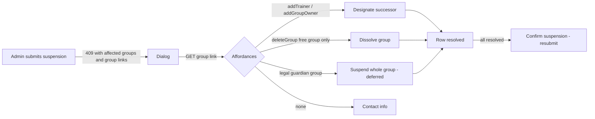

# Proposal

## Why

When suspending a member who is the last owner of a group, the "Varování: Správce skupin" dialog lists the blocking groups but its "Určit nástupce" and "Rozpustit skupinu" buttons do nothing. The admin has to leave the dialog, find the group elsewhere and resolve it by hand - and for free groups an administrator who is not an owner cannot do that at all, because group operations are owner-only.

## What Changes

- The suspension-warning dialog becomes actionable: for each blocking group the admin can designate a successor or (free groups only) dissolve the group, directly from the dialog.
- Which actions a row offers is driven by what the caller may actually do with that group (HAL-FORMS affordances of the group resource); a row with no available action tells the admin whom to contact.
- Training groups: successor = new trainer; offered only to a caller who also holds GROUPS:TRAINING. Dissolving is never offered.
- Free groups: a user with MEMBERS:MANAGE may, besides the group owners, add an owner to / dissolve any free group (needed for this flow, and to view the group in order to do so).
- Legal guardian groups: the dialog offers "Pozastavit celou skupinu" - the member and all minors of the group are suspended together in one atomic operation (all or nobody), with the same reason and note; "Určit nástupce" stays as a link to the existing "Zákonní zástupci" group page. Dissolving is never offered (these groups cannot be deleted by hand). **BREAKING (UI only)**: the current dialog shows "Rozpustit skupinu" for legal guardian groups - it is removed.
- Suspension request gains an optional list of legal guardian groups to suspend with the member; blockers of the dependent minors (negative balance, last owner of another group) block the whole operation and are reported per member.
- A suspended member no longer stays a legal guardian of groups that have other guardians (removed on suspension), so a suspended person never keeps acting as a guardian.
- After all listed groups are resolved the admin finishes suspension with an explicit confirmation button in the dialog (no automatic resubmission).
- The suspension-blocked response links each affected group to its resource so the dialog can discover available actions.
- The Membership Suspension requirement named a non-existent permission `MEMBERS:UPDATE`; it is corrected to `MEMBERS:MANAGE` (what the operation actually requires).

## Capabilities

### New Capabilities

None.

### Modified Capabilities

- `members`: Membership Suspension - in-dialog resolution of group ownership blockers, per-type rules, finishing the suspension, permission name correction.
- `legal-guardians`: Suspension of a legal guardian - suspended guardian is removed from guardian lists of groups with other guardians.
- `user-groups`: Warning on Last Owner Deactivation (per-type resolution options, who may resolve), Group Owner Management and Group Deletion (MEMBERS:MANAGE holders may add an owner to / dissolve a free group), Free Group Detail View (viewable by MEMBERS:MANAGE holders).

## Impact

- Backend: `members.application.ManagementService` (atomic cascade), a members-side listener removing suspended guardians, `groups.freegroup` (service, aggregate, controller, postprocessor), suspension adapters of the three group modules and `OwnedGroup` (link), `MembersExceptionHandler`.
- API spec: `docs/openapi/spec/members.yaml` (`AffectedGroup.groupLink`, `SuspendMembershipRequest.cascadeGroupIds`, per-member blockers in `SuspensionBlockedWarning`), `docs/openapi/spec/groups.yaml` (`getGroup`, `addGroupOwner`, `deleteGroup` access and acting-user argument); regenerate bundle and frontend types.
- Frontend: `SuspensionWarningDialog`, `useSuspendMemberAction`, `MemberDetailPage`, `MembersPage`, labels.
- Docs: one new ADR (free-group management by MEMBERS:MANAGE).
- Not touched: `non-functional-requirements` still mentions `MEMBERS:UPDATE` in two unrelated scenarios (follow-up cleanup).

