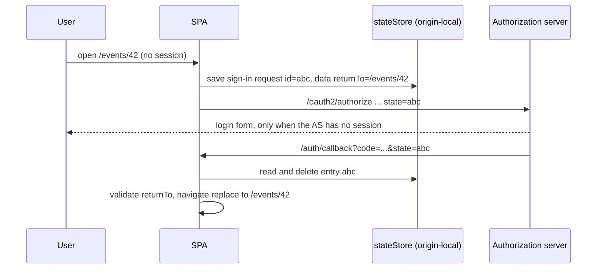

# Design

## Context

See proposal.md (Why) for the problem. Relevant current state:

- `ProtectedRoute` (`frontend/src/App.tsx`) calls `useAuth().login()` whenever the user is neither authenticated nor loading. This covers the first visit of a deep link and the re-login after the stored user is removed (silent renew exhausted in `silentRenewRetry`, `userSignedOut`).
- `AuthProvider` (`frontend/src/contexts/AuthContext2.tsx`): `login()` calls `userManager.signinRedirect()` with no arguments (no-op while `logoutInProgress`). On load, when the path equals the `redirect_uri` path (`/auth/callback`), it runs `signinRedirectCallback()` and then always `navigate('/', {replace: true})`. That is the whole root cause; the authorization server is not involved.
- `oidc-client-ts` 3.3.0, single shared `UserManager` (`klabisAuthUserManager`): `userStore` is sessionStorage, `stateStore` is the library default (localStorage). `redirect_uri` is `/auth/callback` normalised against `window.location`, so the flow always returns to the origin that started it.
- Backend: `klabis-web` redirect URIs are matched exactly (`OAuth2ClientProperties`); the `prompt=none` entry point validates `redirect_uri` against `RegisteredClientRepository` to avoid an open redirect. The login form uses Spring Security's saved request, which resumes the original `/oauth2/authorize` request (including its `state` parameter) after a successful login. Nothing here needs to change.
- Deep-link delivery already works on both origins: Vite (`appType: spa`) serves `index.html` for any path on :3000, and `SpaFallbackFilter` forwards HTML GETs on non-reserved paths to `index.html` on :8443.
- E2E: `Given I am logged in as` restores only the authorization-server cookies, so every scenario signs in through a silent `/oauth2/authorize` round trip. `page.goto('/some/path')` therefore ends on `/`, which is why `When I navigate in the application to ...` pushes into the SPA history instead.

## Goals / Non-Goals

**Goals:**

- Return the user to the requested page (path, query, fragment) after any interactive sign-in started by `ProtectedRoute`, on both :3000 and :8443.
- Never navigate outside the SPA as a result of a remembered return target.

**Non-Goals:**

- Preserving unsaved form input across a re-login.
- Changing silent renew, the logout flow, the registered redirect URIs or any backend code.
- Improving the existing behaviour when `signinRedirectCallback()` fails (the user stays on the callback route as today).
- Domain or REST API changes: there are none, so no domain-model or API chapter is needed.

## Decisions

### D1: The return path is stored as oidc-client-ts `state` (client-side data of the sign-in request)

`login()` calls `signinRedirect({state: {returnTo}})`. oidc-client-ts stores this custom data inside the sign-in request's own entry in `stateStore` (next to the PKCE `code_verifier`), keyed by the opaque random `state` id. Only the id travels to the authorization server. `signinRedirectCallback()` reads the entry, deletes it, and returns the data as `user.state`.

Alternatives considered:

| Option | Why not |
|---|---|
| `url_state` (appended to the `state` parameter sent to the AS) | The path travels through the AS and browser history and appears in AS logs; the URL part is not bound to the stored request, so it is the more tamperable channel. No benefit over client-side data. |
| Own `sessionStorage` key | Needs its own lifecycle: a value left behind by an abandoned sign-in would redirect a later, unrelated sign-in in the same tab. The oidc request entry is already one-shot and stale entries are pruned by the library. |
| Query parameter on `redirect_uri` | `redirect_uri` is matched exactly; supporting variable callbacks would mean wildcard registrations, i.e. an open-redirect surface that conflicts with the project's `redirect_uri` validation rule. |

Because the value is bound to one request id, parallel sign-ins in two tabs do not overwrite each other, which a single storage key would.

### D2: Capture in `login()`, from the current location

`login()` is the single entry point used by `ProtectedRoute` for both the first visit and the re-login after a lost session, so capturing `window.location.pathname + search + hash` there covers all spec scenarios. When the current location is the callback route or `/login`, the return path is `/`. `login()` stays a no-op while logout is in progress (`logoutInProgress` guard from `fix-logout-relogin-race` is kept untouched).

### D3: Open-redirect safety: only same-origin, app-relative paths, used only by the SPA router

A small pure helper `toSafeReturnPath(value: unknown): string` is applied when capturing and again when restoring (the stored value lives in browser storage, so it is re-checked before use):

- must be a string starting with exactly one `/` (rejects `//host`, `/\host`, `http:`, `javascript:` and empty values);
- no control characters; bounded length;
- resolved with `new URL(value, window.location.origin)`, the resulting origin must equal `window.location.origin`;
- the callback route and `/login` are mapped to `/` (avoids a callback loop);
- the result is `pathname + search + hash`; any failure returns `/`.

Restoring uses React Router `navigate(path, {replace: true})`, never `window.location.assign`, so even a value that slipped through cannot leave the SPA. `replace` keeps `/auth/callback` out of the history, as today.

### D4: Interaction with logout and silent renew

| Flow | Effect |
|---|---|
| Logout | `signoutRedirect()` fires `userUnloaded`; `ProtectedRoute` calls `login()`, which is a no-op during logout, so nothing is captured. The post-logout redirect lands on the origin root, the next sign-in captures `/` → home page (spec scenario "Next sign-in after logout starts on the home page"). |
| Silent renew (`signinSilent`, iframe, `silent-renew.html`) | Not touched: it does not use `login()`, does not render the callback route in the top window and does not navigate. No state is passed. |
| Renew exhausted / `userSignedOut` | `removeUser()` → `userUnloaded` → `ProtectedRoute` → `login()` captures the page the user is on; after re-login they return to it. |
| Callback error | Unchanged: no navigation happens; the stored request entry is consumed or pruned by the library. |

### D5: Behaviour on :3000 (Vite) and :8443 (backend-served bundle)

| | :3000 | :8443 |
|---|---|---|
| Deep link served by | Vite SPA fallback | `SpaFallbackFilter` → `index.html` |
| `redirect_uri` | `http://localhost:3000/auth/callback` | `https://localhost:8443/auth/callback` |
| `stateStore` origin | `http://localhost:3000` (start and callback on same origin) | `https://localhost:8443` |
| Login form | `GET /login` from Vite, `POST /login` proxied; saved request resumes `/oauth2/authorize` | served and handled by the backend |

The design relies only on the start and the callback of a sign-in being on the same origin, which holds in both setups because `redirect_uri` is derived from `window.location`. No configuration differs between them. The `:8443` bundle needs the usual `publish-frontend-resources` step to pick up the change.

### Testing strategy

- Unit (Vitest): `toSafeReturnPath` table of accepted and rejected inputs; `AuthProvider` tests that `login()` passes the current location as state, that the callback navigates to `user.state.returnTo`, and that a missing, foreign-origin or callback-route value navigates to `/`; the existing logout-guard tests stay green.
- E2E: real deep links with `page.goto` replace the history-push workaround; a new `@spec:users` feature covers the silent re-authorization and the login-form path.

## Risks / Trade-offs

- [Same-origin script could plant a crafted value in the state store] → It still has to pass D3 and is only fed to the SPA router; a same-origin script already has full control anyway.
- [Stale-state pruning removes the entry if the user idles on the login form longer than `staleStateAgeInSeconds` (default 15 min)] → The callback then fails as it does today; acceptable for the expected load and usage.
- [Returning to a page the user is no longer authorised for after signing in as someone else in the same tab] → Only possible if logout is bypassed; the page shows the usual permission-denied state, no data leaks because every API call is authorised on the backend.
- [E2E scenarios depend on the fix] → The workaround removal and the new scenario are in the same slice as the frontend change, so the suite never runs against a half state.

## Glossary

| Term | Meaning |
|---|---|
| Deep link | An application URL pointing to a page other than the home page (bookmark, shared link, link from e-mail or notification). |
| Return path | The app-relative path (with query and fragment) the user requested before sign-in started. |
| Silent re-authorization | Sign-in completed by the authorization server without showing the login form because its own session is still valid. |
