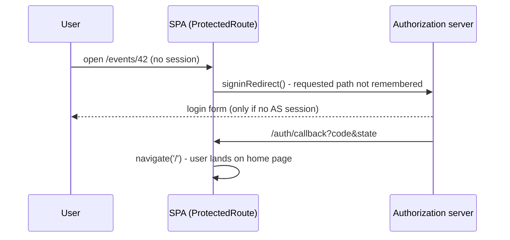

# Proposal

## Why

A user without an application session who opens a deep link (a bookmark, a shared link such as `/events/<id>` or `/membership-fee-tiers`, a link from an e-mail or push notification) always lands on the home page after signing in, not on the page they asked for. This happens with the login form and also when the authorization server session still exists and sign-in completes without any form. Bookmarks and shared links are effectively broken, and the E2E suite has to work around it by driving the SPA router directly.

Root cause (frontend only): `AuthProvider.login()` calls `userManager.signinRedirect()` without remembering the current location, and the `/auth/callback` handler always finishes with `navigate('/', {replace: true})`.

## What Changes

- When sign-in starts because a protected page was opened without a session, the SPA remembers the requested page (path, query and fragment) as client-side data bound to that sign-in request.
- After the sign-in callback completes, the SPA navigates to the remembered page instead of the home page. The remembered value is accepted only as a same-origin, app-relative path; anything else falls back to the home page.
- The same applies when the session is lost while the user is working (silent renew exhausted) and sign-in is started again: the user returns to the page they were on.
- Logout keeps its current behaviour: the user ends on the post-logout page and the next sign-in starts from the home page.
- No backend change: the OAuth2 `redirect_uri` stays the single registered `/auth/callback`.
- E2E: the `When I navigate in the application to ...` workaround steps are replaced by real deep links (`page.goto`), and a scenario covering a deep link opened without a session is added.

## Capabilities

### New Capabilities

_None._

### Modified Capabilities

- `users`: adds a requirement that a user who opens a protected page without being signed in returns to that page after signing in (with or without the login form), and that only pages of the application itself are restored.

## Impact

- **Frontend**: `src/contexts/AuthContext2.tsx` (`login()` and the callback branch), a small return-path helper with unit tests, `src/contexts/AuthContext2.test.tsx`.
- **E2E**: `frontend/e2e/steps/navigation.steps.ts`, `frontend/e2e/steps/membership-fees.steps.ts`, `frontend/e2e/features/membership-fees.feature`, `frontend/e2e/features/membership-fee-campaign-manual-close.feature`, a new deep-link scenario, `frontend/e2e/README.md`.
- **Backend**: none. Registered redirect URIs, the `prompt=none` entry point and `SpaFallbackFilter` stay unchanged.
- **API**: none.
