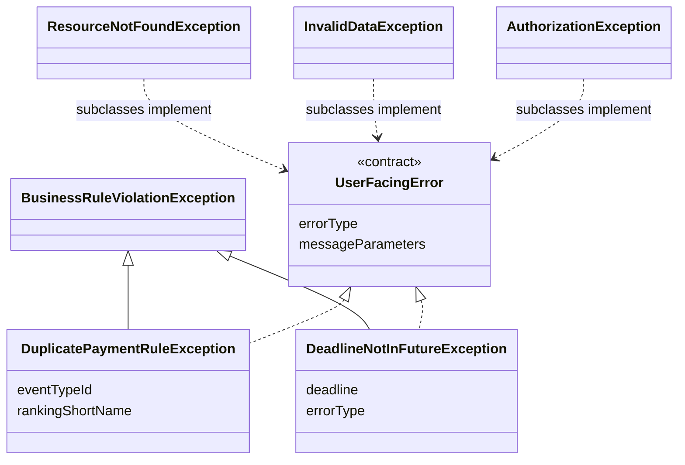
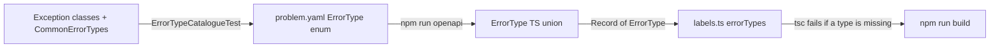
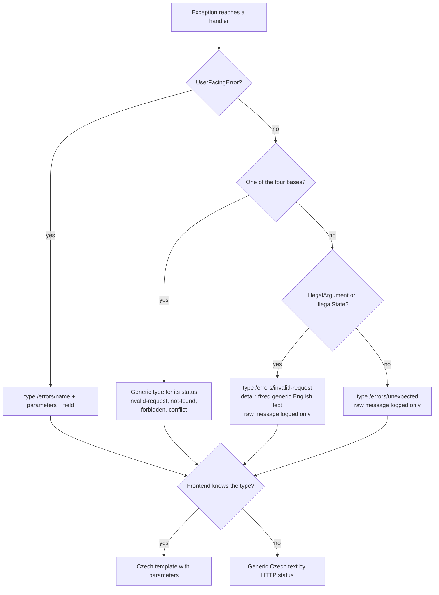

# Design

## Context

See proposal.md, section Why, for the motivation. This section describes the current mechanism.

### Backend

- **Exceptions.** There are 92 exception classes. Most extend one of four bases in `common/exceptions`:
  - `BusinessRuleViolationException`: 49 subclasses, mapped to 400;
  - `ResourceNotFoundException`: 14 subclasses, mapped to 404;
  - `InvalidDataException`: 5 subclasses, mapped to 400;
  - `AuthorizationException`: 5 subclasses, mapped to 403.

  Another 16 extend `RuntimeException` directly and are mapped by module handlers. Each builds an English sentence in its constructor, often with an ID inside, for example `DuplicatePaymentRuleException(EventTypeReference, rankingShortName)`.
- **Handlers.** `common/mvc/MvcExceptionHandler`, 11 module `*ExceptionHandler` classes and a local handler in `PermissionController` (44 `@ExceptionHandler` methods in total) copy `ex.getMessage()` into `detail`.
- **ProblemDetail `type` today.**
  - Mostly the Spring default `about:blank`.
  - `https://api.klabis.example.com/errors/unauthorized` and `/forbidden`, set by the security entry point and access-denied handler in `ResourceServerSecurityConfiguration`. `AccountStatusValidationFilter` also writes the forbidden one, as `application/json`.
  - `https://klabis.com/problems/{user-not-found, cannot-remove-last-admin, admin-lockout, invalid-authority, invalid-request}`, set in `PermissionController`.
  - The bare strings `OVERDRAFT_LIMIT_EXCEEDED` and `TRANSACTION_ALREADY_REVERSED`, set in `FinanceExceptionHandler`.
  - No frontend or E2E code reads `type`. Four backend test assertions check it: three in `PermissionControllerTest` and one in `MemberAccountControllerTest`.
- **Validation output.**
  - Field errors from bean validation are emitted as `fieldErrors: {field: defaultMessage}`.
  - Global errors are emitted as `errors: ["message [ConstraintCode]"]`.
  - Parameter errors are emitted as `parameterErrors: ["param: message"]`.
- **Invariants.** There are about 150 `IllegalArgumentException`/`IllegalStateException` throw sites and about 400 `Assert.*` messages, all English. `IllegalArgumentException` reaches the user verbatim as a 400 `detail`.
- **Bean validation.**
  - About 2,000 constraints on the generated DTOs use the Hibernate Validator default messages. The Hibernate Validator jar ships `ValidationMessages_cs.properties`, but there is no locale configuration, so the language follows the browser's `Accept-Language`.
  - There are 38 hand-written `message="…"` English texts.

### Frontend

- `api/hateoas.ts` `toFormValidationError` turns every 400 `application/problem+json` response into an error with the hardcoded English message `'Form validation errors'`. Its `validationErrors` field is `fieldErrors`, or `errors`, or `{error: detail}`. `ErrorDisplay` lists these as `field: message` lines with raw keys.
- `HalFormsForm` passes server errors to Formik as `initialErrors`. Formik reads that only when the form mounts, so after a failed submit the errors most likely never appear at the fields. Phase 1 verifies this.
- About 20 pages render `<Alert>{error.message}</Alert>`, which shows the technical `HTTP 404 (Not Found)` text.
- `ChangePasswordDialog` matches the English substring `'Current password is incorrect'`. `usePermissionsEditor` maps status 409 to a Czech label.
- `localization/labels.ts` is the central Czech text store. Client-side Yup validation already uses it.

### Constraints

- The application is Czech-only, and the Klabis SPA is its only API client.
- The project principle is KISS, with 200–300 users. Error paths are rare, so a name lookup at error time costs nothing that matters.
- Domain code stays free of web-framework types, because the dependency rule points inward.
- The OpenAPI spec is the source of truth for the API (spec-first). Both the backend and the frontend generate from it.

## Goals / Non-Goals

**Goals:**
- Czech text for every error the SPA shows. Texts live in `labels.ts`, next to the rest of the UI language.
- A stable, documented error type per kind of error, usable by the UI, by tests and by any future client.
- Field-bound server errors rendered at the field.
- A generic Czech fallback that never shows raw English or technical text.
- A build-time guarantee that the backend's error types, the spec list and the Czech texts stay in step.

**Non-Goals:**
- Multiple UI languages, although nothing here prevents adding them later.
- Translating log output or `detail`. `detail` stays English and is meant for developers.
- Server-rendered pages (login, password setup), e-mail texts, and synchronisation history entries.
- Translating every `Assert`/`IllegalArgumentException` one by one (see D5).

## Decisions

### D1: The backend identifies errors and the frontend words them

The backend reports *what* went wrong as a ProblemDetail `type` plus named parameters. The frontend turns that into Czech text using `labels.ts`.

| Option considered | Verdict |
|---|---|
| (a) Czech texts in the backend (hardcoded or a `MessageSource` catalogue) | Rejected. It splits the UI language between two code bases. |
| **(b) Type plus parameters, frontend maps** | **Chosen.** One place for UI language (`labels.ts`). Standard RFC 9457 `type`, no custom code property. The frontend can format dates and amounts the Czech way. |
| (c) Hybrid (backend text plus code) | Rejected. It needs two mechanisms for the same thing. |

The known cost of (b) is that each new error touches the backend, the spec and `labels.ts`. D4 makes forgetting any of them a build failure rather than a silent English or generic message.

**Exception:** bean-validation field messages are generic constraint texts ("nesmí být prázdné"). The backend sends them already in Czech (D6), so the frontend does not need one mapping for every constraint and attribute.

### D2: Error type URIs

- **Form.** A relative URI `/errors/{error-name}`. `error-name` is kebab-case, specific and stable, for example `/errors/duplicate-payment-rule` or `/errors/voting-deadline-not-in-future`. RFC 9457 allows relative type URIs. They resolve against the API origin and do not have to be dereferenceable.
- **Default derivation.** The type is derived from the exception's simple class name without the `Exception` suffix, in kebab-case: `DuplicatePaymentRuleException` becomes `/errors/duplicate-payment-rule`. An exception may override it. `DeadlineNotInFutureException` covers two rules:
  - `/errors/voting-deadline-not-in-future` when a campaign is started;
  - `/errors/voting-deadline-in-past` when the deadline of an active campaign is changed, because today is allowed there.
- **Generic types emitted by handlers, not by domain exceptions:**

  | Type | Status | Used for |
  |---|---|---|
  | `/errors/validation-failed` | 400 | Bean-validation failures. Carry Czech `fieldErrors`/`errors`. |
  | `/errors/invalid-request` | 400 | Internal checks (`IllegalArgumentException`/`IllegalStateException`), unreadable or mistyped requests, and 400 errors that do not have their own type yet |
  | `/errors/unauthorized` | 401 | Missing or invalid authentication |
  | `/errors/forbidden` | 403 | Missing authority |
  | `/errors/account-inactive` | 403 | Deactivated account (`AccountStatusValidationFilter`) |
  | `/errors/not-found` | 404 | Unknown path, and not-found errors without their own type |
  | `/errors/conflict` | 409 | Conflict errors that do not have their own type yet (exceptions not yet migrated) |
  | `/errors/concurrent-update` | 409 | Optimistic locking |
  | `/errors/unexpected` | 500 | Anything unhandled |

- **Migration of existing explicit types**, done in the phase of the owning module:
  - `https://api.klabis.example.com/errors/unauthorized` and `/forbidden` become `/errors/unauthorized` and `/errors/forbidden`. This is in phase 1, because it is common infrastructure. `AccountStatusValidationFilter` also switches to `application/problem+json` with `/errors/account-inactive`.
  - `https://klabis.com/problems/*` become `/errors/user-not-found`, `/errors/cannot-remove-last-permission-manager`, `/errors/admin-lockout`, `/errors/invalid-authority` and `/errors/invalid-request` (common/users phase).
  - `OVERDRAFT_LIMIT_EXCEEDED` and `TRANSACTION_ALREADY_REVERSED` become `/errors/overdraft-limit-exceeded` and `/errors/transaction-already-reversed` (finance phase).
  - **Consumers affected:** no frontend or E2E code reads `type`. Only the four backend test assertions change. There are no external API clients.

### D3: Parameters and field binding (domain change)

A small framework-free contract, **UserFacingError**, is opted into by each migrated exception. The four bases do not implement it. This lets the modules migrate one at a time, and an exception that has not migrated yet falls back to a generic type (D2):

- **`errorType`**: the `error-name` from D2. A default method derives it from the class name.
- **`messageParameters`**: a map from parameter name to value, containing names, labels, dates and amounts. Never IDs.

`getMessage()` stays English and goes into `detail` and the logs.

Handlers write each parameter as a top-level ProblemDetail extension property. An error bound to one form field adds the `field` property with the request field name. That binding is done by the module's REST exception handler, not by the domain, so wire names stay out of the domain.

- **Value formats.**
  - Dates are ISO-8601 strings, consistent with the existing NFR. The frontend formats them as Czech dates.
  - Amounts are a number plus a currency.
  - Names and labels are plain strings.
- **Names for ID-only errors.** If the domain only knows an ID, the module handler resolves the name through a port the module already has. For example, the membership fees handler uses `MembershipFeeTierOptionsPort.listEventTypeOptions()` and `listRankingOptions()` for `/errors/duplicate-payment-rule`. If the lookup fails, the parameter is left out, and the Czech template has a wording without it. It never falls back to the ID.



| Element | Change | Description |
|---|---|---|
| UserFacingError | **added** | The contract that a user-facing error has an error type (default: kebab-cased class name) and message parameters (default: none). |
| BusinessRuleViolationException, ResourceNotFoundException, InvalidDataException, AuthorizationException | **unchanged** | They keep the HTTP status mapping. In phase 3, a test requires every subclass to implement UserFacingError. |
| Module exceptions (about 90, including the 16 that extend `RuntimeException` directly) | **changed per module phase** | Implement UserFacingError. The 16 are also rebased onto one of the four bases. |
| DuplicatePaymentRuleException | **changed** | Keeps the event type identifier. The handler resolves the name and the ranking label as parameters. |
| DeadlineNotInFutureException | **changed** | The parameter is the deadline. The error type differs for the start case and the change case. |

### D4: Shared list of error types and completeness

The **OpenAPI spec is the shared list**, and no extra artifact is introduced.

- **Spec.** `docs/openapi/spec/_shared/problem.yaml` gains an `ErrorType` schema: `type: string`, with an `enum` of every `/errors/...` value. Each value has a short description of its parameters and, where it applies, its `field`. `ProblemDetail.type` references it, and the extension properties (`field`, `fieldErrors`, `errors`, `parameterErrors`) are documented.
- **Backend codegen.** The generate-all backend codegen would otherwise emit an empty Java enum. To prevent that, `ErrorType` is added to the common `schemaMappings` (`OpenApiModule.kt`, next to `ProblemDetail`) as `java.lang.String`.
- **Backend test.** `ErrorTypeCatalogueTest` checks that:
  - every class implementing the contract (classpath scan of `com.klabis`) and every generic type constant (D2 table, kept in one `CommonErrorTypes` class) has a distinct type;
  - every emitted type is listed in the `ErrorType` enum, which the test reads from `problem.yaml`;
  - every enum value is emitted somewhere, so the list has no stale entries.
- **Frontend.** `npm run openapi` turns the enum into a TypeScript string union, `components['schemas']['ErrorType']`. `labels.ts` declares `errorTypes: Record<ErrorType, (p: ErrorParams) => string>`, so a type without a Czech text fails `tsc`/`npm run build`. This is a compile-time completeness check, and no separate frontend test is needed.



Because the contract is opt-in (D3), an exception that has not migrated yet emits the generic type for its status, so the test needs no allow-list. A module's errors enter the enum only when the module migrates. Phase 3 adds one more assertion: every subclass of the four bases implements UserFacingError.

### D5: Internal checks and fallbacks



- **Internal checks.** `Assert` and `IllegalArgumentException`/`IllegalStateException` produce `/errors/invalid-request`. Their message is logged at WARN and never sent.
- **User-reachable checks.** During each module phase, invariants that users can realistically trigger become typed domain errors with their own type and Czech text. This applies, for example, to a form value that the frontend validation does not catch.
- **Frontend helper.** One helper, `describeError(error)`, turns any thrown error into Czech:
  1. a known `type` gives its template from `labels.errorTypes`;
  2. otherwise a status-based generic text (400, 401, 403, 404, 409, 5xx);
  3. otherwise `labels.errors.unexpectedError`.

  All `<Alert>{error.message}</Alert>` sites use this helper.

### D6: Fixed Czech locale for bean validation

- The locale resolver is fixed to `cs`, so the Spring validator interpolates the bundled Czech Hibernate Validator messages regardless of `Accept-Language`. There is no `messages.properties`.
- The 38 hand-written `message="…"` texts are rewritten in Czech directly in the annotation.
- `errors` and `parameterErrors` lose the `[ConstraintCode]` and `param:` prefixes.
- The frontend shows `fieldErrors` texts as they are, at the matching field.

### D7: Field-level rendering in the frontend

- `toFormValidationError` keeps `type`, the parameters, `field`, `fieldErrors` and `errors` separately, and drops the English `'Form validation errors'` literal.
- **Field assignment.**
  - A typed error with `field` puts its Czech template text on that field.
  - Bean-validation `fieldErrors` put their Czech texts on their fields.
  - `HalFormsForm` applies these with Formik `setErrors` and marks the fields as touched after a failed submit. The entered values stay in the form.
- **The alert above the form shows:**
  - the Czech text of a typed error without `field`;
  - the `errors` texts;
  - `labels.errors.formValidationErrors` as a heading when only field errors exist;
  - field errors whose key matches no rendered field, labelled with that property's `prompt` from the HAL-FORMS template. Never with the raw key.
- **Special handling by type.** `ChangePasswordDialog` switches from English substring matching to `type === '/errors/incorrect-current-password'`.

### D8: Phasing

- **Phase 1:** infrastructure plus membership fees, starting with the voting deadline and duplicate rule slices. It includes:
  - the contract (D3);
  - the generic types and the security type migration (D2);
  - the fixed locale (D6);
  - the spec enum and completeness test (D4);
  - the frontend mapping and field rendering (D7);
  - the `describeError` helper (D5).
- **Phase 2:** module by module, in this order: members, events (with event types, disciplines and registrations), calendar, finance (type migration), groups, common/users (permission type migration, `ChangePasswordDialog`), sync/oris and notifications. Each module is a vertical slice covering exceptions, handler, spec enum, `labels.ts`, tests and E2E.
- **Phase 3:** frontend sweep of the remaining `error.message` renders, the ADR, and the full verification.

## API Changes

No endpoints, links or affordances change. Every `application/problem+json` response changes:

| Property | Before | After |
|---|---|---|
| `type` | `about:blank`, or three ad-hoc styles (see Context) | `/errors/{error-name}` from the `ErrorType` enum. **Changed values.** |
| `title` | English | unchanged (English, not shown by the SPA) |
| `status`, `instance` | unchanged | unchanged |
| `detail` | English `ex.getMessage()`, may contain IDs | English, developer-facing, not shown by the SPA. A fixed generic sentence for `/errors/invalid-request` and `/errors/unexpected`. |
| *parameters* | absent | **new**: named extension properties per type, for example `eventTypeName` or `deadline` |
| `field` | absent | **new**: request field name for field-bound typed errors |
| `fieldErrors` | `{field: English message}` | `{field: Czech message}` (bean validation only) |
| `errors` | `["message [ConstraintCode]"]` | `["Czech message"]` |
| `parameterErrors` | `["param: message"]` | `["Czech message"]` |

Example of a duplicate payment rule (409):

```json
{
  "type": "/errors/duplicate-payment-rule",
  "title": "Duplicate Payment Rule",
  "status": 409,
  "detail": "A rule for event type 728af44d-… and ranking 'A' already exists on this level",
  "eventTypeName": "Závod jednotlivců",
  "rankingLabel": "Ž A"
}
```

Example of a voting deadline in the past when starting a campaign (400):

```json
{
  "type": "/errors/voting-deadline-not-in-future",
  "title": "Bad Request",
  "status": 400,
  "detail": "Voting deadline must be in the future, but was: 2026-10-18",
  "deadline": "2026-10-18",
  "field": "votingDeadline"
}
```

The matching `labels.ts` entries:

```ts
errorTypes: {
  '/errors/duplicate-payment-rule': (p) =>
    `Úroveň již obsahuje pravidlo pro typ akce „${p.eventTypeName ?? 'zvolený typ akce'}“ a žebříček „${p.rankingLabel}“.`,
  '/errors/voting-deadline-not-in-future': () => 'Termín pro výběr musí být v budoucnosti.',
}
```

## Glossary

| Term | Meaning |
|---|---|
| Error type | The RFC 9457 problem type `/errors/{error-name}`. It identifies one kind of error and is never shown to the user. |
| Error type list | The `ErrorType` enum in the OpenAPI spec, which every emitted type must belong to. |
| Message parameters | Named, user-visible values that the Czech text needs: names, labels, dates and amounts. Never internal identifiers. |
| Field-bound error | An error concerning one form field, named by `field` (typed errors) or keyed in `fieldErrors` (bean validation), and shown at that field. |
| Form-level error | An error concerning the whole submission, shown above the form. |
| Generic error message | A Czech fallback text chosen by HTTP status when the type is unknown or generic. |

## Risks / Trade-offs

- **[Trade-off] Each new error touches three places:** the exception, the spec enum and `labels.ts`. → D4 turns any omission into a failing backend test or a failing `tsc`, not a silent fallback.
- **[Risk] Message parameters drift from the template**, for example when a parameter is renamed in Java. → The frontend tests for each type use the parameter names documented in the spec enum description. Backend handler tests assert the parameter names.
- **[Risk] The generic codegen emits an empty Java enum for `ErrorType`.** → The `schemaMappings` entry to `String` (D4). Verify it in phase 1 by building the backend after the spec change.
- **[Risk] Tests that assert on English `detail` text.** → Keep them where they are (`detail` stays English), and add `type` assertions.
- **[Risk] Relative type URIs that someone dereferences end on the SPA fallback page.** → RFC 9457 does not require dereferenceable types, and no client dereferences them.
- **[Risk] Hibernate Validator's generic Czech texts read awkwardly.** → They are shown under the labelled field. Override an individual constraint text in the annotation only when feedback asks for it.
- **[Risk] A name lookup fails on the error path.** → The parameter is left out, and the template has a wording without it.

## Migration Plan

- There is no data migration. The backend and the frontend ship in one artifact, so each phase deploys atomically.
- `describeError` handles both old responses (`about:blank`, English `detail`) and new ones through the status fallback. A partially migrated codebase therefore never shows raw English to users. It shows a generic Czech text until the module is migrated.
- Rollback means reverting the phase's commits.
- Record the decision as a new ADR (ADR-011) in `docs/design-decisions.md` when phase 1 lands. The ADR records that the backend identifies errors by RFC 9457 `type` URIs `/errors/{name}` with named parameters, that the frontend owns the Czech wording in `labels.ts`, and that the spec `ErrorType` enum is the shared list enforced on both sides. It also records why bean validation is the exception (fixed Czech locale).
