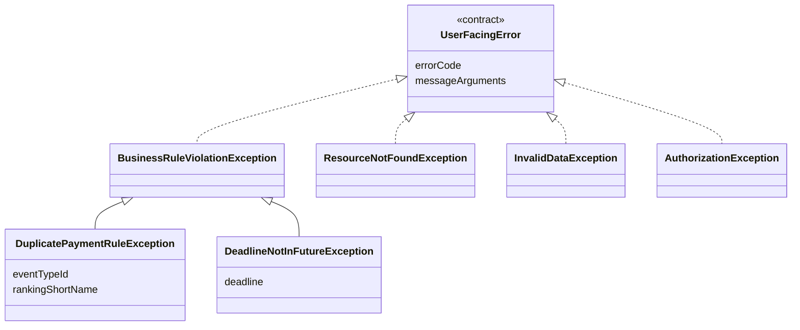
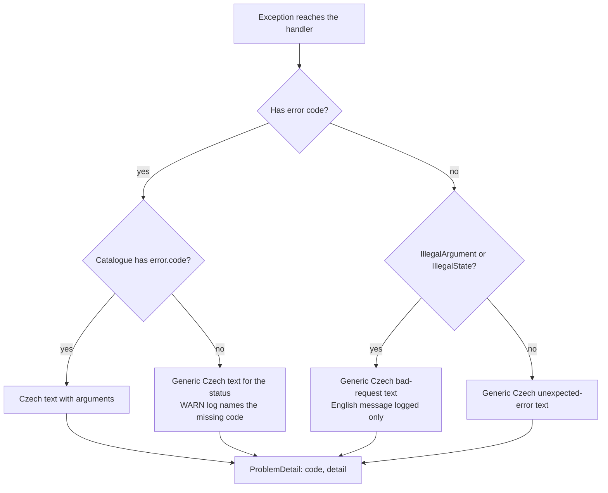

# Design

## Context

See proposal.md, section Why, for the motivation. This section describes the current mechanism.

### Backend

- **Exceptions.** There are 92 exception classes. Most extend one of four bases in `common/exceptions`:
  - `BusinessRuleViolationException`: 49 subclasses, mapped to 400;
  - `ResourceNotFoundException`: 14 subclasses, mapped to 404;
  - `InvalidDataException`: 5 subclasses, mapped to 400;
  - `AuthorizationException`: 5 subclasses, mapped to 403.

  Another 16 extend `RuntimeException` directly and are mapped by module handlers. Every exception builds an English sentence in its constructor, often with an ID inside, for example `DuplicatePaymentRuleException(EventTypeReference, rankingShortName)`.
- **Handlers.**
  - `common/mvc/MvcExceptionHandler` maps the four base classes, `IllegalArgumentException`, optimistic locking, and bean-validation exceptions. It copies `ex.getMessage()` into `detail`.
  - Eleven module `*ExceptionHandler` classes and a local handler in `PermissionController` (44 `@ExceptionHandler` methods in total) do the same, with English `title`s.
- **Validation output.**
  - Field errors from bean validation are emitted as `fieldErrors: {field: defaultMessage}`.
  - Global errors are emitted as `errors: ["message [ConstraintCode]"]`. The constraint code leaks into the text.
  - Parameter errors are emitted as `parameterErrors: ["param: message"]`.
- **Invariants.** There are about 150 `IllegalArgumentException`/`IllegalStateException` throw sites and about 400 `Assert.*` invariant messages. All are English. `IllegalArgumentException` reaches the user verbatim as a 400 `detail`.
- **Bean validation.** There are about 35 hand-written constraint annotations, 38 of them with English `message=` texts. The generated DTOs carry about 2,000 constraint annotations with no explicit message, so they use the Hibernate Validator defaults. The Hibernate Validator jar ships `ValidationMessages_cs.properties`, so these defaults are Czech only when the request locale is Czech. Today that depends on the browser's `Accept-Language`.
- **No message catalogue.** There is no `messages.properties`, no `MessageSource` configuration and no locale configuration.

### Frontend

- `api/hateoas.ts` `toFormValidationError` turns every 400 `application/problem+json` response into an error with the hardcoded English message `'Form validation errors'`. Its `validationErrors` field is `fieldErrors`, or `errors`, or `{error: detail}`. Other problem responses become `new Error(detail)`.
- `ErrorDisplay` renders that message and then a list of `field: message` lines with raw keys. This produces the *"Form validation errors / error: Voting deadline…"* output seen in the E2E tests.
- `HalFormsForm` passes server errors to Formik as `initialErrors`. Formik reads that only when the form mounts, so after a failed submit the errors most likely do not appear next to the fields. Phase 1 verifies this.
- About 20 pages render `<Alert>{error.message}</Alert>` for load failures. They show the technical `HTTP 404 (Not Found)` text from `FetchError`.
- Two places already interpret errors in the frontend:
  - `ChangePasswordDialog` matches the English substring `'Current password is incorrect'` in `detail`;
  - `usePermissionsEditor` maps status 409 to a Czech label.
- Client-side Yup validation already uses Czech texts from `labels.ts` (`VALIDATION_MESSAGES`).

### Constraints

- The application is Czech-only, and the Klabis SPA is its only API client.
- The project principle is KISS, with 200–300 users and at most 10–20 working concurrently. Error paths are rare, so a name lookup at error time costs nothing that matters.
- Domain and application code must stay free of web-framework types, because the dependency rule points inward.

## Goals / Non-Goals

**Goals:**
- Czech text for every error the SPA shows, produced in one place that a reviewer can read through.
- A stable machine-readable error code, so tests and the occasional special UI handling do not depend on message wording.
- Field-bound server errors rendered at the field.
- A safe generic fallback that never shows raw English or technical text.
- A build-time check that keeps the catalogue complete as new exceptions are added.

**Non-Goals:**
- Supporting multiple UI languages. The design must not prevent this later, but it is not built now.
- Translating log output. Exception messages stay English for operators.
- Server-rendered pages (login, password setup), e-mail texts, and synchronisation history entries.
- Translating every `Assert`/`IllegalArgumentException` invariant one by one (see D4).

## Decisions

### D1: Where Czech texts live: hybrid (backend catalogue plus stable code)

The options were compared on the effort to cover about 90 exceptions plus validation, the drift risk, and how much each touches.

| Option | How it works | Pros | Cons |
|---|---|---|---|
| **(a1) Czech hardcoded in exceptions** | The constructor builds a Czech sentence. | Smallest diff per exception. No infrastructure. | Czech text ends up in logs. Texts are scattered over 90 files. There is no stable code, so tests and the frontend match on wording. Names must be known at throw time, inside the domain. |
| **(a2) Backend message catalogue** | `messages.properties` (Czech) keyed by code. The handler resolves the text with arguments. | One reviewable file. Logs stay English. Bean validation can use the same catalogue. Fixed Czech locale makes the Hibernate Validator defaults Czech for free. | Small infrastructure: `MessageSource` and locale configuration, plus code and arguments on the exceptions. |
| **(b) Codes and parameters only, frontend maps** | ProblemDetail carries `code` and `params`. `labels.ts` holds a Czech template per code. | Fits the existing frontend `labels.ts` localization. | Every exception needs a change in both backend and frontend. Parameter formatting is duplicated in TypeScript. About 2,000 generated bean-validation constraints would each need a frontend mapping per constraint type and attribute. A code without a frontend entry silently degrades to the generic text, and no backend test can catch that. |
| **(c) Hybrid** | (a2), plus the ProblemDetail also carries `code`. The frontend shows the backend text and reacts to `code` only where it needs behaviour. | Everything (a2) offers, plus a stable code for E2E/unit assertions and for UI special cases such as `ChangePasswordDialog`. The frontend stays generic. | Same small infrastructure as (a2). |

**Recommendation: (c).** Texts that depend on domain data, such as names, counts and dates, are formatted where the data is. One catalogue is the cheapest thing to keep complete, and a backend test can enforce that (D6). Option (b) doubles the work for each exception and gives nothing back to a Czech-only, single-client application.

### D2: Error code and message arguments on exceptions (domain change)

The common exception bases get two framework-free properties:

- **`errorCode`**: by default, the exception's simple class name without the `Exception` suffix, for example `DuplicatePaymentRule` or `DeadlineNotInFuture`. Simple class names are unique across the codebase today, and the completeness test (D6) guards that. An exception may override the code.
- **`messageArguments`**: an ordered list of values used in the Czech template. These are names and labels, never IDs (see D5).

`getMessage()` keeps its English text for logs. Module exceptions that extend `RuntimeException` directly, such as `TransactionAlreadyReversedException` and `AdminLockoutException`, are moved under the matching base, or they implement the same small contract.



| Element | Change | Description |
|---|---|---|
| UserFacingError | **added** | The contract that a user-facing error has a stable error code and message arguments. |
| BusinessRuleViolationException, ResourceNotFoundException, InvalidDataException, AuthorizationException | **changed** | Implement the contract. Error code defaults to the simple class name. Arguments default to none. |
| Module exceptions extending `RuntimeException` (16) | **changed** | Rebased onto one of the four bases, or implement the contract directly. |
| DuplicatePaymentRuleException | **changed** | Keeps the event type identifier for the handler to resolve. The English message no longer needs to be user-safe. |
| DeadlineNotInFutureException | **changed** | The argument is the deadline date. The campaign-start and deadline-change cases use different codes, because changing a deadline to today is allowed. |

Rejected alternative: making the exceptions implement Spring's `ErrorResponse` (built-in `problemDetail.<FQCN>` codes). That would pull a web type into the domain layer, and fully qualified class names as keys break on every package move.

### D3: Fixed Czech locale and one message catalogue

- **Catalogue.** `backend/src/main/resources/messages.properties` holds the Czech texts:
  - keys `error.<ErrorCode>`;
  - generic fallbacks `error.generic.badRequest`, `error.generic.notFound`, `error.generic.forbidden`, `error.generic.conflict` and `error.generic.unexpected`;
  - Czech overrides for the few Spring MVC framework errors a user can hit, such as an unreadable body or a type mismatch.
- **Locale.** The locale resolver is fixed to `cs`, so the request locale is Czech regardless of `Accept-Language`. Spring Boot's validator interpolates through the same locale, so all generated bean-validation constraints produce the Czech Hibernate Validator messages without any annotation change. The 38 hand-written `message="…"` texts are rewritten either to catalogue keys (`{validation.calendarItem.nameRequired}`) or to plain Czech.
- **Handlers.** `MvcExceptionHandler` and the module handlers resolve `detail` from the catalogue using `errorCode` and `messageArguments`. They set `code` on the ProblemDetail. They keep their HTTP status mapping and their English `title`, because the frontend never shows `title`.

Rejected alternative: honouring `Accept-Language`. An English browser would then get English bean-validation messages next to Czech domain messages.

### D4: Fallback for unmapped errors



- **Invariant failures.** `IllegalArgumentException` and `Assert` failures are programming invariants. The frontend's own validation normally prevents them, so the user sees only a generic Czech text. Their raw message is never sent, which also closes the internal-ID leak.
- **Reachable invariants.** Where a module review finds an invariant that users actually reach through a form, it is promoted to a proper domain exception with a catalogue entry. This is part of each module phase.
- **Frontend fallback.** One helper, `describeError(error)`, turns any thrown error into a Czech text:
  1. the ProblemDetail `detail`, when the response is `application/problem+json`;
  2. otherwise a Czech text chosen by HTTP status (403, 404, 409, 5xx);
  3. otherwise `labels.errors.unexpectedError`.

  All `<Alert>{error.message}</Alert>` sites switch to this helper.

### D5: Names instead of identifiers

The Czech template takes names, so the handler must have them.

- **Names known where the exception is thrown.** Prefer this. For example, a group name or a member's full name already loaded in the aggregate is passed as a message argument.
- **Only an identifier known.** This is the case for `DuplicatePaymentRule`, because the domain holds an `EventTypeReference`. The module's exception handler resolves the display name through a port the module already has. Membership fees already exposes event type and ranking options through `MembershipFeeTierOptionsPort` (`listEventTypeOptions`, `listRankingOptions`). The lookup runs only on the error path. If the name cannot be resolved, the text omits it ("pro tento typ akce") rather than showing the identifier.
- **Not-found errors** never repeat the identifier. For example: "Člen nebyl nalezen."

Rejected alternative: passing names into the domain only so that it can build error texts. That couples aggregate methods to presentation.

### D6: Completeness check

A backend unit test scans `com.klabis` for every class implementing the error contract (D2) and asserts three things:

- the simple class names are unique;
- `messages.properties` has `error.<code>` for each;
- every catalogue `error.*` key has a matching code. This catches stale keys.

The test is added in phase 1 with an allow-list of modules not yet migrated. Each module phase removes its module from the allow-list, and phase 3 deletes the allow-list.

### D7: Field-level rendering

- **Backend: binding errors to fields.** Bean-validation field errors already carry the field path. They now carry Czech messages through D3.
  - For a domain error that belongs to one form field, the module's REST exception handler, not the domain, binds it to the request field name. For example, `DeadlineNotInFuture` binds to `votingDeadline`. The handler emits the field in `fieldErrors` and leaves `detail` as the general sentence. Binding in the adapter keeps wire names out of the domain.
  - Global errors (`errors`) and parameter errors (`parameterErrors`) lose the `[ConstraintCode]` and `param:` prefixes and contain only Czech text.
- **Frontend.**
  - `toFormValidationError` keeps `fieldErrors`, `detail`, `errors` and `code` separately, instead of folding them into one map.
  - `HalFormsForm` applies `fieldErrors` with Formik `setErrors` and marks those fields as touched after a failed submit, so each message appears under its field. Values stay in the form.
  - The alert above the form shows:
    - the `detail` and `errors` texts for form-level problems;
    - `labels.errors.formValidationErrors` ("Chyby validace formuláře") as a heading when only field errors exist;
    - field errors whose key matches no rendered field, labelled with that property's `prompt` from the HAL-FORMS template, or without a label. Never with the raw key.
  - The English `'Form validation errors'` literal is removed.
- **Special handling by code.** `ChangePasswordDialog` uses `code` instead of English substring matching. `usePermissionsEditor` may stay status-based.

### D8: Phasing

- **Phase 1:** the infrastructure (D2–D4, D6 with allow-list, D7) plus the whole membership fees module. This module was chosen because the E2E tests found the problem there and its 11 exceptions form a small first slice.
- **Phase 2:** module by module, each one a vertical slice covering exceptions, handler, catalogue entries, tests and E2E texts. The order is members, events (with event types and disciplines), calendar, finance, groups (free, training, family), common/users (permissions, password), sync/oris, notifications.
- **Phase 3:** remove the allow-list, then sweep the frontend `error.message` sites and the E2E features.

## API Changes

No endpoints, links or affordances change. Every `application/problem+json` error response changes additively:

| Property | Before | After |
|---|---|---|
| `type`, `status`, `instance` | unchanged | unchanged |
| `title` | English, per handler | unchanged (English, not shown by the SPA) |
| `detail` | English `ex.getMessage()`, may contain IDs | Czech text from the catalogue, or a generic Czech text |
| `code` | absent | **new**: stable error code, for example `DuplicatePaymentRule`. Generic fallbacks use `BadRequest`, `NotFound`, `Forbidden`, `Conflict` and `Unexpected`. |
| `fieldErrors` | `{field: English message}` | `{field: Czech message}`. Also used for domain errors bound to a field. |
| `errors` | `["message [ConstraintCode]"]` | `["Czech message"]` |
| `parameterErrors` | `["param: message"]` | `["Czech message"]` |

Example of a duplicate payment rule (409):

```json
{
  "type": "about:blank",
  "title": "Duplicate Payment Rule",
  "status": 409,
  "code": "DuplicatePaymentRule",
  "detail": "Úroveň již obsahuje pravidlo pro typ akce „Závod jednotlivců“ a žebříček „Ž A“."
}
```

Example of a voting deadline in the past when starting a campaign (400):

```json
{
  "title": "Bad Request",
  "status": 400,
  "code": "DeadlineNotInFuture",
  "detail": "Termín pro výběr musí být v budoucnosti.",
  "fieldErrors": { "votingDeadline": "Termín pro výběr musí být v budoucnosti." }
}
```

`docs/openapi/spec/_shared/problem.yaml` documents `code`, `fieldErrors`, `errors` and `parameterErrors` as top-level properties. The bundle and the frontend types are regenerated.

## Glossary

| Term | Meaning |
|---|---|
| Error code | A stable, language-independent name of an error kind, for example `DuplicatePaymentRule`. It is used by tests and by UI special cases, and is never shown to the user. |
| Message catalogue | The single list of Czech error texts, keyed by error code, with placeholders for message arguments. |
| Message arguments | The user-visible values inserted into an error text: names, labels, dates and amounts. Never internal identifiers. |
| Field-bound error | An error that concerns one form field and is shown next to it. |
| Form-level error | An error that concerns the whole submission and is shown above the form. |
| Generic error message | The Czech fallback text shown when no specific text exists. |

## Risks / Trade-offs

- **[Risk] The catalogue drifts from the exceptions.** → The completeness test (D6) fails the build.
- **[Risk] Backend and E2E tests that assert on English `detail` text break.** → In each phase, switch those assertions to `code` where the wording is not the point. Keep a few text assertions to check the Czech output itself.
- **[Risk] `MessageFormat` quoting.** Apostrophes and `{` in Czech texts need escaping, and numbers and dates format with the locale. → Pass dates and amounts already formatted as strings (`d. M. yyyy`, `1 200 Kč`). One catalogue test resolves every key with sample arguments.
- **[Risk] Hibernate Validator's generic Czech texts read awkwardly next to a specific label**, for example "nesmí být prázdné". → They are shown under the labelled field, so the subject is clear. Override individual constraint messages in the catalogue only when feedback asks for it.
- **[Trade-off] Czech text lives in the backend while other UI text lives in `labels.ts`.** This is accepted. The two halves meet at the error code, and the backend is the only place that has the data the message describes.
- **[Risk] A name lookup in the error handler fails**, for example when the events module is unavailable. → The text degrades to a wording without the name. It never falls back to the identifier.

## Migration Plan

- There is no data migration. The backend and the frontend ship in one artifact, so each phase deploys atomically.
- The frontend helper accepts both old responses (English `detail`, no `code`) and new ones. A phase can therefore land backend-first or frontend-first in development without breaking the UI.
- Rollback means reverting the phase's commits. The API change is additive.
- When phase 1 lands, record the decision as a new ADR in `docs/design-decisions.md`. It covers why the backend owns Czech error texts and the frontend keys behaviour on `code`.
