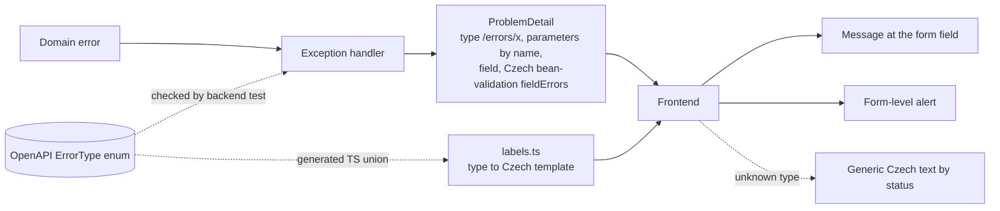

# Proposal

## Why

The Klabis UI is Czech, but almost every error produced by the backend reaches the user in English, and some messages expose internal identifiers. E2E tests in the membership fees module surfaced two typical cases:

- adding a duplicate payment rule shows *"A rule for event type 728af44d-… and ranking 'Dupx' already exists on this level"*: English, with a raw UUID instead of the event type name;
- starting a campaign with today's deadline shows *"Form validation errors / error: Voting deadline must be in the future, but was: 2026-10-18"*: an English heading plus an English sentence, shown above the form instead of next to the deadline field.

The problem is project-wide.

- **Backend.** About 90 exception classes, about 150 `IllegalArgumentException`/`IllegalStateException` throw sites and about 400 `Assert` invariant messages are all English. Handlers copy `ex.getMessage()` straight into the ProblemDetail `detail`. The ProblemDetail `type` is mostly `about:blank`, and the few explicit values use three unrelated styles.
- **Frontend.** The frontend shows `detail` verbatim, under a hardcoded English heading *"Form validation errors"*.
- **Specs.** No requirement in `openspec/specs/` says which language the user sees errors in.

## What Changes

- **New cross-cutting rule:** every error message shown to a user is in Czech. It names things by their user-visible names and never shows internal identifiers.
- **Backend identifies errors; it does not word them.**
  - Every error response carries an RFC 9457 `type`: a relative URI `/errors/{error-name}`, for example `/errors/duplicate-payment-rule` or `/errors/voting-deadline-not-in-future`.
  - The values the message needs (names, dates, amounts) are sent as ProblemDetail extension properties, never as IDs.
  - A domain error that concerns one form field also names that field.
  - `detail` stays an English, developer-facing text that the UI never shows.
  - Existing explicit `type` values are migrated to the relative form: `https://api.klabis.example.com/errors/*` and `https://klabis.com/problems/*` (security, permissions), and `OVERDRAFT_LIMIT_EXCEEDED`/`TRANSACTION_ALREADY_REVERSED` (finance).
- **Frontend words errors.**
  - `labels.ts` maps each error type to a Czech text template and interpolates the parameters.
  - Field-bound errors are shown at their form field.
  - An unknown type falls back to a generic Czech text chosen by HTTP status.
- **Bean validation stays on the backend.** A fixed Czech locale makes Hibernate Validator produce Czech field messages, and the frontend shows them as they are. The 38 hand-written English `message=` texts are rewritten in Czech.
- **Internal checks** (`Assert`, `IllegalArgumentException`/`IllegalStateException`) return one generic error type, and the English message is only logged. Checks a user can realistically trigger become typed errors with their own type and Czech text.
- **Shared list of error types.** It is documented once in the OpenAPI spec as the `ErrorType` enum. Completeness is enforced on both sides:
  - a backend test asserts that every emitted type is distinct and listed in the spec;
  - the frontend's `Record<ErrorType, …>` in `labels.ts` fails the TypeScript build when a type has no Czech text.
- **One change, delivered in phases:**
  1. infrastructure plus membership fees;
  2. the remaining modules one by one;
  3. closing.

## Capabilities

### New Capabilities

None.

### Modified Capabilities

- `non-functional-requirements`: adds requirements that:
  - user-facing error messages are in Czech, name records by their names, are shown at the related form field, and fall back to a generic Czech message;
  - error responses identify the error by a documented `/errors/...` type and carry the message parameters by name.
- `membership-fees`: the duplicate payment rule scenario and the past voting deadline scenario now state what the administrator sees.

## Impact

- **Backend:**
  - `common/exceptions` gains a small opt-in contract (error type derived from the class name, plus message parameters), which each module's exceptions adopt in that module's phase. Exceptions not yet migrated emit a generic type for their status;
  - `MvcExceptionHandler`, the 11 module `*ExceptionHandler` classes, the local handler in `PermissionController`, the security entry point and access-denied handler, and `AccountStatusValidationFilter` set `/errors/...` types and parameters;
  - the locale resolver is fixed to Czech;
  - module handlers resolve names where the domain only has an ID.
- **API:**
  - The `type` values change. No current consumer reads `type`: there are no frontend or E2E usages. Four backend test assertions are affected: three in `PermissionControllerTest` and one in `MemberAccountControllerTest`.
  - Additive extension properties.
  - `_shared/problem.yaml` gains the `ErrorType` enum and documents the extension properties. The backend codegen maps `ErrorType` to `String`.
  - The Klabis SPA is the only API client.
- **Frontend:**
  - `api/hateoas.ts`, `ErrorDisplay` and `HalFormsForm` (field errors applied after submit);
  - a new `describeError` helper replacing about 20 `error.message` renders;
  - `labels.ts` (`errorTypes`);
  - `ChangePasswordDialog` (type instead of English substring matching).
- **Tests:** backend assertions on English `detail`, frontend `hateoas`/`ErrorDisplay` tests, and E2E features asserting English error texts.
- **Documentation:** a new ADR in `docs/design-decisions.md` records the type-URI mapping decision.
- **Out of scope:** server-rendered pages (login, password setup), e-mail texts, and synchronisation history entries.

## Decisions Taken

1. Frontend mapping keyed by the ProblemDetail `type` (`/errors/{error-name}`), with parameters by name. There is no backend message catalogue for domain errors.
2. Fixed Czech locale. Bean-validation field messages come from the backend in Czech and are not mapped in the frontend.
3. One generic type for internal checks, with the English message only logged. Checks users can trigger become typed errors.
4. One change, delivered in phases.
