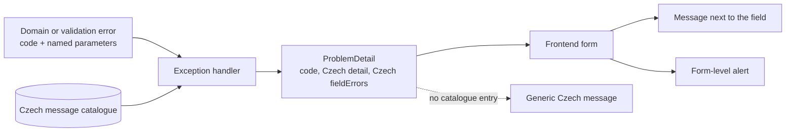

# Proposal

## Why

The Klabis UI is Czech, but almost every error produced by the backend reaches the user in English, and some messages expose internal identifiers. E2E tests in the membership fees module surfaced two typical cases:

- adding a duplicate payment rule shows *"A rule for event type 728af44d-… and ranking 'Dupx' already exists on this level"*: English, with a raw UUID instead of the event type name;
- starting a campaign with today's deadline shows *"Form validation errors / error: Voting deadline must be in the future, but was: 2026-10-18"*: an English heading plus an English sentence, shown above the form instead of next to the deadline field.

The problem is project-wide. The backend has about 90 exception classes, about 150 `IllegalArgumentException`/`IllegalStateException` throw sites, and about 400 `Assert` invariant messages. All of them are written in English, and the global handler copies `ex.getMessage()` straight into the ProblemDetail `detail`. The frontend shows that text verbatim. Its own fallback heading, *"Form validation errors"*, is also a hardcoded English string, even though `labels.ts` already has the Czech `formValidationErrors` label. No requirement in `openspec/specs/` says which language the user sees errors in, so nothing stops new English messages from being added.

## What Changes

- **New cross-cutting rule:** every error message shown to a user is in Czech. It names things by their user-visible names, such as the event type name or the member's name, and never shows internal identifiers (UUIDs, class names, field keys).
- **Backend:** error texts are resolved into Czech at the HTTP boundary from one message catalogue, keyed by a stable error code. Exception classes keep their English `getMessage()` for logs. Each error response carries:
  - the stable `code`;
  - a Czech `detail`;
  - Czech per-field messages for errors tied to a form field.

  Bean-validation messages are rendered in Czech regardless of the browser language. Errors without a catalogue entry, including internal invariant failures, return a generic Czech message instead of the raw English text.
- **Frontend:**
  - field-level server errors are shown next to the matching form field;
  - form-level errors are shown in a Czech alert above the form, without raw field keys;
  - unrecognised errors fall back to a generic Czech message;
  - the hardcoded English *"Form validation errors"* heading and the English-substring matching in `ChangePasswordDialog` are removed.
- **Rollout in phases:**
  1. shared infrastructure plus the membership fees module;
  2. each remaining module (members, events, calendar, finance, groups, common/users, sync, notifications);
  3. a completeness check that fails the build when a user-facing exception has no Czech message.
- **Membership fees:** the duplicate-rule error names the event type and ranking. The past-deadline error is shown on the voting deadline field.

## Capabilities

### New Capabilities

None.

### Modified Capabilities

- `non-functional-requirements`: adds a requirement that user-facing error messages are in Czech, name domain objects by their names rather than internal identifiers, are shown next to the related form field when tied to one, and fall back to a generic Czech message.
- `membership-fees`: the duplicate payment rule scenario and the past voting deadline scenario now state what the administrator sees: a Czech message naming the event type and ranking, and an error on the voting deadline field.

## Impact

- **Backend:**
  - `common/exceptions` base classes gain an error code and message arguments;
  - `common/mvc/MvcExceptionHandler` the 11 module `*ExceptionHandler` classes and the local handler in `PermissionController` (44 handler methods in total) resolve Czech texts from a new message catalogue (`messages.properties`);
  - Spring `MessageSource` and locale configuration are set to fixed Czech;
  - exception classes in every module get message arguments that use names instead of IDs. Some application services must look up names, for example the event type name for duplicate payment rules.
- **API:** additive only. ProblemDetail gains a `code` property, and `detail`/`fieldErrors` become Czech. `docs/openapi/spec/_shared/problem.yaml` documents `code` and `fieldErrors`. The only API client is the Klabis SPA.
- **Frontend:**
  - `api/hateoas.ts` (`toFormValidationError`) and `components/UI/ErrorDisplay.tsx`;
  - `HalFormsForm` (server field errors applied after submit);
  - `ChangePasswordDialog` and `usePermissionsEditor` switch to code-based handling;
  - `localization/labels.ts` (generic fallbacks).
- **Tests:**
  - backend handler and exception tests that assert on English `detail` text;
  - frontend tests of `hateoas.ts` and `ErrorDisplay`;
  - E2E scenarios in `frontend/e2e` that assert on English error texts.
- **Out of scope:** server-rendered pages (login, password setup), e-mail texts, and messages stored in synchronisation history. These have their own UI paths and do not use ProblemDetail.

## Open Decisions

1. **Where Czech texts live.** The recommendation is option (c) in `design.md`: the backend owns the Czech texts in one catalogue and also sends a stable `code`. The alternatives are hardcoded Czech in the exceptions (a) or frontend-only mapping (b).
2. **Fixed Czech locale or the browser's `Accept-Language`.** The recommendation is a fixed Czech locale, because the application is Czech-only.
3. **Generic message for internal invariant failures.** About 550 `Assert` and `IllegalArgumentException`/`IllegalStateException` messages would not be translated one by one; the user sees a generic Czech message. The alternative is translating the ones that users can actually reach.
4. **Change granularity.** One change with module-by-module phases, or this change for infrastructure plus membership fees with each further module as its own follow-up change.
