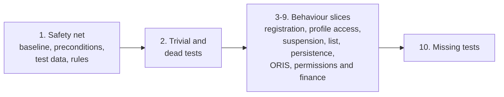

## Why

The members module carries the largest test suite in the project: about 1,070 backend
test methods (23,400 lines), 310 frontend tests (4,100 lines) and 40 E2E scenarios.
A static review against `backend-patterns/references/testing-guide.md` ("each behaviour
is tested once, at the lowest level that can verify it") found that roughly a third of
it repeats coverage that already exists at the same or a lower level. The duplication
slows every build, makes behaviour changes expensive (one rule is asserted in up to five
places) and hides the few behaviours that have no test at all.

Members is also the module the testing guide names as its canonical reference, so its
tests are copied as patterns into new modules. Cleaning it up first stops the
duplication from spreading.

## What Changes

- **Safety net first.** Record a JaCoCo and Vitest coverage baseline for the members
  code, add the five assertions that the later deletions depend on, make
  `MemberTestDataBuilder` defaults stable over time (today the default member is a minor
  born 2010-05-15 and turns adult on 2028-05-15) and fix the duplicate UUID in
  `LegalGuardianGroupServiceTest`.
- **Testing rules.** Extend `testing-guide.md` and the test-levels section of
  `frontend/CLAUDE.md` with the rules whose absence caused the duplication: what is not
  tested (generated record methods, MapStruct null guards, framework binding, one-line
  delegation), relationship rules belong to `*RelationshipSource` tests and not to
  WebMvc slices, matrices are parameterized, test data must not depend on the date,
  a new Spring context needs a reason, page tests mock only the API, E2E covers
  journeys only.
- **Remove and merge redundant tests, one behaviour at a time** (registration, profile
  editing and access, suspension, member list, persistence, ORIS sync, permissions and
  finance journeys). Each slice decides across backend, frontend and E2E where the
  behaviour stays tested and removes the rest. Expected result: about 330 backend test
  methods, 120 frontend tests and 24 E2E scenarios fewer, and three Spring test contexts
  fewer.
- **Remove dead production code** whose only callers are tests:
  `PersonName.initials()` / `formalName()` and `RegistrationNumber.getClubCode()` /
  `getBirthYear()` / `getSequenceNumber()`.
- **Add missing tests as the last slice**: birth number modification audit, birth number
  encryption at rest, saving member permissions in the frontend, ORIS import of a member
  with unknown nationality or gender. A new test that fails reveals a bug; the bug is not
  fixed in this change (see design D6). Write protection of the reserved profile fields
  that have no test today (first name, date of birth, birth number) is covered earlier,
  by the parameterized test that replaces the per-field tests.

## No Behavior Change Justification

**Specs reviewed:**
- `openspec/specs/members/spec.md` — unaffected; only tests of the described behaviour
  are removed or merged, and no scenario loses its last test.
- `openspec/specs/legal-guardians/spec.md` — unaffected for the same reason.
- `openspec/specs/member-accounts/spec.md` — unaffected; E2E scenarios removed from
  `member-accounts.feature` stay covered by unit tests and are listed in the feature's
  "Not automated" header.
- `openspec/specs/member-synchronization/spec.md` — unaffected; ORIS integration tests
  are merged, not dropped as a capability.
- `openspec/specs/member-permissions-dialog/spec.md` — unaffected.

**Why no spec update is needed:**
The change touches test code, test fixtures, developer documentation and five production
methods that no production code calls. No endpoint, response field, validation rule,
authorization rule or UI behaviour changes. Two places where code and spec disagree were
found during the review and are tracked separately in
[#455](https://github.com/zabiny/klabis/issues/455) and
[#456](https://github.com/zabiny/klabis/issues/456); this change keeps the current code
behaviour and its tests.

## Impact

- `backend/src/test/java/com/klabis/members/**` — most of the change; about 8,000 lines
  removed. `MemberFilterCrossModuleTest`, `RegisterMemberAutoProvisioningTest` and
  `BirthNumberAuditServiceTest` stop creating their own Spring contexts.
- `backend/src/main/java/com/klabis/members/domain/PersonName.java`,
  `RegistrationNumber.java` — unused methods removed.
- `frontend/src/pages/members/**`, `frontend/src/components/members/**` tests, new
  shared fixtures under `frontend/src/__mocks__/`.
- `frontend/e2e/features/members.feature`, `legal-guardians.feature`,
  `member-accounts.feature` and their steps.
- `.claude/skills/backend-patterns/references/testing-guide.md`, `frontend/CLAUDE.md`.
- Faster backend and frontend test runs and a shorter E2E run; no deployment impact.
