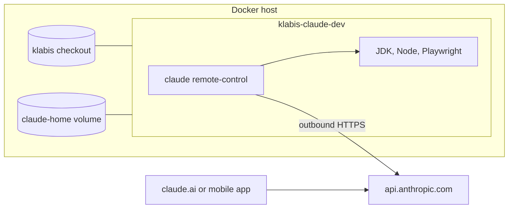

# ClaudeDeveloperContainer

Docker container with Claude Code and the full Klabis toolchain, running as a [Remote Control](https://code.claude.com/docs/en/remote-control) server. You drive it from [claude.ai/code](https://claude.ai/code) or the Claude mobile app; the klabis checkout on the host is bind-mounted into it.

Cloud scheduled tasks from claude.ai cannot be routed into this container: that needs [self-hosted environments](https://code.claude.com/docs/en/self-hosted-environments), which are Team/Enterprise only.

## Toolsets

The base is always included. The optional toolsets are picked with `WITH_JAVA` / `WITH_E2E` in `.env`, and changing them needs a rebuild (`docker compose up -d --build`).

| Toolset | Contents | Switch |
|---|---|---|
| base | Claude Code (native installer in the home volume, auto-updates), Node.js latest 24.x (`frontend/.nvmrc`), `openspec` 1.14.2, `gh`, git, ssh, jq, lsof, python3; plugins `developer`, `openspec-ext`, `hookify` | always |
| java | Temurin JDK 21 (Gradle comes from the wrapper), Gradle concurrency hook, Gradle daemon heap cap | `WITH_JAVA=true` |
| e2e | Chromium for `@playwright/test` 1.64.1, Google Chrome stable plus the `playwright` MCP plugin (headless) | `WITH_E2E=true`, requires `WITH_JAVA=true` |

Node is always in the base because openspec and the plugin MCP servers need it. With the base alone, the frontend still builds and its unit tests run. `GITLAB_ZBM_TOKEN` is needed only with `WITH_JAVA=true`.

The home volume keeps the seeded config. After switching toolsets on an existing volume, delete `~/.claude/.seeded` and `~/.claude/.plugins-installed` so the config and plugins are regenerated for the new set.

Limits: 4 GB RAM + 2 GB swap, 3 CPUs. At 3 CPUs the backend test suite runs a single fork (`availableProcessors / 4`), and the Gradle daemon is capped at `-Xmx768m` in `~/.gradle/gradle.properties`.



## Setup on a new host

Prerequisites: Docker with Compose v2, Linux x64, and a klabis checkout owned by a regular (non-root) user.

```bash
cd <klabis>/tools/claude-developer-container
cp env.example .env          # set KLABIS_DIR (absolute path), toolsets and GITLAB_ZBM_TOKEN
docker compose up -d --build
docker compose exec claude-dev claude-dev login
```

`login` runs `claude auth login` (claude.ai subscription; open the URL and paste the code back), then `gh auth login`, and prints the container's SSH public key. Register that key:

- on GitHub, under **Settings > SSH and GPG keys**, as an **Authentication** key and again as a **Signing** key, so commits show as Verified;
- on GitLab (`gitlab.polach.cloud`) as an SSH key, so the `polachCloud` remote works.

The RC server starts by itself once you're logged in. Watch it with `docker compose logs -f`. The session shows up in claude.ai/code under the name `RC_SESSION_NAME`.

## Daily use

| Task | Command |
|---|---|
| Logs and session URL | `docker compose logs -f` |
| Shell in the repository | `docker compose exec claude-dev claude-dev shell` |
| Interactive Claude in the terminal | `docker compose exec -it claude-dev claude-dev claude` |
| Restart RC | `docker compose restart` |
| Update toolchain | `docker compose up -d --build` |

The RC server runs in `--spawn session` mode: one session at a time, working directly in the mounted checkout, with permission mode `auto`. When that session ends, a new one starts.

## How it works

- **UID mapping**: `entrypoint.sh` starts as root, gives the `dev` user the UID and GID of the `KLABIS_DIR` owner, then drops privileges with `gosu`. Files Claude creates belong to the host user.
- **Same path**: the repository is mounted at the same absolute path as on the host, so git worktree metadata and Claude project paths stay valid from both sides.
- **Home volume** (`claude-home` → `/home/dev`) persists Claude credentials, plugins, auto memory, the gh token, the SSH key, and the Gradle and npm caches.
- **Seeded config**: on first start, `seed/` is copied to `~/.claude` (`CLAUDE.md`, `settings.json` with auto-mode rules, and the Gradle concurrency hook). Later edits in the volume are kept. To re-seed, delete `~/.claude/.seeded`. To reinstall plugins, delete `~/.claude/.plugins-installed`.
- **Secrets**: `GITLAB_ZBM_TOKEN` is a plain container environment variable. It is visible in `docker inspect` and to every command Claude runs, and `.env` lies inside the mounted repository, so Claude can read it. Use a token with `read_api` scope only.
- **Git**: push to GitHub and `gh` use the gh token, through `gh auth setup-git`. Commits and tags are signed with `~/.ssh/id_ed25519` (`gpg.format=ssh`). The identity comes from `GIT_AUTHOR_NAME` and `GIT_AUTHOR_EMAIL`.

## Keeping versions in sync

When the project bumps Node, Playwright or OpenSpec, update the `ARG`s at the top of the `Dockerfile` and rebuild. `/ms-playwright` is writable, so after a Playwright bump `npx playwright install chromium` also works inside the container without a rebuild.
